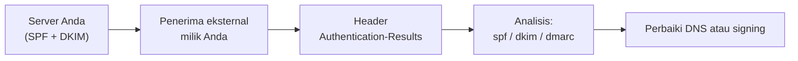

# Authentication-Results dan Pengujian Aman

!!! info "Identitas chapter"
    **ID:** `CH-08-02-04` · **Kategori/modul:** CAT-08 / MOD-08-02 (Autentikasi Email) · **Estimasi:** 90 menit · **Lingkungan:** lab + domain yang Anda kendalikan · [Lihat chapter ini di dashboard](../../../#CH-08-02-04)

!!! note "Status verifikasi"
    Isi chapter ini ditulis dari dokumentasi resmi dan belum dijalankan penulis pada VM (`verified_on: null`).

## 1. Ringkasan

Setelah SPF, DKIM, dan DMARC terpasang, bukti yang paling jujur adalah header `Authentication-Results` pada pesan yang diterima. Chapter ini mengajarkan cara membacanya dan menguji secara aman tanpa merusak reputasi domain atau IP Anda.

## 2. Tujuan Pembelajaran

1. Membaca `Authentication-Results`, `Received-SPF`, dan `DKIM-Signature`.
2. Mengaitkan hasil `spf`, `dkim`, `dmarc` dengan penyebab.
3. Merancang uji yang aman: volume rendah, penerima milik sendiri.

## 3. Prasyarat

- `CH-08-02-03` — DMARC: Alignment dan Progres Kebijakan.
- SPF, DKIM, DMARC terpublikasi (`CH-08-02-01` sampai `CH-08-02-03`).

## 4. Materi Teori

### 4.1 Contoh header (ilustrasi)

Contoh berikut **hanya ilustrasi** bentuknya, bukan keluaran dari uji nyata:

```text
Authentication-Results: mx.penerima.example;
       spf=pass smtp.mailfrom=example.com;
       dkim=pass header.d=example.com header.s=202610;
       dmarc=pass header.from=example.com
```

| Bagian | Arti |
|---|---|
| `spf=` | Hasil SPF terhadap domain `MAIL FROM` |
| `dkim=` | Hasil verifikasi tanda tangan, dengan `d=` dan `s=` |
| `dmarc=` | Hasil gabungan dan alignment |



### 4.2 Pengujian aman

- Kirim hanya ke beberapa akun yang Anda kuasai di penyedia berbeda.
- Jangan mengirim massal atau ke alamat acak untuk "menguji".
- Pada klien web penyedia besar, ada opsi "Tampilkan sumber/asli" untuk melihat header penuh.
- Layanan uji pihak ketiga menerima salinan email Anda; pertimbangkan kerahasiaan sebelum memakainya.

Server Anda sendiri hanya menambahkan `Authentication-Results` untuk pesan masuk jika ada komponen yang memverifikasi (OpenDKIM `Mode sv`, atau Rspamd pada `CH-10-02-02`).

## 5. Praktik dan Implementasi

1. Kirim pesan dari akun Anda ke dua akun eksternal milik Anda.
2. Tampilkan header penuh.
3. Catat hasil `spf`, `dkim`, `dmarc`.
4. Ubah satu variabel (mis. hapus tanda tangan di lab) dan amati perubahan hasil.
5. Dokumentasikan.

## 6. Perintah Linux

```bash title="Memeriksa DNS yang dirujuk header"
dig +short TXT example.com
dig +short TXT 202610._domainkey.example.com
dig +short TXT _dmarc.example.com
```

Ganti dengan domain dan selector Anda. Hasil yang diharapkan: tiga record terbaca sesuai konfigurasi sebelumnya.

## 7. Konfigurasi

Tidak ada berkas konfigurasi yang diubah pada chapter ini.

## 8. Verifikasi

- Ketiganya `pass` pada pesan dari server Anda ke penyedia eksternal.
- Anda dapat menjelaskan hasil setiap baris untuk satu pesan nyata Anda sendiri.

## 9. Troubleshooting

| Gejala | Kemungkinan penyebab | Tindakan |
|---|---|---|
| `spf=fail/softfail` | IP pengirim tidak di SPF | Tambah IP / periksa jalur keluar |
| `dkim=none` | Pesan tidak bertanda tangan | Periksa milter dan domain di signing table |
| `dkim=fail` | Pesan berubah / kunci salah | Cek selector dan DNS |
| `dmarc=fail` | Tidak selaras | Periksa `d=`, `MAIL FROM`, dan `From` |

## 10. Security Review

- Header asli memuat IP, nama host, dan metadata internal; jangan unggah ke layanan publik tanpa menyunting.
- Jangan menguji dengan mengirim banyak email ke penyedia besar; reputasi bisa rusak.
- Jangan memakai domain milik orang lain dalam uji pemalsuan.

## 11. Latihan

1. Buat laporan satu halaman dengan tangkapan header (disunting) dan analisisnya.
2. Rancang uji yang menunjukkan `dmarc=fail` di lab tertutup.
3. Jelaskan apa yang terlihat jika DKIM lulus tetapi SPF gagal.

## 12. Assessment

1. Siapa yang menulis `Authentication-Results`?
2. Mengapa uji massal berbahaya?
3. Apa arti `header.d`?

**Kunci singkat.** (1) Penerima/verifier. (2) Merusak reputasi. (3) Domain penandatangan DKIM.

## 13. Checklist Kelulusan

- [ ] Hasil `spf/dkim/dmarc` pass terbukti dari pesan nyata milik sendiri.
- [ ] Laporan analisis tersanitasi dibuat.

!!! note "Status belajar"
    Ubah status chapter secara manual di dashboard. Menyelesaikan checklist ini tidak mengubah status otomatis.

## 14. Referensi Resmi

- [RFC 8601 — Authentication-Results](https://www.rfc-editor.org/rfc/rfc8601)
- [RFC 7208 — SPF](https://www.rfc-editor.org/rfc/rfc7208)
- [RFC 6376 — DKIM](https://www.rfc-editor.org/rfc/rfc6376)
- [RFC 7489 — DMARC](https://www.rfc-editor.org/rfc/rfc7489)

Tautan referensi tidak diverifikasi otomatis pada build ini; periksa ketersediaannya sebelum dipakai.

---

[Kembali ke dashboard kurikulum](../../../#CH-08-02-04){ .md-button }
