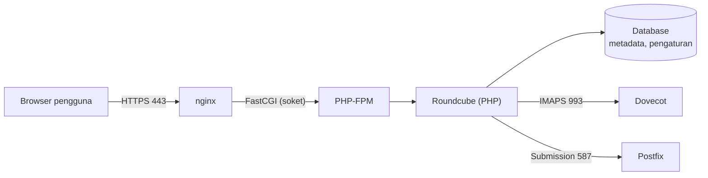

# Web Server, PHP, dan Database untuk Webmail

!!! info "Identitas chapter"
    **ID:** `CH-09-01-01` · **Kategori/modul:** CAT-09 / MOD-09-01 (Roundcube (Opsional, Direkomendasikan)) · **Estimasi:** 120 menit · **Lingkungan:** lab lokal (VM) · [Lihat chapter ini di dashboard](../../../#CH-09-01-01)

!!! warning "Peringatan"
    Webmail menambah permukaan serangan berbasis web. Kerjakan di VM lab dan jangan membukanya ke internet sebelum chapter HTTPS dan hardening selesai. Belum dijalankan penulis pada VM (`verified_on: null`).

## 1. Ringkasan

Roundcube berjalan di atas web server, PHP, dan database. Chapter ini menyiapkan fondasinya (nginx, PHP-FPM, dan database) dan memahami dependensi Roundcube sebelum aplikasinya dipasang.

## 2. Tujuan Pembelajaran

1. Menjelaskan peran web server, PHP-FPM, dan database pada webmail.
2. Memasang nginx dan PHP-FPM serta memverifikasi keduanya.
3. Memilih database (SQLite untuk lab; MariaDB/PostgreSQL untuk penggunaan nyata) dan menilai konsekuensinya.

## 3. Prasyarat

- `CH-08-02-04` — Authentication-Results dan Pengujian Aman.
- Mail server dengan IMAP/SMTP ber-TLS (`CH-08-01-03`); sertifikat dari `CH-08-01-02`.

## 4. Materi Teori

### 4.1 Arsitektur



Roundcube **tidak menyimpan email**; email tetap di Dovecot. Database menyimpan akun pengguna Roundcube, kontak, dan pengaturan.

### 4.2 Pilihan database

| Pilihan | Cocok untuk | Catatan |
|---|---|---|
| SQLite | Lab, satu pengguna | Berkas tunggal; bukan untuk banyak pengguna bersamaan |
| MariaDB / PostgreSQL | Penggunaan nyata | Perlu pengelolaan akun dan backup database |

### 4.3 Versi

Ubuntu 24.04 membawa PHP 8.3. Gunakan paket yang diterbitkan Ubuntu agar mendapat pembaruan keamanan lewat APT; catat versi dengan `php -v` dan `apt-cache policy roundcube`.

## 5. Praktik dan Implementasi

**Checklist persiapan**

- [ ] Snapshot VM.
- [ ] Port 80/443 dikelola sadar di UFW.

**Langkah**

1. Pasang nginx dan PHP-FPM beserta ekstensi umum.
2. Pastikan keduanya berjalan.
3. Periksa versi dan soket PHP-FPM.
4. Pilih database dan catat alasan.

## 6. Perintah Linux

```bash title="Memasang"
sudo apt update
sudo apt install nginx php-fpm php-mbstring php-intl php-xml php-curl php-zip php-gd php-sqlite3
systemctl is-active nginx php8.3-fpm
php -v
ls -l /run/php/
```

- Nama unit `php8.3-fpm` mengikuti versi PHP di Ubuntu 24.04; sesuaikan bila berbeda (`systemctl list-units 'php*'`).
- Daftar ekstensi di atas adalah titik awal; kebutuhan pasti ada di dokumentasi Roundcube yang dipasang.
- Hasil yang diharapkan: kedua layanan `active`, `php -v` menampilkan 8.3.x, dan soket seperti `/run/php/php8.3-fpm.sock` ada.

## 7. Konfigurasi

Tidak ada konfigurasi aplikasi pada tahap ini. Kebijakan: **jangan** membuka halaman bawaan nginx ke publik; hapus atau ganti `server` bawaan setelah Roundcube berjalan.

## 8. Verifikasi

```bash title="Verifikasi"
curl -sI http://127.0.0.1/ | head -3
sudo nginx -t
sudo php-fpm8.3 -t
```

Hasil yang diharapkan: `HTTP/1.1 200 OK` (halaman bawaan), `syntax is ok`, dan `configuration file ... test is successful`.

## 9. Troubleshooting

| Gejala | Kemungkinan penyebab | Tindakan |
|---|---|---|
| `502 Bad Gateway` nanti | Soket PHP-FPM salah | Cocokkan `fastcgi_pass` dengan `/run/php/` |
| Ekstensi hilang | Paket belum dipasang | `apt install php-...` lalu restart PHP-FPM |
| Port 80 dipakai | Server web lain (mis. Apache) | Hentikan salah satu |
| Konfigurasi ditolak | Sintaks | `nginx -t` untuk lokasi galat |

## 10. Security Review

- Versi PHP/nginx wajib dijaga lewat `apt upgrade`.
- Sembunyikan versi (`server_tokens off;`) sebagai defense in depth, bukan pengganti patch.
- Jangan menjalankan webmail di server yang sama dengan layanan lain yang tak berkaitan bila bisa dihindari.

## 11. Latihan

1. Gambar ulang diagram arsitektur dengan nama host dan port Anda.
2. Bandingkan SQLite dan MariaDB untuk 5 pengguna dan 500 pengguna.
3. Catat versi semua komponen dalam tabel.

## 12. Assessment

1. Apa yang disimpan database Roundcube?
2. Mengapa memakai PHP-FPM, bukan modul web server?
3. Mengapa versi dicatat?

**Kunci singkat.** (1) Metadata dan pengaturan, bukan email. (2) Isolasi proses dan pengaturan terpisah. (3) Pelacakan patch dan reproduksi masalah.

## 13. Checklist Kelulusan

- [ ] nginx dan PHP-FPM aktif dan teruji.
- [ ] Pilihan database dan alasannya tertulis.

!!! note "Status belajar"
    Ubah status chapter secara manual di dashboard. Menyelesaikan checklist ini tidak mengubah status otomatis.

## 14. Referensi Resmi

- [Dokumentasi nginx](https://nginx.org/en/docs/)
- [PHP: FastCGI Process Manager](https://www.php.net/manual/en/install.fpm.php)
- [Roundcube: Persyaratan](https://github.com/roundcube/roundcubemail/wiki/Installation)
- [Paket Ubuntu: roundcube](https://packages.ubuntu.com/noble/roundcube)

Tautan referensi tidak diverifikasi otomatis pada build ini; periksa ketersediaannya sebelum dipakai.

---

[Kembali ke dashboard kurikulum](../../../#CH-09-01-01){ .md-button }
