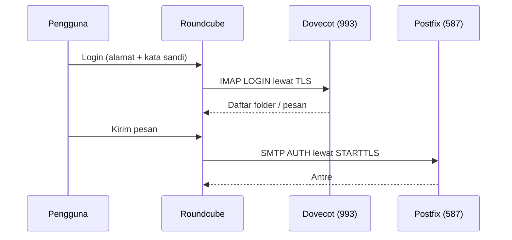

# Instalasi Roundcube dan Integrasi IMAP/SMTP

!!! info "Identitas chapter"
    **ID:** `CH-09-01-02` · **Kategori/modul:** CAT-09 / MOD-09-01 (Roundcube (Opsional, Direkomendasikan)) · **Estimasi:** 150 menit · **Lingkungan:** lab lokal (VM) · [Lihat chapter ini di dashboard](../../../#CH-09-01-02)

!!! warning "Peringatan"
    Konfigurasi Roundcube memuat kunci rahasia (`des_key`) dan kredensial database. Jangan commit, jangan tempel di tiket. Sertifikat IMAP/SMTP wajib divalidasi; jangan mematikan verifikasi. Belum dijalankan penulis pada VM (`verified_on: null`).

## 1. Ringkasan

Anda memasang Roundcube dari paket Ubuntu, menghubungkannya ke Dovecot (IMAPS) dan Postfix (submission), lalu memverifikasi login dan pengiriman.

## 2. Tujuan Pembelajaran

1. Memasang paket Roundcube dan menyiapkan database lewat dbconfig-common.
2. Mengonfigurasi `imap_host` dan `smtp_host` ber-TLS.
3. Menghubungkan nginx ke Roundcube dan memverifikasi login serta pengiriman.

## 3. Prasyarat

- `CH-09-01-01` — Web Server, PHP, dan Database untuk Webmail.
- `CH-09-01-01`; submission dan IMAPS aktif (`CH-08-01-03`).

## 4. Materi Teori

### 4.1 Alur



### 4.2 Berkas dan lokasi (paket Debian/Ubuntu)

| Berkas | Fungsi |
|---|---|
| `/etc/roundcube/config.inc.php` | Konfigurasi utama |
| `/etc/roundcube/debian-db.php` | Kredensial database (dibuat dbconfig-common) |
| `/usr/share/roundcube` | Kode aplikasi (root web) |
| `/var/log/roundcube/` | Log aplikasi |

Lokasi dapat berbeda antar paket; periksa `dpkg -L roundcube-core`.

### 4.3 Verifikasi sertifikat

Roundcube terhubung ke Dovecot/Postfix dengan nama host. Gunakan nama yang ada pada sertifikat (`mail.example.com`). Mematikan verifikasi (`verify_peer` false) menghilangkan perlindungan TLS dan tidak boleh dijadikan solusi.

## 5. Praktik dan Implementasi

1. Pasang paket.
2. Atur opsi database saat diminta.
3. Sunting `config.inc.php`.
4. Tambahkan blok nginx.
5. Login dan kirim pesan uji.

## 6. Perintah Linux

```bash title="Memasang"
apt-cache depends roundcube-core | head -20
sudo apt install --no-install-recommends roundcube roundcube-sqlite3
```

Periksa dulu dependensi: bila paket menarik Apache (`apache2`) sebagai dependensi wajib, jangan jalankan keduanya pada port yang sama. Pilihan `--no-install-recommends` mencegah paket tambahan, tetapi jalankan `apt` simulasi (`-s`) bila ragu. Dialog dbconfig-common akan menanyakan penggunaan database; untuk lab pilih SQLite.

```bash title="Mengambil versi dan lokasi"
dpkg -s roundcube-core | grep -E '^Version'
dpkg -L roundcube-core | head -30
```

## 7. Konfigurasi

```text title="/etc/roundcube/config.inc.php (potongan; sesuaikan nilai Anda)"
$config['imap_host'] = 'ssl://mail.example.com:993';
$config['smtp_host'] = 'tls://mail.example.com:587';
$config['smtp_user'] = '%u';
$config['smtp_pass'] = '%p';
$config['product_name'] = 'Webmail Lab';
$config['support_url'] = '';
```

```text title="Blok nginx (potongan, tanpa TLS; HTTPS di chapter berikutnya)"
server {
    listen 80;
    server_name mail.example.com;
    root /usr/share/roundcube;
    index index.php;

    location ~ ^/(config|temp|logs|bin|SQL|installer)/ { deny all; }
    location / { try_files $uri $uri/ /index.php; }
    location ~ \.php$ {
        include snippets/fastcgi-php.conf;
        fastcgi_pass unix:/run/php/php8.3-fpm.sock;
    }
}
```

- Nama `imap_host`/`smtp_host` mengikuti format Roundcube 1.6 (skema `ssl://`/`tls://`). Periksa `defaults.inc.php` pada versi terpasang.
- Kunci `des_key` dibuat paket saat instalasi; jangan ubah/jangan tampilkan.
- Pastikan direktori `config`, `temp`, `logs` tidak dapat diakses lewat web (blok `deny` di atas).
- Setelah menyunting: `sudo nginx -t && sudo systemctl reload nginx`.

## 8. Verifikasi

```bash title="Verifikasi"
curl -sI http://mail.example.com/ | head -3
sudo tail -n 20 /var/log/roundcube/errors.log
sudo journalctl -u dovecot --since "5 min ago" --no-pager | grep -i login
```

Hasil yang diharapkan: halaman login Roundcube (HTTP 200); login dengan akun uji berhasil dan folder tampil; pesan uji terkirim dan muncul di Sent dan tujuan; log Dovecot mencatat login dari server webmail. `errors.log` kosong atau tanpa galat TLS.

## 9. Troubleshooting

| Gejala | Kemungkinan penyebab | Tindakan |
|---|---|---|
| `Connection to storage server failed` | Host/port/TLS salah | Uji `openssl s_client -connect mail.example.com:993` dari server |
| Galat sertifikat | Nama tidak cocok sertifikat | Pakai nama pada sertifikat, bukan `localhost` |
| `SMTP Error (535)` | Kredensial/AUTH | Samakan dengan klien biasa; lihat log Postfix |
| 502/404 | Soket PHP / `root` salah | Periksa `fastcgi_pass` dan `root` |

## 10. Security Review

- Kredensial database ada di `debian-db.php`; batasi izin (hanya `root` dan `www-data` sesuai kebutuhan paket).
- Jangan menyalin `config.inc.php` ke repositori.
- Jangan membuka login webmail lewat HTTP polos di luar lab.
- Hapus/nonaktifkan `installer` bila ada.

## 11. Latihan

1. Kirim email dari webmail ke akun eksternal milik Anda dan baca headernya.
2. Verifikasi dari server bahwa Roundcube memakai IMAPS (bukan 143 polos).
3. Catat nilai `config.inc.php` yang Anda ubah (tanpa rahasia).

## 12. Assessment

1. Di mana email disimpan: Roundcube atau Dovecot?
2. Mengapa tidak boleh mematikan verifikasi sertifikat?
3. Apa fungsi blok `deny` pada nginx?

**Kunci singkat.** (1) Dovecot. (2) Menghilangkan perlindungan TLS. (3) Mencegah akses langsung ke berkas sensitif.

## 13. Checklist Kelulusan

- [ ] Login dan pengiriman via Roundcube berhasil.
- [ ] TLS ke Dovecot/Postfix tervalidasi.
- [ ] Tidak ada rahasia tersimpan di catatan.

!!! note "Status belajar"
    Ubah status chapter secara manual di dashboard. Menyelesaikan checklist ini tidak mengubah status otomatis.

## 14. Referensi Resmi

- [Roundcube: Instalasi](https://github.com/roundcube/roundcubemail/wiki/Installation)
- [Roundcube: Konfigurasi](https://github.com/roundcube/roundcubemail/wiki/Configuration)
- [Paket Ubuntu: roundcube](https://packages.ubuntu.com/noble/roundcube)
- [nginx: ngx_http_fastcgi_module](https://nginx.org/en/docs/http/ngx_http_fastcgi_module.html)

Tautan referensi tidak diverifikasi otomatis pada build ini; periksa ketersediaannya sebelum dipakai.

---

[Kembali ke dashboard kurikulum](../../../#CH-09-01-02){ .md-button }
