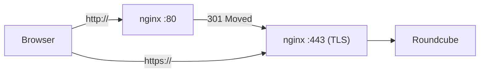

# HTTPS, Keamanan Browser, dan Sesi Login

!!! info "Identitas chapter"
    **ID:** `CH-09-01-03` · **Kategori/modul:** CAT-09 / MOD-09-01 (Roundcube (Opsional, Direkomendasikan)) · **Estimasi:** 90 menit · **Lingkungan:** lab lokal (VM) · [Lihat chapter ini di dashboard](../../../#CH-09-01-03)

!!! warning "Peringatan"
    Mengaktifkan HSTS bersifat sulit dibatalkan karena diingat browser. Aktifkan setelah HTTPS stabil, mulai dengan `max-age` pendek. Belum dijalankan penulis pada VM (`verified_on: null`).

## 1. Ringkasan

Webmail membawa kata sandi pengguna lewat browser sehingga HTTPS wajib. Anda mengaktifkan HTTPS dengan sertifikat dari `CH-08-01-02`, menambahkan header keamanan dasar, dan mengencangkan sesi login.

## 2. Tujuan Pembelajaran

1. Mengonfigurasi HTTPS dan pengalihan HTTP→HTTPS di nginx.
2. Menambahkan header keamanan dasar.
3. Mengencangkan sesi login Roundcube.
4. Memverifikasi dengan `curl -I` dan `openssl s_client`.

## 3. Prasyarat

- `CH-09-01-02` — Instalasi Roundcube dan Integrasi IMAP/SMTP.
- Roundcube berjalan (`CH-09-01-02`); sertifikat untuk `mail.example.com`.

## 4. Materi Teori

### 4.1 Alur akses aman



### 4.2 Header

| Header | Tujuan |
|---|---|
| `Strict-Transport-Security` | Browser selalu memakai HTTPS |
| `X-Content-Type-Options: nosniff` | Cegah tebakan tipe konten |
| `X-Frame-Options: SAMEORIGIN` | Kurangi clickjacking |
| `Referrer-Policy` | Batasi kebocoran URL ke pihak lain |

`Content-Security-Policy` sangat membantu tetapi mudah merusak fitur webmail; uji bertahap bila Anda menambahkannya.

### 4.3 Sesi

Batas sesi (`session_lifetime`) menyeimbangkan kenyamanan dan risiko perangkat yang tertinggal terbuka. Cookie sesi harus ditandai `Secure` dan `HttpOnly`; Roundcube menandai `Secure` saat dilayani lewat HTTPS.

## 5. Praktik dan Implementasi

1. Tambahkan blok HTTPS dan pengalihan di nginx.
2. Tambahkan header (HSTS dengan `max-age` rendah dulu).
3. Setel `session_lifetime`.
4. Muat ulang dan uji.

## 6. Perintah Linux

```bash title="Memuat ulang dan menguji"
sudo nginx -t && sudo systemctl reload nginx
curl -sI http://mail.example.com/ | head -3
curl -sI https://mail.example.com/ | grep -iE 'HTTP/|strict|x-content|x-frame|referrer'
openssl s_client -connect mail.example.com:443 -servername mail.example.com </dev/null 2>/dev/null | openssl x509 -noout -subject -enddate
```

## 7. Konfigurasi

```text title="nginx (potongan)"
server {
    listen 80;
    server_name mail.example.com;
    return 301 https://$host$request_uri;
}
server {
    listen 443 ssl;
    server_name mail.example.com;
    ssl_certificate     /etc/letsencrypt/live/mail.example.com/fullchain.pem;
    ssl_certificate_key /etc/letsencrypt/live/mail.example.com/privkey.pem;
    ssl_protocols TLSv1.2 TLSv1.3;
    server_tokens off;

    add_header Strict-Transport-Security "max-age=300" always;
    add_header X-Content-Type-Options "nosniff" always;
    add_header X-Frame-Options "SAMEORIGIN" always;
    add_header Referrer-Policy "no-referrer" always;

    root /usr/share/roundcube;
    index index.php;
    location ~ ^/(config|temp|logs|bin|SQL|installer)/ { deny all; }
    location / { try_files $uri $uri/ /index.php; }
    location ~ \.php$ {
        include snippets/fastcgi-php.conf;
        fastcgi_pass unix:/run/php/php8.3-fpm.sock;
    }
}
```

```text title="/etc/roundcube/config.inc.php (potongan)"
$config['session_lifetime'] = 30;
$config['session_samesite'] = 'Lax';
```

- `session_lifetime` dalam menit. Pilih nilai sesuai kebijakan Anda.
- `max-age=300` hanya untuk uji; naikkan bertahap setelah yakin.
- Nama opsi dapat berubah antar versi; cek `defaults.inc.php`.
- Perpanjangan sertifikat harus memuat ulang nginx juga: tambahkan `nginx` pada hook di `CH-08-01-02`.

## 8. Verifikasi

- HTTP menghasilkan `301` ke HTTPS; HTTPS menampilkan header keamanan yang dikonfigurasi.
- Sertifikat valid (tanggal dan nama sesuai).
- Di browser, cookie sesi bertanda `Secure` dan `HttpOnly` (periksa lewat alat pengembang).

## 9. Troubleshooting

| Gejala | Kemungkinan penyebab | Tindakan |
|---|---|---|
| Redirect loop | Header proxy / `return 301` salah | Periksa blok port 80 |
| Peringatan konten campuran | Sumber HTTP | Pastikan URL internal HTTPS |
| Sesi cepat berakhir | `session_lifetime` kecil | Naikkan sewajarnya |
| Halaman putih | PHP galat | `tail /var/log/roundcube/errors.log` dan `php8.3-fpm` |

## 10. Security Review

- HSTS salah dikonfigurasi dapat mengunci pengguna keluar; mulai kecil.
- Header tidak menggantikan patch Roundcube/PHP.
- Jangan memakai sertifikat swasigned untuk pengguna nyata.

## 11. Latihan

1. Uji header dengan `curl -I` sebelum dan sesudah perubahan.
2. Jelaskan skenario ancaman yang dicegah tiap header.
3. Tentukan nilai `session_lifetime` untuk dua profil pengguna.

## 12. Assessment

1. Mengapa HSTS dimulai dengan `max-age` pendek?
2. Apa fungsi `nosniff`?
3. Apa risiko sesi yang terlalu panjang?

**Kunci singkat.** (1) Sulit dibatalkan. (2) Mencegah tebakan tipe konten. (3) Perangkat tertinggal dapat dipakai pihak lain.

## 13. Checklist Kelulusan

- [ ] HTTPS aktif, HTTP dialihkan, header terverifikasi.
- [ ] Sesi dikonfigurasi dan dicatat.

!!! note "Status belajar"
    Ubah status chapter secara manual di dashboard. Menyelesaikan checklist ini tidak mengubah status otomatis.

## 14. Referensi Resmi

- [nginx: ngx_http_ssl_module](https://nginx.org/en/docs/http/ngx_http_ssl_module.html)
- [RFC 6797 — HSTS](https://www.rfc-editor.org/rfc/rfc6797)
- [MDN: HTTP security headers](https://developer.mozilla.org/en-US/docs/Web/Security)
- [Roundcube: Konfigurasi](https://github.com/roundcube/roundcubemail/wiki/Configuration)

Tautan referensi tidak diverifikasi otomatis pada build ini; periksa ketersediaannya sebelum dipakai.

---

[Kembali ke dashboard kurikulum](../../../#CH-09-01-03){ .md-button }
