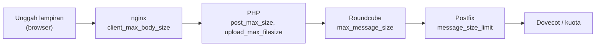

# Batas Lampiran, Backup, dan Upgrade Webmail

!!! info "Identitas chapter"
    **ID:** `CH-09-01-04` · **Kategori/modul:** CAT-09 / MOD-09-01 (Roundcube (Opsional, Direkomendasikan)) · **Estimasi:** 90 menit · **Lingkungan:** lab lokal (VM) · [Lihat chapter ini di dashboard](../../../#CH-09-01-04)

!!! warning "Peringatan"
    Backup webmail berisi kredensial dan `des_key`; enkripsi dan batasi aksesnya. Upgrade dilakukan setelah snapshot dan backup. Belum dijalankan penulis pada VM (`verified_on: null`).

## 1. Ringkasan

Anda menyelaraskan batas ukuran lampiran di tiga lapisan (PHP, nginx, Postfix), menyusun prosedur backup Roundcube (database dan konfigurasi), dan prosedur upgrade yang aman.

## 2. Tujuan Pembelajaran

1. Menyelaraskan `upload_max_filesize`, `post_max_size`, `client_max_body_size`, dan `message_size_limit`.
2. Menyusun backup dan restore Roundcube.
3. Menyusun prosedur upgrade lewat APT dengan rollback.

## 3. Prasyarat

- `CH-09-01-03` — HTTPS, Keamanan Browser, dan Sesi Login.
- Webmail aktif dan HTTPS (`CH-09-01-03`).

## 4. Materi Teori

### 4.1 Rantai batas ukuran

Lampiran dikodekan base64 (+ sekitar 33%), sehingga batas pesan Postfix harus lebih besar dari batas lampiran mentah.



Batas efektif adalah yang **terkecil** di rantai; penyelarasan mencegah unggahan gagal diam-diam.

### 4.2 Yang di-backup

| Komponen | Isi |
|---|---|
| Database | Pengaturan, kontak, identitas |
| `/etc/roundcube/` | Konfigurasi dan `des_key` |
| Email | Dovecot `/var/vmail` (bagian dari backup mail, `CH-11-03-01`) |

### 4.3 Upgrade

Dengan paket APT, upgrade melalui `apt upgrade`, dan dbconfig-common dapat menjalankan migrasi skema. Selalu baca catatan rilis dan lakukan di jendela pemeliharaan setelah backup.

## 5. Praktik dan Implementasi

1. Tentukan batas lampiran (mis. 20 MB mentah).
2. Setel di PHP, nginx, dan Postfix.
3. Uji unggahan di bawah dan di atas batas.
4. Buat backup dan uji restore pada VM.
5. Tuliskan prosedur upgrade.

## 6. Perintah Linux

```bash title="Memeriksa batas yang berlaku"
php -i | grep -E '^(upload_max_filesize|post_max_size)'
postconf message_size_limit
sudo nginx -T 2>/dev/null | grep client_max_body_size
```

```bash title="Menerapkan Postfix"
sudo postconf -e 'message_size_limit = 30000000'
sudo postfix check && sudo systemctl reload postfix
```

```bash title="Backup (contoh untuk SQLite; ganti sesuai database Anda)"
sudo install -d -m 0700 /root/backup-roundcube
sudo tar -czf /root/backup-roundcube/rc-$(date +%F).tar.gz /etc/roundcube /var/lib/dbconfig-common/sqlite3
sudo chmod 0600 /root/backup-roundcube/*.tar.gz
```

Lokasi basis data SQLite pada paket Debian dapat berbeda; periksa `debian-db.php`. Untuk MariaDB/PostgreSQL, gunakan `mariadb-dump`/`pg_dump` sesuai dokumentasi masing-masing.

## 7. Konfigurasi

```text title="/etc/php/8.3/fpm/php.ini (potongan)"
upload_max_filesize = 25M
post_max_size = 28M
```

```text title="nginx (di blok server atau http)"
client_max_body_size 30m;
```

- `post_max_size` ≥ `upload_max_filesize`; pesan akhir Postfix harus lebih besar dari keduanya setelah base64.
- Restart PHP-FPM dan reload nginx setelah menyunting: `sudo systemctl restart php8.3-fpm && sudo systemctl reload nginx`.
- Batas besar menaikkan beban memori/disk dan risiko penyalahgunaan; jangan berlebihan.

## 8. Verifikasi

- Lampiran ≤ batas terkirim; lampiran lebih besar ditolak dengan pesan yang jelas.
- `php -i`, `nginx -T`, dan `postconf` menunjukkan nilai selaras.
- Backup dapat diekstrak di VM uji dan berkas konfigurasi terbaca.

## 9. Troubleshooting

| Gejala | Kemungkinan penyebab | Tindakan |
|---|---|---|
| Unggahan gagal tanpa pesan | Batas nginx lebih kecil | Samakan `client_max_body_size` |
| `552 Message size exceeds` | Batas Postfix | Naikkan `message_size_limit` |
| Upload > batas PHP gagal | `post_max_size` kecil | Naikkan dan restart PHP-FPM |
| Upgrade merusak halaman | Migrasi/plugin tidak kompatibel | Pulihkan snapshot/backup |

## 10. Security Review

- Batas besar memudahkan penyalahgunaan dan DoS; jangan menaikkan tanpa alasan.
- Arsip backup memuat `des_key`/kredensial; enkripsi (`CH-10-03-04`).
- Jangan mengunduh paket Roundcube dari sumber tidak resmi.

## 11. Latihan

1. Hitung batas Postfix untuk lampiran 20 MB.
2. Uji tiga ukuran lampiran dan catat titik kegagalan.
3. Latih restore Roundcube pada VM kosong.

## 12. Assessment

1. Mengapa batas Postfix harus lebih besar dari batas lampiran?
2. Apa yang ada di backup Roundcube dan apa yang tidak?
3. Mengapa upgrade dilakukan setelah snapshot?

**Kunci singkat.** (1) Base64 menambah ukuran. (2) Database dan konfigurasi; email ada di backup Dovecot. (3) Untuk pemulihan.

## 13. Checklist Kelulusan

- [ ] Batas lampiran selaras di semua lapisan.
- [ ] Backup dan restore Roundcube diuji.
- [ ] Prosedur upgrade tertulis.

!!! note "Status belajar"
    Ubah status chapter secara manual di dashboard. Menyelesaikan checklist ini tidak mengubah status otomatis.

## 14. Referensi Resmi

- [Postfix: message_size_limit](https://www.postfix.org/postconf.5.html#message_size_limit)
- [PHP: Konfigurasi unggah berkas](https://www.php.net/manual/en/features.file-upload.common-pitfalls.php)
- [nginx: client_max_body_size](https://nginx.org/en/docs/http/ngx_http_core_module.html#client_max_body_size)
- [Roundcube: Upgrade](https://github.com/roundcube/roundcubemail/wiki/Upgrade)

Tautan referensi tidak diverifikasi otomatis pada build ini; periksa ketersediaannya sebelum dipakai.

---

[Kembali ke dashboard kurikulum](../../../#CH-09-01-04){ .md-button }
