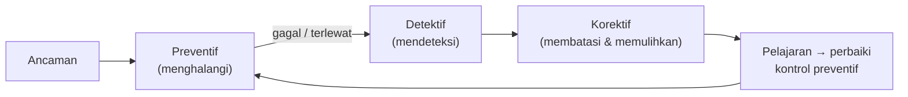

# Kerangka Kontrol: Preventif, Detektif, Korektif

!!! info "Identitas chapter"
    **ID:** `CH-10-01-01` · **Kategori/modul:** CAT-10 / MOD-10-01 (Kontrol Pencegahan) · **Estimasi:** 60 menit · **Lingkungan:** lab lokal (VM) · [Lihat chapter ini di dashboard](../../../#CH-10-01-01)

!!! note "Status verifikasi"
    Isi chapter ini ditulis dari dokumentasi resmi dan belum dijalankan penulis pada VM (`verified_on: null`).

## 1. Ringkasan

Keamanan mail server bukan satu alat, melainkan kumpulan kontrol dengan tiga fungsi: **mencegah** kejadian buruk, **mendeteksinya** bila terjadi, dan **mengoreksinya** sehingga dampaknya kecil. Chapter ini membangun kerangka itu sebagai peta untuk seluruh Level 9.

## 2. Tujuan Pembelajaran

1. Membedakan kontrol preventif, detektif, dan korektif dengan contoh mail server.
2. Memetakan ancaman utama ke kontrol.
3. Menyusun matriks kontrol sederhana dengan bukti verifikasi.

## 3. Prasyarat

- `CH-09-01-04` — Batas Lampiran, Backup, dan Upgrade Webmail.
- Layanan email lab berjalan dan TLS/autentikasi telah dipahami (Level 7).

## 4. Materi Teori

### 4.1 Tiga jenis kontrol

| Jenis | Tujuan | Contoh pada mail server |
|---|---|---|
| Preventif | Menghalangi serangan | Firewall default-deny, SSH kunci, TLS wajib, relay tertutup |
| Detektif | Mengetahui bahwa sesuatu terjadi | Log, alert antrean/volume, pemantauan kedaluwarsa sertifikat |
| Korektif | Membatasi dan memulihkan | Fail2ban, backup, runbook, rotasi kunci |

### 4.2 Peta ancaman

| Ancaman | Kontrol preventif | Detektif | Korektif |
|---|---|---|---|
| Open relay | `smtpd_relay_restrictions` | Volume keluar abnormal | Hentikan akun, bersihkan antrean |
| Brute force login | Rate limit, kata sandi kuat | Log autentikasi gagal | Fail2ban, reset kata sandi |
| Spoofing domain | SPF/DKIM/DMARC enforcement | Laporan DMARC | Ubah kebijakan, rotasi kunci |
| Pencurian kunci privat | Izin ketat, enkripsi backup | Audit akses berkas | Terbitkan ulang sertifikat/kunci |
| Malware/phishing | Filtering, kebijakan lampiran | Log filter | Karantina, edukasi |

### 4.3 Defense in depth

Satu kontrol dapat gagal; lapisan berlapis memastikan satu kegagalan tidak menjadi insiden. Setiap kontrol harus punya **cara memverifikasi** bahwa ia berfungsi.

## 5. Praktik dan Implementasi

1. Pilih lima ancaman paling relevan bagi server Anda.
2. Isi matriks tiga kolom kontrol untuk tiap ancaman.
3. Tambahkan kolom "bukti verifikasi" (perintah atau log yang membuktikan).
4. Tandai kontrol yang belum ada sebagai pekerjaan di bab berikutnya.

## 6. Perintah Linux

Chapter ini konseptual; tidak ada perintah yang mengubah sistem.

## 7. Konfigurasi

Tidak ada berkas konfigurasi yang diubah pada chapter ini.

## 8. Verifikasi

Matriks lengkap: tiap ancaman memiliki setidaknya satu kontrol preventif dan satu detektif, dan tiap kontrol memiliki bukti verifikasi yang dapat dijalankan.

## 9. Troubleshooting

| Gejala | Kemungkinan penyebab | Tindakan |
|---|---|---|
| Kontrol tanpa cara verifikasi | Asumsi, bukan bukti | Tambahkan perintah/log pembuktian |
| Semua kontrol preventif saja | Tidak ada deteksi | Tambahkan log/alert |
| Matriks usang | Perubahan tidak dicatat | Tinjau ulang setiap perubahan besar |

## 10. Security Review

- Kontrol yang tidak diuji hanya memberi rasa aman.
- Matriks berisi detail arsitektur; perlakukan sebagai dokumen internal.

## 11. Latihan

1. Lengkapi matriks untuk server Anda.
2. Pilih satu ancaman dan jelaskan skenario lolos dari kontrol preventif.
3. Tentukan kontrol korektif yang meminimalkan kerugian pada skenario itu.

## 12. Assessment

1. Apa beda kontrol detektif dan korektif?
2. Mengapa setiap kontrol perlu bukti verifikasi?
3. Berikan satu contoh defense in depth.

**Kunci singkat.** (1) Mengetahui vs membatasi/memulihkan. (2) Untuk memastikan benar-benar bekerja. (3) SSH kunci + firewall + Fail2ban.

## 13. Checklist Kelulusan

- [ ] Matriks kontrol dibuat dengan bukti verifikasi.
- [ ] Kesenjangan kontrol tercatat.

!!! note "Status belajar"
    Ubah status chapter secara manual di dashboard. Menyelesaikan checklist ini tidak mengubah status otomatis.

## 14. Referensi Resmi

- [NIST SP 800-53 Rev. 5 — Security and Privacy Controls](https://csrc.nist.gov/pubs/sp/800/53/r5/upd1/final)
- [NIST SP 800-45 Ver. 2 — Guidelines on Electronic Mail Security](https://csrc.nist.gov/pubs/sp/800/45/ver2/final)
- [Ubuntu Server: Security](https://documentation.ubuntu.com/server/explanation/intro-to/security/)

Tautan referensi tidak diverifikasi otomatis pada build ini; periksa ketersediaannya sebelum dipakai.

---

[Kembali ke dashboard kurikulum](../../../#CH-10-01-01){ .md-button }
