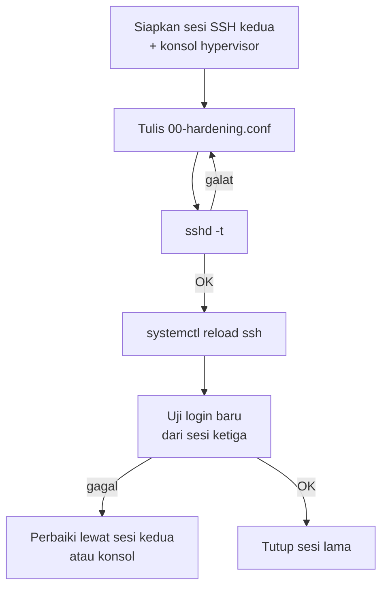

# Hardening SSH dan Eksposur Jaringan

!!! info "Identitas chapter"
    **ID:** `CH-10-01-02` · **Kategori/modul:** CAT-10 / MOD-10-01 (Kontrol Pencegahan) · **Estimasi:** 120 menit · **Lingkungan:** lab lokal (VM) · [Lihat chapter ini di dashboard](../../../#CH-10-01-02)

!!! danger "Peringatan keras"
    Mengubah SSH dapat mengunci Anda dari server. Selalu buka sesi SSH kedua yang tetap terbuka, siapkan konsol hypervisor, validasi dengan `sshd -t`, dan buat snapshot sebelum memuat ulang. Belum dijalankan penulis pada VM (`verified_on: null`).

## 1. Ringkasan

Anda memperketat SSH (tanpa kata sandi, tanpa login root, pengguna terbatas) memakai berkas drop-in, lalu memverifikasi dari host lain bahwa hanya port yang direncanakan terbuka.

## 2. Tujuan Pembelajaran

1. Menerapkan hardening SSH lewat `sshd_config.d`.
2. Memeriksa konfigurasi efektif dengan `sshd -T`.
3. Memverifikasi eksposur port dari luar dengan `nmap` pada server milik sendiri.

## 3. Prasyarat

- `CH-10-01-01` — Kerangka Kontrol: Preventif, Detektif, Korektif.
- Login SSH berbasis kunci sudah berfungsi (`CH-04-03-01`).

## 4. Materi Teori

### 4.1 Pengaturan inti

| Direktif | Nilai | Alasan |
|---|---|---|
| `PasswordAuthentication` | `no` | Hindari brute force kata sandi |
| `KbdInteractiveAuthentication` | `no` | Tutup jalur kata sandi lain |
| `PermitRootLogin` | `no` | Wajib akun biasa + sudo |
| `AllowUsers` | daftar pengguna | Batasi siapa yang bisa login |
| `MaxAuthTries` | `3` | Batasi percobaan per koneksi |

### 4.2 Urutan drop-in

OpenSSH memakai nilai **pertama** yang ditemukan untuk tiap direktif, dan membaca `sshd_config.d/*.conf` berurutan menurut nama. Pada image cloud, berkas seperti `50-cloud-init.conf` bisa mengaktifkan kata sandi; beri nama berkas Anda `00-hardening.conf` agar diproses lebih dulu.



### 4.3 Eksposur jaringan

Hardening SSH tidak berguna bila layanan lain terbuka tanpa disengaja. Bandingkan daftar port yang mendengarkan (`ss`) dengan yang terlihat dari luar (`nmap`) dan dengan rencana (25, 465, 587, 993, ...).

## 5. Praktik dan Implementasi

**Checklist persiapan**

- [ ] Snapshot VM.
- [ ] Dua sesi SSH aktif dan akses konsol tersedia.
- [ ] Kunci publik Anda sudah ada di `authorized_keys`.

**Langkah**

1. Tulis drop-in.
2. Validasi dan reload.
3. Uji dari sesi baru.
4. Pindai dari host lain (hanya server milik sendiri).

## 6. Perintah Linux

```bash title="Memeriksa konfigurasi efektif"
sudo sshd -T | grep -iE 'passwordauthentication|permitrootlogin|allowusers|maxauthtries|kbdinteractive'
sudo ss -tlnp
```

```bash title="Validasi lalu reload"
sudo sshd -t && sudo systemctl reload ssh
```

Pada Ubuntu 24.04 unit bernama `ssh` (dengan aktivasi soket `ssh.socket`); perubahan port tidak dicakup di sini.

```bash title="Dari HOST LAIN, hanya terhadap server milik sendiri"
nmap -Pn -p 1-1024,3306,5432,6379,11334 mail.example.com
```

Gunakan `nmap` hanya pada sistem yang Anda miliki atau berwenang untuk diuji. Hasil yang diharapkan: hanya port rencana yang `open`; layanan internal (Redis 6379, kontroler Rspamd 11334, database) tidak terbuka.

## 7. Konfigurasi

```text title="/etc/ssh/sshd_config.d/00-hardening.conf"
PasswordAuthentication no
KbdInteractiveAuthentication no
PermitRootLogin no
MaxAuthTries 3
AllowUsers admin-anda
```

Ganti `admin-anda` dengan akun nyata Anda; `AllowUsers` yang salah mengunci semua orang. Uji dahulu dengan sesi kedua.

## 8. Verifikasi

- `sshd -T` menunjukkan nilai yang diharapkan.
- Login kunci dari sesi baru berhasil; login dengan kata sandi ditolak (`Permission denied (publickey)`).
- `nmap` hanya menampilkan port rencana.

## 9. Troubleshooting

| Gejala | Kemungkinan penyebab | Tindakan |
|---|---|---|
| Terkunci setelah reload | `AllowUsers` salah / kunci belum terpasang | Pulihkan lewat konsol, ubah drop-in |
| Nilai tidak berlaku | Berkas lain didahulukan | Beri nama `00-...`, cek `sshd -T` |
| `nmap` menunjukkan port tak terduga | Layanan mendengarkan semua alamat | Batasi `listen`/firewall |
| Reload gagal | Sintaks | `sshd -t` untuk lokasi galat |

## 10. Security Review

- Jangan melakukan ini tanpa jalur pemulihan (konsol).
- Pindai hanya aset milik sendiri; memindai pihak lain dapat melanggar hukum dan kebijakan.
- Port yang tidak perlu harus ditutup di firewall dan di layanan itu sendiri.

## 11. Latihan

1. Buat tabel port: rencana vs `ss` vs `nmap`.
2. Simulasikan login kata sandi yang ditolak dan catat pesannya.
3. Tulis prosedur pemulihan jika terkunci.

## 12. Assessment

1. Mengapa nama berkas drop-in penting?
2. Apa fungsi `sshd -t`?
3. Mengapa perlu memindai dari host lain?

**Kunci singkat.** (1) Nilai pertama yang dipakai. (2) Validasi sebelum reload. (3) Melihat eksposur sebagaimana penyerang.

## 13. Checklist Kelulusan

- [ ] Hardening SSH diterapkan dan diverifikasi.
- [ ] Tabel port rencana vs aktual dibuat.
- [ ] Jalur pemulihan terdokumentasi.

!!! note "Status belajar"
    Ubah status chapter secara manual di dashboard. Menyelesaikan checklist ini tidak mengubah status otomatis.

## 14. Referensi Resmi

- [OpenSSH: sshd_config(5)](https://man.openbsd.org/sshd_config)
- [Ubuntu Server: OpenSSH](https://documentation.ubuntu.com/server/how-to/security/openssh-server/)
- [Nmap: Dokumentasi](https://nmap.org/docs.html)

Tautan referensi tidak diverifikasi otomatis pada build ini; periksa ketersediaannya sebelum dipakai.

---

[Kembali ke dashboard kurikulum](../../../#CH-10-01-02){ .md-button }
