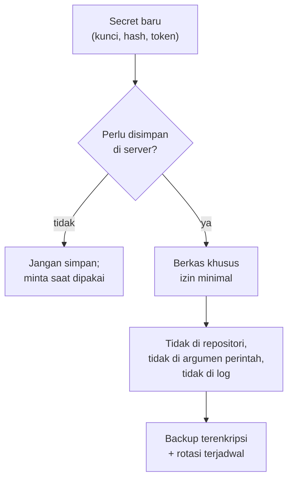

# Least Privilege, Izin Service, dan Manajemen Secrets

!!! info "Identitas chapter"
    **ID:** `CH-10-01-03` · **Kategori/modul:** CAT-10 / MOD-10-01 (Kontrol Pencegahan) · **Estimasi:** 120 menit · **Lingkungan:** lab lokal (VM) · [Lihat chapter ini di dashboard](../../../#CH-10-01-03)

!!! note "Status verifikasi"
    Isi chapter ini ditulis dari dokumentasi resmi dan belum dijalankan penulis pada VM (`verified_on: null`).

## 1. Ringkasan

Prinsip least privilege berarti setiap layanan dan berkas hanya memiliki izin yang dibutuhkan. Anda memeriksa izin berkas kritis, pengguna layanan, dan sandboxing systemd, serta membangun kebiasaan mengelola secrets tanpa membocorkannya.

## 2. Tujuan Pembelajaran

1. Menetapkan izin berkas sensitif (kunci, hash, konfigurasi).
2. Memeriksa pengguna dan sandboxing layanan dengan `systemctl` dan `systemd-analyze security`.
3. Mengelola secrets: lokasi, izin, dan larangan penyimpanan.

## 3. Prasyarat

- `CH-10-01-02` — Hardening SSH dan Eksposur Jaringan.
- Memahami izin dan sudo (`CH-02-01-03`) dan systemd (`CH-02-02-01`).

## 4. Materi Teori

### 4.1 Berkas sensitif

| Berkas | Izin yang masuk akal |
|---|---|
| Kunci privat TLS (`privkey.pem`) | Hanya root |
| Kunci DKIM (`*.private`) | Hanya pengguna `opendkim` |
| `/etc/dovecot/users` | `root:dovecot`, mode 0640 |
| Konfigurasi webmail | Hanya root dan layanan yang butuh |
| Direktori `/var/vmail` | `vmail`, mode 0700 |

### 4.2 Alat pemeriksa

`namei -l` menunjukkan izin di setiap komponen jalur sehingga direktori induk yang terlalu terbuka terlihat. `systemd-analyze security` memberi skor eksposur sebuah unit; skor tinggi bukan berarti pasti bermasalah, tetapi daftar temuan menunjukkan sandboxing yang belum dipakai.



### 4.3 Aturan secrets

Jangan menaruh secrets di argumen perintah (terlihat di `ps`), variabel lingkungan yang dapat dibaca proses lain, riwayat shell, repositori, atau log. Simpan di berkas berizin ketat dan batasi siapa yang dapat membacanya.

## 5. Praktik dan Implementasi

1. Inventaris berkas rahasia dan izinnya.
2. Perbaiki izin yang terlalu longgar.
3. Periksa pengguna dan skor beberapa unit.
4. Buat daftar secrets dan lokasinya (tanpa nilainya).

## 6. Perintah Linux

```bash title="Memeriksa izin"
sudo stat -c '%A %U:%G %n' /etc/dovecot/users /etc/letsencrypt/live/mail.example.com/privkey.pem /var/vmail
sudo namei -l /etc/opendkim/keys/example.com/202610.private
sudo find /etc -maxdepth 3 -type f -perm -o+r \( -name '*.key' -o -name '*.private' -o -name 'users' \) 2>/dev/null
```

Perintah `find` mencari berkas rahasia yang dapat dibaca semua orang; hasil kosong adalah yang diharapkan.

```bash title="Memeriksa layanan"
systemctl show dovecot -p User -p Group -p NoNewPrivileges
systemd-analyze security dovecot.service --no-pager | tail -15
```

Skor dan temuan bergantung pada versi unit. Jangan menambahkan opsi sandboxing ke unit produksi tanpa menguji, karena dapat memutus akses yang dibutuhkan layanan.

## 7. Konfigurasi

Tidak ada konfigurasi baru; perbaikan izin dilakukan dengan `chmod`/`chown` pada berkas yang ditemukan, mis.:

```bash title="Contoh perbaikan"
sudo chmod 0640 /etc/dovecot/users && sudo chown root:dovecot /etc/dovecot/users
sudo chmod 0600 /etc/opendkim/keys/example.com/202610.private && sudo chown opendkim:opendkim /etc/opendkim/keys/example.com/202610.private
```

## 8. Verifikasi

- `stat` menunjukkan izin sesuai tabel 4.1.
- `find` tidak menampilkan berkas rahasia yang dapat dibaca semua orang.
- Layanan tetap berjalan setelah perbaikan (`systemctl is-active postfix dovecot opendkim`).

## 9. Troubleshooting

| Gejala | Kemungkinan penyebab | Tindakan |
|---|---|---|
| Layanan gagal setelah `chmod` | Pengguna layanan tak lagi dapat membaca | Beri grup yang sesuai, jangan 0644 |
| `namei` menunjukkan induk terbuka | Izin direktori induk | Perketat direktori |
| Skor `systemd-analyze` tinggi | Sandboxing belum dipakai | Evaluasi terpisah, uji dulu |
| Rahasia ada di riwayat shell | Perintah dengan argumen rahasia | Hapus riwayat dan rotasi rahasia |

## 10. Security Review

- Rahasia yang pernah bocor harus **dirotasi**, bukan hanya dihapus.
- Hindari kata sandi di argumen CLI dan variabel lingkungan.
- Jangan menyalin rahasia ke tiket atau chat.
- Izin `0777`/`0644` untuk kunci privat adalah temuan serius.

## 11. Latihan

1. Buat inventaris 10 berkas rahasia: pemilik, izin, tujuan.
2. Jalankan `systemd-analyze security` untuk tiga unit dan bandingkan.
3. Tulis kebijakan penanganan secrets satu halaman.

## 12. Assessment

1. Mengapa kata sandi di argumen CLI berbahaya?
2. Apa fungsi `namei -l`?
3. Apa yang dilakukan bila rahasia terlanjur bocor?

**Kunci singkat.** (1) Terlihat di daftar proses/riwayat. (2) Menampilkan izin tiap komponen jalur. (3) Rotasi.

## 13. Checklist Kelulusan

- [ ] Inventaris dan izin berkas rahasia diperiksa dan diperbaiki.
- [ ] Kebijakan secrets tertulis tanpa nilai rahasia.

!!! note "Status belajar"
    Ubah status chapter secara manual di dashboard. Menyelesaikan checklist ini tidak mengubah status otomatis.

## 14. Referensi Resmi

- [systemd: systemd-analyze(1)](https://www.freedesktop.org/software/systemd/man/latest/systemd-analyze.html)
- [systemd: systemd.exec(5)](https://www.freedesktop.org/software/systemd/man/latest/systemd.exec.html)
- [Ubuntu Server: Security](https://documentation.ubuntu.com/server/explanation/intro-to/security/)

Tautan referensi tidak diverifikasi otomatis pada build ini; periksa ketersediaannya sebelum dipakai.

---

[Kembali ke dashboard kurikulum](../../../#CH-10-01-03){ .md-button }
