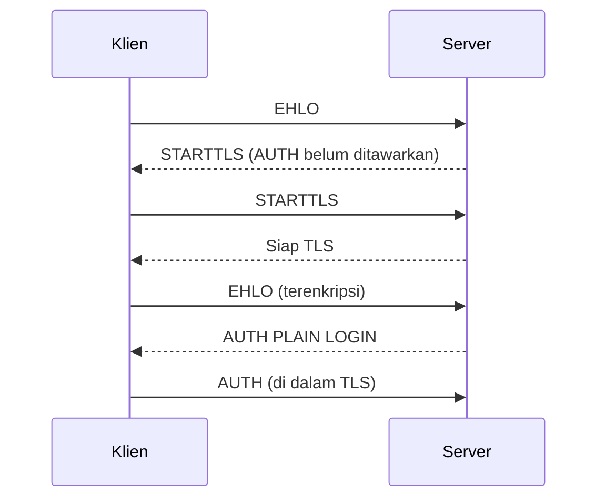

# Pemaksaan TLS, Keamanan SMTP AUTH, dan Kebijakan Password

!!! info "Identitas chapter"
    **ID:** `CH-10-01-04` · **Kategori/modul:** CAT-10 / MOD-10-01 (Kontrol Pencegahan) · **Estimasi:** 120 menit · **Lingkungan:** lab lokal (VM) · [Lihat chapter ini di dashboard](../../../#CH-10-01-04)

!!! warning "Peringatan"
    Perubahan ini memengaruhi login semua pengguna. Pastikan TLS berfungsi (`CH-08-01-03`) sebelum memaksanya, dan uji dengan akun uji. Belum dijalankan penulis pada VM (`verified_on: null`).

## 1. Ringkasan

Anda memaksa TLS sebelum SMTP AUTH dan sebelum login IMAP, menetapkan kebijakan kata sandi, dan memilih skema penyimpanan hash yang kuat.

## 2. Tujuan Pembelajaran

1. Memaksa TLS sebelum AUTH pada Postfix dan Dovecot.
2. Menetapkan kebijakan kata sandi dan skema hash.
3. Memverifikasi bahwa AUTH tanpa TLS ditolak.

## 3. Prasyarat

- `CH-10-01-03` — Least Privilege, Izin Service, dan Manajemen Secrets.
- TLS aktif (`CH-08-01-03`).

## 4. Materi Teori

### 4.1 Pemaksaan TLS

| Layanan | Pengaturan | Efek |
|---|---|---|
| Postfix (submission) | `smtpd_tls_auth_only = yes` | AUTH hanya setelah TLS |
| Dovecot | `disable_plaintext_auth = yes` | Tolak login tanpa TLS |
| Dovecot | `ssl = required` | Wajib TLS |



### 4.2 Kebijakan kata sandi

Rekomendasi NIST SP 800-63B menekankan panjang, pemeriksaan terhadap kata sandi yang sudah bocor/umum, dan tidak memaksa aturan komposisi atau rotasi periodik tanpa alasan. Terapkan MFA di webmail/VPN bila tersedia; protokol IMAP/SMTP umumnya tidak mendukung MFA, sehingga kata sandi aplikasi/unik per perangkat dapat dipertimbangkan.

### 4.3 Hash

`doveadm pw -l` menampilkan skema yang didukung build Dovecot Anda. Pilih skema yang kuat dan lambat (mis. yang berbasis `crypt` SHA512 atau Argon2 bila tersedia); jangan skema tanpa garam atau cepat (MD5/SHA1 polos).

## 5. Praktik dan Implementasi

1. Periksa nilai saat ini.
2. Atur pemaksaan TLS.
3. Uji AUTH tanpa TLS dan dengan TLS.
4. Dokumentasikan kebijakan kata sandi.

## 6. Perintah Linux

```bash title="Memeriksa nilai"
postconf smtpd_tls_auth_only
sudo doveconf disable_plaintext_auth ssl
doveadm pw -l
```

```bash title="Menguji penolakan AUTH tanpa TLS (port 587)"
openssl s_client -connect mail.example.com:587 -starttls smtp -servername mail.example.com </dev/null 2>&1 | grep -iE 'auth|starttls'
nc -v mail.example.com 587
```

Pada `nc`, ketik `EHLO uji.invalid` lalu `QUIT`. Hasil yang diharapkan: sebelum STARTTLS, baris `250-AUTH` **tidak** muncul. Setelah TLS (lewat `openssl s_client`), `AUTH` ditawarkan.

## 7. Konfigurasi

```text title="Postfix (submission di master.cf, sudah ada di CH-08-01-03)"
smtpd_tls_auth_only = yes
```

```text title="/etc/dovecot/conf.d/10-auth.conf"
disable_plaintext_auth = yes
```

```text title="/etc/dovecot/conf.d/10-ssl.conf"
ssl = required
```

## 8. Verifikasi

- `AUTH` tidak tampil sebelum STARTTLS dan tampil setelahnya.
- Login IMAP tanpa TLS di port 143 ditolak.
- Klien sah (TLS) tetap dapat masuk.

## 9. Troubleshooting

| Gejala | Kemungkinan penyebab | Tindakan |
|---|---|---|
| Klien lama tidak bisa login | Tidak mendukung TLS | Perbarui klien |
| `AUTH` tidak muncul setelah TLS | Sertifikat/konfigurasi | Cek log `postfix/submission` |
| Pengguna mengeluh | Perubahan mendadak | Umumkan dan beri tenggat |

## 10. Security Review

- Kata sandi plaintext di jaringan adalah kegagalan keamanan kritis.
- Jangan menyimpan kata sandi plaintext; gunakan hash kuat.
- Batasi kegagalan login (`CH-10-01-05`).
- Pertimbangkan kata sandi unik per perangkat dan pemeriksaan kata sandi bocor.

## 11. Latihan

1. Tulis kebijakan kata sandi satu halaman dengan alasan tiap aturan.
2. Uji klien tanpa TLS dan dokumentasikan penolakannya.
3. Bandingkan skema hash yang tersedia di `doveadm pw -l`.

## 12. Assessment

1. Mengapa `smtpd_tls_auth_only` penting?
2. Mengapa aturan komposisi kompleks tidak lagi dianjurkan NIST?
3. Apa risiko skema hash cepat?

**Kunci singkat.** (1) Cegah kredensial plaintext. (2) Menghasilkan kata sandi lemah yang dapat ditebak. (3) Mudah dibobol offline.

## 13. Checklist Kelulusan

- [ ] AUTH tanpa TLS ditolak di SMTP dan IMAP.
- [ ] Kebijakan kata sandi dan skema hash terdokumentasi.

!!! note "Status belajar"
    Ubah status chapter secara manual di dashboard. Menyelesaikan checklist ini tidak mengubah status otomatis.

## 14. Referensi Resmi

- [NIST SP 800-63B — Digital Identity Guidelines](https://pages.nist.gov/800-63-3/sp800-63b.html)
- [Postfix: smtpd_tls_auth_only](https://www.postfix.org/postconf.5.html#smtpd_tls_auth_only)
- [Dokumentasi Dovecot 2.3: Password schemes](https://doc.dovecot.org/2.3/configuration_manual/authentication/password_schemes/)

Tautan referensi tidak diverifikasi otomatis pada build ini; periksa ketersediaannya sebelum dipakai.

---

[Kembali ke dashboard kurikulum](../../../#CH-10-01-04){ .md-button }
