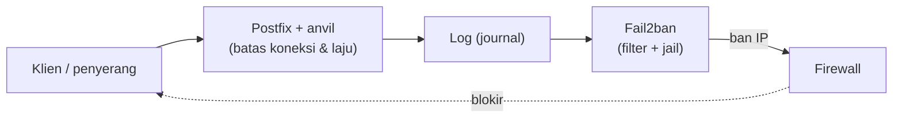

# Rate Limiting, Batas Koneksi, dan Fail2ban

!!! info "Identitas chapter"
    **ID:** `CH-10-01-05` · **Kategori/modul:** CAT-10 / MOD-10-01 (Kontrol Pencegahan) · **Estimasi:** 150 menit · **Lingkungan:** lab lokal (VM) · [Lihat chapter ini di dashboard](../../../#CH-10-01-05)

!!! warning "Peringatan"
    Fail2ban memblokir IP; konfigurasi salah dapat memblokir Anda sendiri atau pengguna sah di belakang NAT. Isi `ignoreip` dengan alamat administrasi Anda dan uji dari VM lab. Belum dijalankan penulis pada VM (`verified_on: null`).

## 1. Ringkasan

Anda membatasi laju koneksi dan pengiriman di Postfix dan memasang Fail2ban untuk memblokir sumber yang berulang kali gagal autentikasi di SSH, Postfix, dan Dovecot.

## 2. Tujuan Pembelajaran

1. Menerapkan batas koneksi dan laju di Postfix.
2. Memasang Fail2ban dan membuat jail untuk SSH, Postfix, Dovecot.
3. Memverifikasi filter terhadap log nyata dan memeriksa status ban.

## 3. Prasyarat

- `CH-10-01-04` — Pemaksaan TLS, Keamanan SMTP AUTH, dan Kebijakan Password.
- Memahami log autentikasi (`CH-07-02-03`).

## 4. Materi Teori

### 4.1 Dua lapis

| Lapisan | Alat | Fungsi |
|---|---|---|
| Rate limit | Postfix `anvil` | Batasi koneksi/laju per klien secara langsung |
| Ban reaktif | Fail2ban | Blokir IP setelah pola kegagalan di log |



### 4.2 Parameter Postfix

| Parameter | Fungsi |
|---|---|
| `smtpd_client_connection_count_limit` | Koneksi simultan per klien |
| `smtpd_client_connection_rate_limit` | Koneksi per satuan waktu |
| `smtpd_client_message_rate_limit` | Pesan per satuan waktu |
| `smtpd_client_recipient_rate_limit` | Penerima per satuan waktu |
| `anvil_rate_time_unit` | Satuan waktu (bawaan 60 dtk) |

Klien yang dikecualikan lewat `smtpd_client_event_limit_exceptions` (bawaan `$mynetworks`) tidak dibatasi.

### 4.3 Risiko
Pengguna di belakang NAT berbagi satu IP: ban satu orang dapat memutus banyak. Setel `maxretry` dan `bantime` sewajarnya.

## 5. Praktik dan Implementasi

1. Backup `/etc/postfix/main.cf`.
2. Setel batas Postfix dengan nilai konservatif.
3. Pasang Fail2ban, tulis `jail.local`.
4. Uji filter dengan `fail2ban-regex`.
5. Simulasikan kegagalan dari VM lab lain dan amati ban.

## 6. Perintah Linux

```bash title="Batas Postfix"
sudo postconf -e 'smtpd_client_connection_count_limit = 20'
sudo postconf -e 'smtpd_client_connection_rate_limit = 60'
sudo postconf -e 'smtpd_client_message_rate_limit = 60'
sudo postfix check && sudo systemctl reload postfix
```

Nilai di atas adalah titik awal ilustratif; sesuaikan dengan volume normal Anda yang sebenarnya.

```bash title="Fail2ban"
sudo apt install fail2ban
ls /etc/fail2ban/filter.d | grep -E 'sshd|postfix|dovecot'
sudo fail2ban-client status
```

```bash title="Menguji filter terhadap journal"
sudo fail2ban-regex systemd-journal "dovecot" 2>&1 | tail -5
```

`fail2ban-regex` melaporkan jumlah baris yang cocok; periksa dokumentasi bila argumen berbeda pada versi Anda.

## 7. Konfigurasi

```text title="/etc/fail2ban/jail.local"
[DEFAULT]
backend  = systemd
bantime  = 1h
findtime = 10m
maxretry = 5
ignoreip = 127.0.0.1/8 ::1 <ALAMAT-ADMIN-ANDA>

[sshd]
enabled = true

[dovecot]
enabled = true

[postfix]
enabled = true
```

- Ganti `<ALAMAT-ADMIN-ANDA>` dengan IP administrasi nyata; jangan biarkan placeholder.
- Pada Ubuntu 24.04 log berada di journal; `backend = systemd` diperlukan. Nama unit Postfix adalah `postfix@-.service`, sementara filter bawaan mungkin mencocokkan `postfix.service`; periksa `journalmatch` di filter dan sesuaikan di `jail.local` jika `fail2ban-regex` tidak menemukan baris.
- Mode filter Postfix tersedia (mis. `mode`); baca `filter.d/postfix.conf` pada versi Anda.
- Setelah menyunting: `sudo systemctl restart fail2ban`.

## 8. Verifikasi

```bash title="Verifikasi"
sudo fail2ban-client status
sudo fail2ban-client status sshd
sudo fail2ban-client get sshd banip
```

Hasil yang diharapkan: jail terdaftar; setelah beberapa kegagalan sengaja dari VM uji, IP VM itu muncul pada daftar ban. Buka blokir dengan `sudo fail2ban-client set sshd unbanip <IP>`.

## 9. Troubleshooting

| Gejala | Kemungkinan penyebab | Tindakan |
|---|---|---|
| Jail tidak menghitung | `journalmatch` tidak cocok | `fail2ban-regex`, sesuaikan unit |
| Admin terblokir | `ignoreip` kosong | Pulihkan lewat konsol, `unbanip` |
| Fail2ban gagal start | Sintaks `jail.local` | `journalctl -u fail2ban` |
| Pengguna sah terblokir | NAT bersama | Naikkan `maxretry`, kecualikan |

## 10. Security Review

- Fail2ban reaktif; bukan pengganti kata sandi kuat dan TLS.
- Serangan terdistribusi dari banyak IP lolos dari ban per-IP.
- Log yang dimanipulasi dapat memicu ban palsu terhadap alamat korban; batasi sumber log.
- Jangan menjalankan filter kustom tanpa pengujian regex.

## 11. Latihan

1. Simulasikan 6 login gagal dari VM uji dan dokumentasikan ban.
2. Hitung dampak `maxretry` pada pengguna di belakang NAT.
3. Tulis prosedur unban dan komunikasinya.

## 12. Assessment

1. Apa beda rate limit Postfix dan Fail2ban?
2. Mengapa `ignoreip` penting?
3. Mengapa `backend = systemd` di Ubuntu 24.04?

**Kunci singkat.** (1) Pembatasan langsung vs ban reaktif dari log. (2) Cegah terblokir sendiri. (3) Log ada di journal.

## 13. Checklist Kelulusan

- [ ] Batas Postfix diterapkan dan nilainya beralasan.
- [ ] Jail SSH/Dovecot/Postfix aktif dan teruji.
- [ ] Prosedur unban tertulis.

!!! note "Status belajar"
    Ubah status chapter secara manual di dashboard. Menyelesaikan checklist ini tidak mengubah status otomatis.

## 14. Referensi Resmi

- [Postfix: TUNING_README (anvil)](https://www.postfix.org/TUNING_README.html)
- [Postfix: postconf — smtpd_client_connection_rate_limit](https://www.postfix.org/postconf.5.html#smtpd_client_connection_rate_limit)
- [Fail2ban: Dokumentasi](https://fail2ban.readthedocs.io/en/latest/)
- [Fail2ban: Wiki](https://github.com/fail2ban/fail2ban/wiki)

Tautan referensi tidak diverifikasi otomatis pada build ini; periksa ketersediaannya sebelum dipakai.

---

[Kembali ke dashboard kurikulum](../../../#CH-10-01-05){ .md-button }
