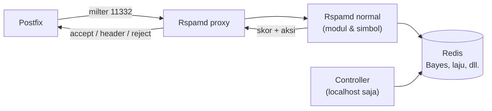

# Rspamd: Arsitektur dan Instalasi

!!! info "Identitas chapter"
    **ID:** `CH-10-02-01` · **Kategori/modul:** CAT-10 / MOD-10-02 (Spam, Malware, dan Phishing) · **Estimasi:** 150 menit · **Lingkungan:** lab lokal (VM) · [Lihat chapter ini di dashboard](../../../#CH-10-02-01)

!!! warning "Peringatan"
    Rspamd menyentuh seluruh alur email. Pasang di VM lab dahulu; kontroler web Rspamd tidak boleh terbuka ke jaringan dan kata sandinya tidak boleh disimpan di catatan. Belum dijalankan penulis pada VM (`verified_on: null`).

## 1. Ringkasan

Rspamd adalah sistem filter spam yang menilai pesan dengan banyak aturan dan menghasilkan skor serta tindakan. Chapter ini menjelaskan komponennya, memasangnya bersama Redis, dan memahami prinsip konfigurasi `local.d`/`override.d` yang menjaga pembaruan tetap aman.

## 2. Tujuan Pembelajaran

1. Menjelaskan worker, modul, simbol, skor, dan aksi Rspamd.
2. Memasang Rspamd dan Redis serta memverifikasi layanan.
3. Menerapkan prinsip konfigurasi di `local.d` tanpa mengubah berkas bawaan.

## 3. Prasyarat

- `CH-10-01-05` — Rate Limiting, Batas Koneksi, dan Fail2ban.
- Postfix menerima email dengan baik; TLS dan autentikasi email aktif (Level 7).

## 4. Materi Teori

### 4.1 Komponen

| Komponen | Fungsi |
|---|---|
| Worker `normal` | Memindai pesan (port 11333) |
| Worker `proxy` | Antarmuka milter untuk Postfix (port 11332) |
| Worker `controller` | Pembelajaran dan antarmuka web (port 11334) |
| Redis | Penyimpanan statistik Bayes, laju, greylisting |
| Modul/simbol | Aturan yang menambah skor (mis. pelanggaran SPF/DKIM) |



### 4.2 Skor dan aksi

Setiap simbol menambah/mengurangi skor; total dibandingkan ambang aksi (bawaan: *greylist*, *add header*, *rewrite subject*, *reject*). Ambang dan bobot disetel bertahap (`CH-10-02-02`).

### 4.3 Konfigurasi aman

Jangan menyunting berkas di `/etc/rspamd/` yang dimiliki paket (mis. `rspamd.conf`, `modules.d/*`). Tulis perubahan di `/etc/rspamd/local.d/` (menambah/menggabung) atau `override.d/` (menimpa). Dengan begitu pembaruan paket tidak menimpa pekerjaan Anda.

## 5. Praktik dan Implementasi

**Checklist persiapan**

- [ ] Snapshot VM; RAM cukup (periksa kebutuhan di dokumentasi).
- [ ] Tidak ada filter lain yang berebut milter.

**Langkah**

1. Pasang paket.
2. Periksa layanan dan konfigurasi.
3. Pastikan kontroler hanya mendengarkan localhost.
4. Atur Redis untuk Rspamd.

## 6. Perintah Linux

```bash title="Memasang dan memeriksa"
sudo apt install rspamd redis-server
sudo systemctl enable --now redis-server rspamd
rspamadm configtest
sudo ss -tlnp | grep -E 'rspamd|redis'
rspamc stat
```

Hasil yang diharapkan: `rspamadm configtest` melaporkan `syntax OK`; `ss` menunjukkan Rspamd dan Redis mendengarkan hanya pada loopback; `rspamc stat` menampilkan statistik awal (nol). Bentuk keluaran bergantung versi.

```bash title="Membuat hash kata sandi kontroler (interaktif)"
rspamadm pw
```

Perintah meminta kata sandi dan mencetak hash; hanya hash yang ditaruh di konfigurasi.

## 7. Konfigurasi

```text title="/etc/rspamd/local.d/redis.conf"
servers = "127.0.0.1";
```

```text title="/etc/rspamd/local.d/worker-controller.inc (hash adalah placeholder)"
bind_socket = "127.0.0.1:11334";
password = "<HASH-DARI-RSPAMADM-PW>";
```

- Antarmuka web hanya untuk localhost; akses jarak jauh lewat terowongan SSH, bukan membuka port 11334.
- Redis harus terikat ke loopback (`bind 127.0.0.1 ::1` dan jangan tanpa autentikasi di jaringan).
- Setelah menyunting: `rspamadm configtest && sudo systemctl restart rspamd`.

## 8. Verifikasi

```bash title="Verifikasi"
rspamadm configtest
systemctl is-active rspamd redis-server
sudo ss -tlnp | grep -E '11332|11333|11334|6379'
```

Port 11334 dan 6379 terikat ke alamat loopback.

## 9. Troubleshooting

| Gejala | Kemungkinan penyebab | Tindakan |
|---|---|---|
| `configtest` galat | Sintaks `local.d` | Baca pesan, perbaiki berkas |
| Rspamd tidak start | Redis tidak berjalan / memori | `journalctl -u rspamd` |
| Kontroler terbuka ke jaringan | `bind_socket` default | Ikat ke `127.0.0.1` |
| Berkas bawaan tertimpa pembaruan | Menyunting bukan di `local.d` | Pindahkan ke `local.d` |

## 10. Security Review

- Kontroler web yang terbuka + kata sandi lemah = pengambilalihan filter.
- Redis tanpa autentikasi yang terbuka ke jaringan adalah kerentanan klasik.
- Rspamd membaca seluruh isi email; perlakukan log dan statistiknya sebagai data pribadi.

## 11. Latihan

1. Gambar alur pesan melalui komponen Rspamd.
2. Cek port terbuka milik Rspamd dan Redis; pastikan loopback.
3. Jelaskan perbedaan `local.d` dan `override.d`.

## 12. Assessment

1. Apa fungsi worker `proxy`?
2. Mengapa tidak menyunting berkas bawaan paket?
3. Mengapa Redis harus terikat ke loopback?

**Kunci singkat.** (1) Antarmuka milter untuk Postfix. (2) Pembaruan menimpa perubahan. (3) Mencegah akses jaringan tanpa autentikasi.

## 13. Checklist Kelulusan

- [ ] Rspamd dan Redis aktif; `configtest` OK.
- [ ] Kontroler dan Redis hanya di loopback.
- [ ] Hash kontroler dibuat; kata sandi tidak tersimpan.

!!! note "Status belajar"
    Ubah status chapter secara manual di dashboard. Menyelesaikan checklist ini tidak mengubah status otomatis.

## 14. Referensi Resmi

- [Rspamd: Dokumentasi](https://docs.rspamd.com/)
- [Rspamd: Memulai](https://docs.rspamd.com/tutorials/quickstart/)
- [Rspamd: Konfigurasi dasar (local.d / override.d)](https://docs.rspamd.com/configuration/)
- [Rspamd: Worker proxy](https://docs.rspamd.com/workers/rspamd_proxy)

Tautan referensi tidak diverifikasi otomatis pada build ini; periksa ketersediaannya sebelum dipakai.

---

[Kembali ke dashboard kurikulum](../../../#CH-10-02-01){ .md-button }
