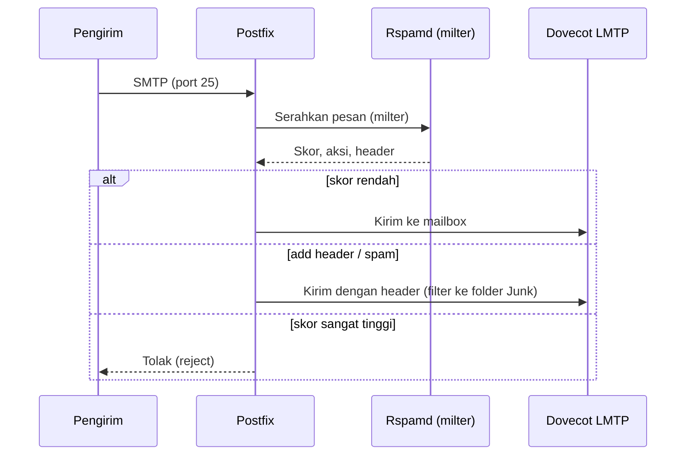

# Integrasi Rspamd dengan Postfix dan Tuning Kebijakan

!!! info "Identitas chapter"
    **ID:** `CH-10-02-02` · **Kategori/modul:** CAT-10 / MOD-10-02 (Spam, Malware, dan Phishing) · **Estimasi:** 150 menit · **Lingkungan:** lab lokal (VM) · [Lihat chapter ini di dashboard](../../../#CH-10-02-02)

!!! warning "Peringatan"
    Milter yang salah dapat menunda atau menolak email sah. Aktifkan bertahap: hanya menambah header lebih dulu, `milter_default_action = accept`, dan pantau log sebelum mengaktifkan penolakan. Belum dijalankan penulis pada VM (`verified_on: null`).

## 1. Ringkasan

Anda menghubungkan Rspamd ke Postfix lewat milter, memastikan header hasil (skor, `Authentication-Results`) tertulis, lalu menyetel aksi dan skor secara bertahap dengan data nyata.

## 2. Tujuan Pembelajaran

1. Mengintegrasikan Rspamd dengan Postfix melalui milter.
2. Mengaktifkan worker proxy mode milter dan header hasil.
3. Menyetel aksi dan skor secara bertahap dan terukur.
4. Menguji dengan pesan uji aman.

## 3. Prasyarat

- `CH-10-02-01` — Rspamd: Arsitektur dan Instalasi.
- `CH-10-02-01`; DKIM OpenDKIM (`CH-08-02-02`) bila dipertahankan untuk penandatanganan.

## 4. Materi Teori

### 4.1 Koordinasi dengan OpenDKIM

Jangan menandatangani DKIM di dua tempat. Pilihan: (a) OpenDKIM menandatangani dan Rspamd hanya memverifikasi/menilai, atau (b) pindahkan penandatanganan ke modul `dkim_signing` Rspamd dan matikan OpenDKIM. Bahan ini memakai (a); bila Anda memilih (b), baca dokumentasi `dkim_signing` dan kunci yang sama.



### 4.2 Tahapan penyetelan

1. Observasi: biarkan Rspamd memberi skor dan menambah header tanpa menolak.
2. Tinjau sampel pesan sah yang mendapat skor tinggi (false positive) dan spam yang lolos.
3. Naikkan/turunkan bobot atau ambang secara kecil.
4. Baru setelah stabil, gunakan `reject` untuk skor sangat tinggi.

### 4.3 Pembelajaran
Statistik Bayes menjadi baik setelah dilatih dengan contoh spam dan ham yang representatif.

## 5. Praktik dan Implementasi

1. Backup `/etc/postfix/main.cf` dan `/etc/rspamd/local.d/`.
2. Aktifkan mode milter pada worker proxy.
3. Tambahkan milter di Postfix.
4. Aktifkan header hasil.
5. Kirim pesan uji dan baca header.

## 6. Perintah Linux

```bash title="Menghubungkan Postfix"
sudo postconf -e 'smtpd_milters = inet:127.0.0.1:8891, inet:127.0.0.1:11332'
sudo postconf -e 'non_smtpd_milters = $smtpd_milters'
sudo postconf -e 'milter_default_action = accept'
sudo postconf -e 'milter_mail_macros = i {mail_addr} {client_addr} {client_name} {auth_authen}'
sudo postfix check && sudo systemctl reload postfix
```

Alamat `8891` adalah OpenDKIM (`CH-08-02-02`). Jika Anda tidak memakai OpenDKIM, hapus entri pertama.

```bash title="Menguji skor sebuah pesan"
rspamc < /tmp/pesan-uji.eml
rspamc stat
```

Gunakan pesan uji yang Anda buat sendiri. String uji spam standar (GTUBE) didokumentasikan secara resmi; ambil dari dokumentasi Rspamd/SpamAssassin, jangan dari sumber tak dikenal. Bentuk keluaran `rspamc` (skor, simbol, aksi) bergantung pada versi.

## 7. Konfigurasi

```text title="/etc/rspamd/local.d/worker-proxy.inc"
milter = yes;
timeout = 120s;
upstream "local" {
  default = yes;
  self_scan = yes;
}
bind_socket = "127.0.0.1:11332";
```

```text title="/etc/rspamd/local.d/milter_headers.conf"
use = ["x-spamd-bar", "authentication-results"];
authenticated_headers = ["authentication-results"];
```

```text title="/etc/rspamd/local.d/actions.conf (nilai awal ilustratif; sesuaikan dengan data)"
reject = 15;
add_header = 6;
greylist = 4;
```

- Nilai di atas sesuai bawaan yang didokumentasikan; ubah hanya berdasarkan sampel Anda.
- Pastikan `milter_default_action = accept` agar gangguan Rspamd tidak menghentikan email sah; untuk lingkungan ketat pertimbangkan `tempfail`.
- Sieve di Dovecot dapat memindahkan pesan berheader spam ke folder Junk (di luar cakupan chapter ini).
- Setelah menyunting: `rspamadm configtest && sudo systemctl restart rspamd`.

## 8. Verifikasi

```bash title="Verifikasi"
sudo postconf smtpd_milters milter_default_action
systemctl is-active rspamd postfix
sudo journalctl -u rspamd --since "10 min ago" --no-pager | tail -20
```

Hasil yang diharapkan: pesan uji ke akun lokal memiliki header `X-Spamd-Bar` dan `Authentication-Results`; log Rspamd mencatat pemindaian.

## 9. Troubleshooting

| Gejala | Kemungkinan penyebab | Tindakan |
|---|---|---|
| Header tidak muncul | Milter tidak terhubung | Cek `smtpd_milters`, `ss -tlnp`, log Postfix |
| Email tertunda | Timeout Rspamd | Periksa beban/log, naikkan timeout |
| Banyak false positive | Ambang terlalu agresif | Kembalikan ke observasi, setel |
| Dua `DKIM-Signature` | Penandatanganan ganda | Nonaktifkan salah satu |

## 10. Security Review

- Jangan menolak berdasarkan skor sebelum meninjau data nyata.
- Rspamd memproses email lengkap; amankan akses dan log.
- Milter pada `non_smtpd_milters` juga memproses pesan lokal; pahami dampaknya.

## 11. Latihan

1. Kumpulkan 20 pesan sah dan 20 spam, catat skor, dan usulkan ambang.
2. Dokumentasikan false positive dan cara memperbaikinya.
3. Pilih (a) atau (b) tentang DKIM dan jelaskan alasannya.

## 12. Assessment

1. Mengapa mulai dari mode observasi?
2. Apa fungsi `milter_default_action`?
3. Apa bahaya penandatanganan DKIM ganda?

**Kunci singkat.** (1) Menghindari memblokir email sah. (2) Perilaku saat milter gagal. (3) Verifikasi bisa gagal/membingungkan.

## 13. Checklist Kelulusan

- [ ] Rspamd terhubung dan header hasil muncul.
- [ ] Ambang disetel berdasarkan sampel, bukan tebakan.
- [ ] Keputusan DKIM (a/b) terdokumentasi.

!!! note "Status belajar"
    Ubah status chapter secara manual di dashboard. Menyelesaikan checklist ini tidak mengubah status otomatis.

## 14. Referensi Resmi

- [Rspamd: Integrasi MTA (Postfix)](https://docs.rspamd.com/tutorials/integration/)
- [Rspamd: Modul milter_headers](https://docs.rspamd.com/modules/milter_headers)
- [Rspamd: Aksi](https://docs.rspamd.com/configuration/metrics/)
- [Postfix: MILTER_README](https://www.postfix.org/MILTER_README.html)

Tautan referensi tidak diverifikasi otomatis pada build ini; periksa ketersediaannya sebelum dipakai.

---

[Kembali ke dashboard kurikulum](../../../#CH-10-02-02){ .md-button }
