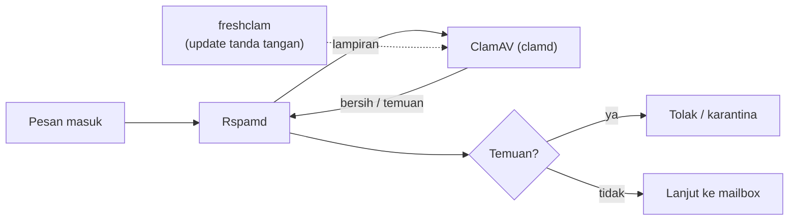

# Pemindaian Malware dan Risiko Lampiran

!!! info "Identitas chapter"
    **ID:** `CH-10-02-03` · **Kategori/modul:** CAT-10 / MOD-10-02 (Spam, Malware, dan Phishing) · **Estimasi:** 120 menit · **Lingkungan:** lab lokal (VM) · [Lihat chapter ini di dashboard](../../../#CH-10-02-03)

!!! warning "Peringatan"
    Antivirus dapat menambah beban memori besar dan menunda email. Pastikan RAM memadai, uji dengan berkas uji standar yang aman, dan jangan pernah menguji dengan malware nyata. Belum dijalankan penulis pada VM (`verified_on: null`).

## 1. Ringkasan

Anda menambahkan pemindaian malware (ClamAV) yang terintegrasi dengan Rspamd, menetapkan kebijakan lampiran berisiko, dan memahami bahwa antivirus berbasis tanda tangan hanya satu lapisan dengan keterbatasan nyata.

## 2. Tujuan Pembelajaran

1. Memasang ClamAV dan memastikan pembaruan tanda tangan berjalan.
2. Mengintegrasikan ClamAV dengan Rspamd.
3. Menetapkan kebijakan lampiran berisiko dan mengujinya dengan berkas uji aman.
4. Menjelaskan keterbatasan antivirus.

## 3. Prasyarat

- `CH-10-02-02` — Integrasi Rspamd dengan Postfix dan Tuning Kebijakan.
- Rspamd terintegrasi (`CH-10-02-02`).

## 4. Materi Teori

### 4.1 Alur



### 4.2 Keterbatasan

Antivirus berbasis tanda tangan tidak mendeteksi malware baru (*zero-day*), file terenkripsi, atau tautan berbahaya. Kebijakan lampiran memberikan lapisan tambahan: tolak/karantina tipe yang jarang sah dan berisiko tinggi (mis. eksekutabel), atau arsip terkunci kata sandi sesuai kebijakan organisasi.

### 4.3 Sumber daya

ClamAV memuat basis tanda tangan ke memori dan dapat memakai beberapa ratus MB hingga lebih dari satu GB RAM; periksa dokumentasi versi Anda dan ukur dengan `free -h` / `systemctl status clamav-daemon`.

## 5. Praktik dan Implementasi

1. Pasang ClamAV dan tunggu pembaruan awal.
2. Aktifkan integrasi di Rspamd.
3. Tambahkan kebijakan tipe lampiran.
4. Uji dengan berkas uji EICAR dari sumber resmi.

## 6. Perintah Linux

```bash title="Memasang dan memeriksa"
sudo apt install clamav-daemon clamav-freshclam
systemctl is-active clamav-freshclam clamav-daemon
sudo journalctl -u clamav-freshclam --since "1 hour ago" --no-pager | tail -5
free -h
```

Pembaruan tanda tangan awal dapat memakan waktu; `clamav-daemon` mungkin gagal start sampai basis data tersedia.

```bash title="Menguji dengan berkas uji standar"
clamdscan --version
clamdscan /tmp/eicar.com
```

Unduh berkas uji EICAR dari situs resmi EICAR sendiri (berkas ini aman dan dirancang agar terdeteksi). Hasil yang diharapkan: `clamdscan` melaporkan `Eicar-Signature FOUND` atau nama serupa. Jangan menguji dengan malware sungguhan.

## 7. Konfigurasi

```text title="/etc/rspamd/local.d/antivirus.conf"
clamav {
  action = "reject";
  type = "clamav";
  servers = "/var/run/clamav/clamd.ctl";
  symbol = "CLAM_VIRUS";
  log_clean = true;
  scan_mime_parts = true;
}
```

```text title="/etc/postfix/mime_header_checks (contoh kebijakan lampiran; uji dulu dengan postmap -q)"
/^\s*Content-(Disposition|Type).*name\s*=\s*"?(.*\.(exe|scr|bat|com|vbs|jar))"?\s*$/ REJECT Tipe lampiran tidak diizinkan
```

```text title="Postfix main.cf (tambahkan)"
mime_header_checks = regexp:/etc/postfix/mime_header_checks
```

- Jalur soket ClamAV (`LocalSocket`) dapat berbeda; periksa `clamdscan --version` dan `/etc/clamav/clamd.conf`.
- Rspamd perlu izin membaca soket `clamd`; periksa keanggotaan grup bila ada `Permission denied`.
- Daftar ekstensi di atas hanya contoh; sesuaikan dengan kebutuhan bisnis agar tidak menolak lampiran sah.

## 8. Verifikasi

- `freshclam` memperbarui tanda tangan tanpa galat.
- `clamdscan` pada berkas uji standar mendeteksi temuan.
- Email berlampiran berkas uji ditolak/ditandai dan tercatat di log Rspamd.
- Lampiran sah (PDF/gambar) tetap diterima.

## 9. Troubleshooting

| Gejala | Kemungkinan penyebab | Tindakan |
|---|---|---|
| `clamd` tidak start | Basis data belum diunduh / RAM | `journalctl -u clamav-daemon`, tunggu `freshclam` |
| Rspamd tidak menghubungi clamd | Jalur soket / izin | Samakan jalur, periksa grup |
| Email lambat | Pemindaian berat / RAM | Periksa sumber daya, ukuran lampiran |
| False positive | Aturan lampiran terlalu luas | Persempit pola, uji dengan `postmap -q` |

## 10. Security Review

- Antivirus bukan jaminan; kombinasikan dengan filter, edukasi, dan kebijakan.
- Jangan mengunduh sampel malware nyata ke server produksi.
- Pesan yang ditolak setelah diterima dapat menghasilkan backscatter; tolak saat SMTP bila memungkinkan.

## 11. Latihan

1. Ukur penggunaan RAM sebelum dan sesudah ClamAV.
2. Uji kebijakan lampiran dengan lima jenis berkas aman.
3. Tulis daftar keterbatasan antivirus untuk pengguna Anda.

## 12. Assessment

1. Mengapa antivirus tanda tangan tidak cukup?
2. Mengapa memakai berkas EICAR untuk uji?
3. Apa tugas `freshclam`?

**Kunci singkat.** (1) Tidak menangkap ancaman baru/terenkripsi. (2) Aman namun terdeteksi. (3) Memperbarui basis data tanda tangan.

## 13. Checklist Kelulusan

- [ ] ClamAV aktif dan tanda tangan diperbarui.
- [ ] Uji dengan berkas standar berhasil.
- [ ] Kebijakan lampiran dan keterbatasannya terdokumentasi.

!!! note "Status belajar"
    Ubah status chapter secara manual di dashboard. Menyelesaikan checklist ini tidak mengubah status otomatis.

## 14. Referensi Resmi

- [ClamAV: Dokumentasi](https://docs.clamav.net/)
- [Rspamd: Modul antivirus](https://docs.rspamd.com/modules/antivirus)
- [Postfix: header_checks (mime_header_checks)](https://www.postfix.org/header_checks.5.html)
- [EICAR (berkas uji antivirus tersedia di situs ini)](https://www.eicar.org/)

Tautan referensi tidak diverifikasi otomatis pada build ini; periksa ketersediaannya sebelum dipakai.

---

[Kembali ke dashboard kurikulum](../../../#CH-10-02-03){ .md-button }
