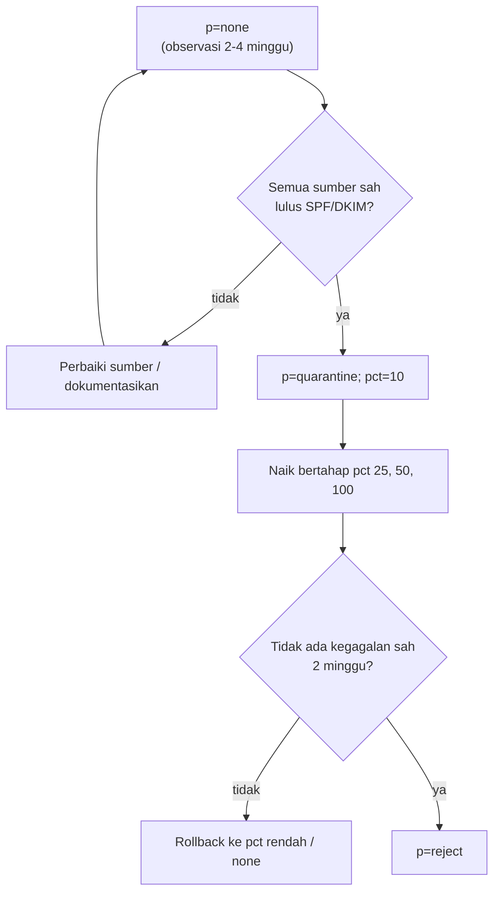

# Pencegahan Phishing dan Spoofing; Strategi Enforcement DMARC

!!! info "Identitas chapter"
    **ID:** `CH-10-02-04` · **Kategori/modul:** CAT-10 / MOD-10-02 (Spam, Malware, dan Phishing) · **Estimasi:** 120 menit · **Lingkungan:** lab lokal (VM) · [Lihat chapter ini di dashboard](../../../#CH-10-02-04)

!!! note "Catatan"
    Menaikkan kebijakan DMARC ke `quarantine` atau `reject` dapat menolak email sah dari sumber yang terlupa. Lakukan bertahap dengan data laporan dan siapkan rollback. Belum dijalankan penulis pada VM (`verified_on: null`).

## 1. Ringkasan

Anda menyusun strategi enforcement DMARC yang bertahap, mengenali teknik spoofing (domain palsu, nama tampilan, domain mirip), dan menyiapkan indikator untuk mendeteksinya.

## 2. Tujuan Pembelajaran

1. Merancang tahapan `none` → `quarantine` → `reject` dengan kriteria naik dan rollback.
2. Mengenali spoofing nama tampilan dan lookalike domain.
3. Menerapkan kontrol pendukung: kebijakan untuk subdomain tak terpakai dan pengawasan.

## 3. Prasyarat

- `CH-10-02-03` — Pemindaian Malware dan Risiko Lampiran.
- DMARC `p=none` terpublikasi dan laporan masuk (`CH-08-02-03`); Rspamd aktif (`CH-10-02-02`).

## 4. Materi Teori

### 4.1 Tahapan enforcement



Durasi di atas hanyalah contoh; tentukan sesuai volume dan sumber pengirim Anda.

### 4.2 Teknik spoofing

| Teknik | Contoh | Pertahanan |
|---|---|---|
| Spoof domain persis | `From: ceo@example.com` dari server lain | DMARC `reject` |
| Nama tampilan | `"CEO example.com" <x@gmail.example>` | Filter tampilan, edukasi |
| Lookalike domain | `examp1e.com` | Pemantauan domain mirip, kebijakan pembayaran |
| Reply-To berbeda | Balasan diarahkan ke penyerang | Peringatan, edukasi |

DMARC melindungi **domain persis** Anda; ia tidak mencegah domain mirip.

### 4.3 Subdomain

Atur kebijakan subdomain (`sp=`) dan publikasikan `v=spf1 -all` serta DMARC `reject` untuk domain/subdomain yang tidak mengirim email.

## 5. Praktik dan Implementasi

1. Inventaris semua sumber pengirim (server sendiri, layanan eksternal).
2. Pastikan tiap sumber lulus SPF atau DKIM dengan alignment.
3. Susun jadwal tahapan dengan kriteria.
4. Daftarkan domain mirip yang wajar dan pantau.
5. Buat prosedur rollback.

## 6. Perintah Linux

```bash title="Memeriksa kebijakan dan sumber"
dig +short TXT _dmarc.example.com
dig +short TXT example.com
dig +short TXT _dmarc.sub.example.com
```

Ganti dengan domain Anda. Hasil yang diharapkan: kebijakan aktif tampil sesuai tahap; subdomain tak terpakai memiliki catatan eksplisit atau mewarisi `sp=`.

## 7. Konfigurasi

```text title="Contoh tahap record DMARC (ilustratif)"
Tahap 1: v=DMARC1; p=none; rua=mailto:dmarc-reports@example.com
Tahap 2: v=DMARC1; p=quarantine; pct=10; rua=mailto:dmarc-reports@example.com
Tahap 3: v=DMARC1; p=reject; rua=mailto:dmarc-reports@example.com
```

`pct` didefinisikan dalam RFC 7489; revisi standar yang lebih baru dapat mengubah tag itu, jadi periksa dukungan penerima. Rollback berarti menurunkan kembali `p`/`pct` dan menunggu TTL.

## 8. Verifikasi

- Laporan agregat tidak menunjukkan sumber sah yang gagal sebelum naik tahap.
- Setelah tiap tahap, tidak ada keluhan penerimaan; pantau log dan laporan.
- Domain/subdomain tak terpakai tidak dapat dipalsukan (DMARC/SPF ketat).

## 9. Troubleshooting

| Gejala | Kemungkinan penyebab | Tindakan |
|---|---|---|
| Email sah masuk spam | Sumber belum SPF/DKIM | Tambahkan, tunggu, ulangi tahap |
| Laporan tidak tiba | `rua` salah | Perbaiki alamat |
| Forwarding gagal | SPF patah, DKIM berubah | Andalkan DKIM; edukasi |
| Rollback lambat | TTL tinggi | Turunkan TTL sebelum perubahan |

## 10. Security Review

- `p=none` tidak melindungi dari spoofing.
- Laporan DMARC berisi alamat IP dan volume; batasi aksesnya.
- Jangan menyerahkan akses DNS ke pihak yang tidak perlu; perubahan DNS adalah risiko tertinggi.

## 11. Latihan

1. Tulis jadwal enforcement dengan kriteria angka.
2. Buat daftar lima domain mirip untuk domain Anda dan cara memantaunya.
3. Susun prosedur rollback.

## 12. Assessment

1. Mengapa naik tahap berdasarkan data?
2. Apa yang tidak dicegah oleh DMARC?
3. Mengapa menurunkan TTL sebelum perubahan?

**Kunci singkat.** (1) Hindari menolak sah. (2) Domain mirip dan nama tampilan. (3) Rollback cepat.

## 13. Checklist Kelulusan

- [ ] Jadwal enforcement dan rollback tertulis.
- [ ] Sumber pengirim terinventaris.
- [ ] Domain tak terpakai diamankan.

!!! note "Status belajar"
    Ubah status chapter secara manual di dashboard. Menyelesaikan checklist ini tidak mengubah status otomatis.

## 14. Referensi Resmi

- [RFC 7489 — DMARC](https://www.rfc-editor.org/rfc/rfc7489)
- [RFC 7208 — SPF](https://www.rfc-editor.org/rfc/rfc7208)
- [dmarc.org](https://dmarc.org/overview/)
- [Rspamd: Modul DMARC](https://docs.rspamd.com/modules/dmarc)

Tautan referensi tidak diverifikasi otomatis pada build ini; periksa ketersediaannya sebelum dipakai.

---

[Kembali ke dashboard kurikulum](../../../#CH-10-02-04){ .md-button }
