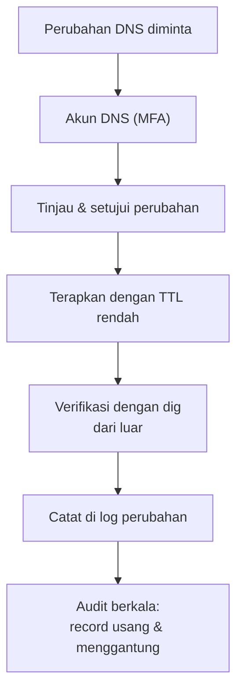

# Keamanan DNS untuk Mail

!!! info "Identitas chapter"
    **ID:** `CH-10-02-05` · **Kategori/modul:** CAT-10 / MOD-10-02 (Spam, Malware, dan Phishing) · **Estimasi:** 90 menit · **Lingkungan:** lab lokal (VM) · [Lihat chapter ini di dashboard](../../../#CH-10-02-05)

!!! warning "Peringatan"
    Perubahan DNS berdampak luas. Gunakan akun terpisah dengan MFA, dan hanya periksa nameserver milik sendiri. Belum dijalankan penulis pada VM (`verified_on: null`).

## 1. Ringkasan

Email bergantung pada DNS: MX, SPF, DKIM, DMARC, dan PTR. Pengambilalihan akun DNS atau record yang menggantung dapat mengalihkan email Anda. Chapter ini membahas pengamanan akun DNS, record yang menggantung, dan penguncian penerbitan sertifikat dengan CAA.

## 2. Tujuan Pembelajaran

1. Mengamankan akun dan proses perubahan DNS.
2. Mengenali risiko subdomain takeover dan MX yang salah.
3. Menambahkan record CAA dan memverifikasi transfer zona ditolak.

## 3. Prasyarat

- `CH-10-02-04` — Pencegahan Phishing dan Spoofing; Strategi Enforcement DMARC.
- Domain dan DNS (Level 4); DNSSEC (`CH-05-02-02`).

## 4. Materi Teori

### 4.1 Risiko

| Risiko | Dampak | Pencegahan |
|---|---|---|
| Akun registrar/DNS diambil alih | MX dan TXT dialihkan, email dicuri | MFA, registrar lock, akses minimal |
| Record CNAME menggantung | Subdomain diambil alih pihak lain | Audit berkala, hapus record usang |
| MX menunjuk host tak dimiliki | Email jatuh ke pihak lain | Pantau MX |
| Zone transfer terbuka | Pembocoran peta host | Batasi AXFR |
| Penerbitan sertifikat bebas | Sertifikat tak sah | CAA |



### 4.2 CAA

Record CAA (RFC 8659) menyatakan CA mana yang boleh menerbitkan sertifikat untuk domain. Contoh: `example.com. CAA 0 issue "letsencrypt.org"`.

### 4.3 Pemantauan

Bandingkan MX, SPF, DMARC, dan NS yang terlihat publik dengan catatan resmi Anda secara terjadwal; perubahan tak terduga adalah sinyal insiden.

## 5. Praktik dan Implementasi

1. Aktifkan MFA dan lock di registrar/DNS.
2. Inventaris semua record, tandai yang usang.
3. Tambahkan CAA.
4. Uji bahwa AXFR ditolak.
5. Jadwalkan pembandingan record berkala.

## 6. Perintah Linux

```bash title="Membaca record penting"
dig +short NS example.com
dig +short MX example.com
dig +short CAA example.com
dig +short TXT example.com
```

```bash title="Menguji transfer zona (hanya NS milik sendiri)"
dig AXFR example.com @ns1.example.com
```

Hasil yang diharapkan: `Transfer failed` atau `REFUSED`. Jangan menjalankan terhadap nameserver pihak lain.

## 7. Konfigurasi

```text title="Contoh record CAA di panel DNS"
Nama : example.com
Tipe : CAA
Nilai: 0 issue "letsencrypt.org"
```

Tidak semua panel DNS mendukung CAA; periksa penyedia Anda. Salah menulis CAA dapat memblokir penerbitan sertifikat Anda sendiri.

## 8. Verifikasi

- `dig CAA` menampilkan record sesuai rencana.
- AXFR ditolak.
- Inventaris DNS tidak menyisakan CNAME menggantung.

## 9. Troubleshooting

| Gejala | Kemungkinan penyebab | Tindakan |
|---|---|---|
| Penerbitan sertifikat gagal | CAA tidak mengizinkan CA | Sesuaikan CAA |
| `dig` tidak konsisten | Cache / beberapa NS | Periksa tiap NS otoritatif |
| Panel tidak mendukung CAA | Keterbatasan penyedia | Pertimbangkan penyedia lain |
| Perubahan tak dikenal | Pengambilalihan akun | Reset kredensial, audit, ganti kunci |

## 10. Security Review

- Pengambilalihan DNS = pengambilalihan email domain; MFA wajib.
- Simpan kredensial DNS/API di pengelola kata sandi, bukan di repositori.
- Catat setiap perubahan DNS; hapus akses saat anggota tim keluar.

## 11. Latihan

1. Audit satu zona dan daftar record usang/menggantung.
2. Tambahkan CAA dan tunjukkan efeknya pada penerbitan.
3. Rancang prosedur pemulihan jika akun DNS diambil alih.

## 12. Assessment

1. Apa itu subdomain takeover?
2. Apa fungsi CAA?
3. Mengapa AXFR terbuka berbahaya?

**Kunci singkat.** (1) Record menggantung diambil pihak lain. (2) Membatasi CA penerbit. (3) Membocorkan peta host.

## 13. Checklist Kelulusan

- [ ] MFA/lock aktif; inventaris DNS bersih.
- [ ] CAA dan penolakan AXFR terverifikasi.
- [ ] Prosedur pemulihan akun DNS tertulis.

!!! note "Status belajar"
    Ubah status chapter secara manual di dashboard. Menyelesaikan checklist ini tidak mengubah status otomatis.

## 14. Referensi Resmi

- [RFC 8659 — CAA](https://www.rfc-editor.org/rfc/rfc8659)
- [RFC 1035 — Domain Names](https://www.rfc-editor.org/rfc/rfc1035)
- [Let's Encrypt: CAA](https://letsencrypt.org/docs/caa/)
- [ICANN: Keamanan DNS](https://www.icann.org/resources/pages/dnssec-what-is-it-why-important-2019-03-05-en)

Tautan referensi tidak diverifikasi otomatis pada build ini; periksa ketersediaannya sebelum dipakai.

---

[Kembali ke dashboard kurikulum](../../../#CH-10-02-05){ .md-button }
