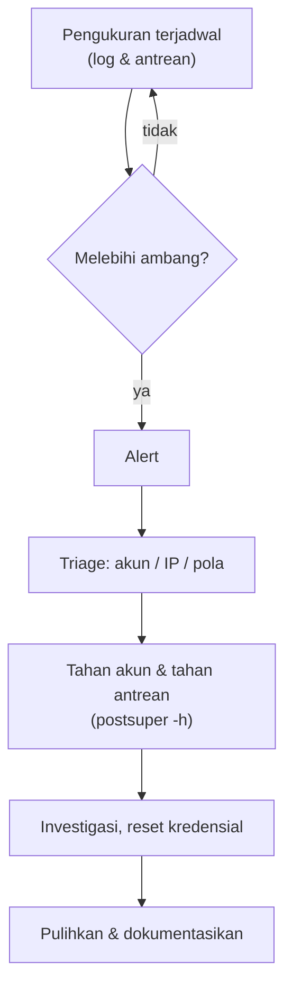

# Deteksi Penyalahgunaan dan Batas Pengiriman Keluar

!!! info "Identitas chapter"
    **ID:** `CH-10-03-01` · **Kategori/modul:** CAT-10 / MOD-10-03 (Deteksi, Koreksi, dan Pemeliharaan) · **Estimasi:** 120 menit · **Lingkungan:** lab lokal (VM) · [Lihat chapter ini di dashboard](../../../#CH-10-03-01)

!!! note "Status verifikasi"
    Isi chapter ini ditulis dari dokumentasi resmi dan belum dijalankan penulis pada VM (`verified_on: null`).

## 1. Ringkasan

Server yang disusupi atau akun yang dicuri sering terlihat pertama kali dari volume pengiriman keluar yang abnormal. Anda membuat pengukuran sederhana dari log dan antrean, menetapkan batas, dan menyiapkan respons.

## 2. Tujuan Pembelajaran

1. Menghitung pengiriman per akun dan per IP dari log.
2. Mendeteksi lonjakan dan antrean abnormal.
3. Menerapkan batas pengiriman dan menyiapkan respons saat terdeteksi.

## 3. Prasyarat

- `CH-10-02-05` — Keamanan DNS untuk Mail.
- Log Postfix dan SASL aktif; batas koneksi (`CH-10-01-05`).

## 4. Materi Teori

### 4.1 Sinyal

| Sinyal | Sumber | Makna |
|---|---|---|
| Banyak `sasl_username=` sama | Log smtpd | Akun mengirim banyak |
| Antrean tumbuh cepat | `postqueue -j` | Pengiriman bermasalah/tersangkut |
| Banyak bounce | Log | Alamat tujuan buruk / spam |
| Login dari banyak IP/negara | Log Dovecot | Kemungkinan kredensial dicuri |



### 4.2 Batas

Postfix membatasi per klien (IP) dengan `smtpd_client_message_rate_limit`. Batas **per akun** memerlukan komponen tambahan (mis. modul pembatas laju Rspamd atau layanan kebijakan); pelajari dokumentasinya sebelum menerapkan.

### 4.3 Dasar normal
Ambang bermakna hanya jika Anda mengetahui pola normal. Ukur beberapa minggu, lalu tetapkan ambang di atas puncak normal dengan margin.

## 5. Praktik dan Implementasi

1. Hitung pengiriman per akun dari log.
2. Catat antrean pada kondisi normal.
3. Tentukan ambang dan jalur eskalasi.
4. Latih respons dengan akun uji.

## 6. Perintah Linux

```bash title="Pengiriman terautentikasi per akun (satu jam terakhir)"
sudo journalctl -u 'postfix@-' --since "1 hour ago" --no-pager \
  | grep -o 'sasl_username=[^ ,]*' | sort | uniq -c | sort -rn | head
```

```bash title="Antrean"
postqueue -j | wc -l
mailq | tail -1
```

```bash title="Menahan antrean mencurigakan (hati-hati)"
sudo postsuper -h ALL
```

`postsuper -h ALL` **menahan seluruh antrean** dan menghentikan pengiriman semua pesan; gunakan hanya pada insiden aktif, lalu `postsuper -H ALL` untuk melepaskan. Nama unit `postfix@-` mengikuti Ubuntu 24.04. Format `sasl_username` bergantung pada log yang ada; verifikasi di log Anda.

## 7. Konfigurasi

```text title="Postfix main.cf (batas per klien; nilai awal ilustratif)"
smtpd_client_message_rate_limit = 100
smtpd_client_recipient_rate_limit = 300
```

Batas per akun: lihat dokumentasi Rspamd (modul `ratelimit`) atau layanan kebijakan sebelum menerapkan.

## 8. Verifikasi

- Perintah log menghasilkan hitungan per akun yang masuk akal.
- Ambang tertulis dan simulasi lonjakan pada lab memicu langkah respons.
- Antrean kembali normal setelah latihan.

## 9. Troubleshooting

| Gejala | Kemungkinan penyebab | Tindakan |
|---|---|---|
| Hitungan nol | Format log berbeda / sudah dirotasi | Periksa baris `sasl_username` nyata |
| Banyak false alarm | Ambang terlalu rendah | Ukur dasar, naikkan |
| Pesan sah tertahan | Batas terlalu ketat | Naikkan, kecualikan sumber tepercaya |
| Antrean macet | Tujuan menolak / DNS | Lihat `CH-06-01-06` |

## 10. Security Review

- Respons pertama pada akun dicuri: tahan akun dan antrean, lalu reset kredensial (bukan hapus bukti).
- IP server yang masuk daftar hitam sulit dipulihkan; deteksi dini adalah kunci.
- Log berisi alamat pengguna; jaga privasi.

## 11. Latihan

1. Buat skrip yang menghitung pengiriman per akun dan memberi peringatan di atas ambang.
2. Simulasikan lonjakan di lab dan catat waktu deteksi.
3. Tulis runbook "akun diduga dicuri".

## 12. Assessment

1. Apa sinyal awal akun dicuri?
2. Mengapa perlu dasar normal?
3. Apa bahaya `postsuper -h ALL`?

**Kunci singkat.** (1) Lonjakan pengiriman/login dari banyak IP. (2) Agar ambang bermakna. (3) Menghentikan semua pengiriman.

## 13. Checklist Kelulusan

- [ ] Pengukuran per akun/IP berjalan.
- [ ] Ambang dan respons tertulis dan diuji di lab.

!!! note "Status belajar"
    Ubah status chapter secara manual di dashboard. Menyelesaikan checklist ini tidak mengubah status otomatis.

## 14. Referensi Resmi

- [Postfix: postsuper(1)](https://www.postfix.org/postsuper.1.html)
- [Postfix: postqueue(1)](https://www.postfix.org/postqueue.1.html)
- [Rspamd: Modul ratelimit](https://docs.rspamd.com/modules/ratelimit)
- [M3AAWG: Praktik terbaik](https://www.m3aawg.org/published-documents)

Tautan referensi tidak diverifikasi otomatis pada build ini; periksa ketersediaannya sebelum dipakai.

---

[Kembali ke dashboard kurikulum](../../../#CH-10-03-01){ .md-button }
