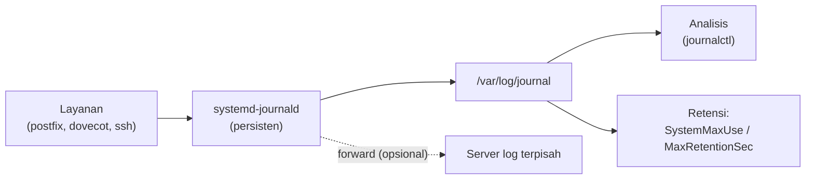

# Integritas Log, Akses Log, dan Retensi

!!! info "Identitas chapter"
    **ID:** `CH-10-03-02` · **Kategori/modul:** CAT-10 / MOD-10-03 (Deteksi, Koreksi, dan Pemeliharaan) · **Estimasi:** 90 menit · **Lingkungan:** lab lokal (VM) · [Lihat chapter ini di dashboard](../../../#CH-10-03-02)

!!! note "Status verifikasi"
    Isi chapter ini ditulis dari dokumentasi resmi dan belum dijalankan penulis pada VM (`verified_on: null`).

## 1. Ringkasan

Log adalah bukti. Anda memastikan log tersimpan persisten, tidak mudah diubah, dapat diakses hanya oleh yang berwenang, dan memiliki retensi yang jelas sesuai kebutuhan operasional dan privasi.

## 2. Tujuan Pembelajaran

1. Mengaktifkan jurnal persisten dan membatasi ukuran/retensinya.
2. Memverifikasi integritas dasar jurnal dan membatasi akses.
3. Menetapkan kebijakan retensi dan rotasi.

## 3. Prasyarat

- `CH-10-03-01` — Deteksi Penyalahgunaan dan Batas Pengiriman Keluar.
- Memahami `journalctl` dan log layanan (`CH-06-01-06`).

## 4. Materi Teori

### 4.1 Prinsip

| Tujuan | Cara |
|---|---|
| Ketersediaan | Jurnal persisten, ruang cukup |
| Integritas | Akses terbatas, salinan jarak jauh, verifikasi |
| Kerahasiaan | Izin ketat; log memuat data pribadi |
| Retensi | Kebijakan tertulis, penghapusan terjadwal |

Penyerang dengan akses root dapat mengubah log lokal; karena itu salinan ke sistem lain (log jarak jauh) adalah kontrol terkuat.



### 4.2 Catatan Ubuntu 24.04

Log layanan email ada di journal. `/var/log/mail.log` hanya ada bila `rsyslog` dipasang. Berkas log lain (mis. Nginx, Roundcube) memakai `logrotate`.

## 5. Praktik dan Implementasi

1. Periksa apakah jurnal persisten.
2. Atur batas ukuran dan retensi.
3. Verifikasi integritas dan izin.
4. Tulis kebijakan retensi.

## 6. Perintah Linux

```bash title="Memeriksa status"
journalctl --disk-usage
ls -ld /var/log/journal
sudo journalctl --verify
id
```

`journalctl --verify` memeriksa konsistensi internal berkas jurnal, bukan keaslian terhadap penyerang; tanpa FSS (*forward secure sealing*) ia tidak membuktikan tidak ada manipulasi. Pengguna dalam grup `adm`/`systemd-journal` dapat membaca jurnal seluruh sistem; batasi keanggotaan.

```bash title="Menerapkan"
sudo mkdir -p /var/log/journal
sudo systemctl restart systemd-journald
```

## 7. Konfigurasi

```text title="/etc/systemd/journald.conf.d/90-retensi.conf"
[Journal]
Storage=persistent
SystemMaxUse=1G
MaxRetentionSec=90day
```

- Nilai 1G dan 90 hari adalah contoh; sesuaikan dengan ruang disk dan kewajiban retensi organisasi.
- Retensi minimum dapat ditetapkan oleh regulasi; konsultasikan sebelum menetapkan.
- Log memuat alamat email dan IP, yang dapat tergolong data pribadi; terapkan retensi minimum yang diperlukan.

## 8. Verifikasi

```bash title="Verifikasi"
journalctl --disk-usage
sudo journalctl --verify | tail -3
journalctl -u dovecot --since "1 day ago" --no-pager | head -3
```

Hasil yang diharapkan: pemakaian disk di bawah batas, verifikasi tanpa kesalahan, dan log layanan tersedia setelah reboot (uji dengan reboot lab).

## 9. Troubleshooting

| Gejala | Kemungkinan penyebab | Tindakan |
|---|---|---|
| Log hilang setelah reboot | Jurnal volatile | Buat `/var/log/journal`, set `Storage=persistent` |
| Disk penuh | Batas tidak diatur | Set `SystemMaxUse` |
| `--verify` melaporkan galat | Berkas korup | Selidiki, simpan salinan |
| Tidak ada `/var/log/mail.log` | `rsyslog` tidak ada | Pakai journal atau pasang rsyslog |

## 10. Security Review

- Log yang bisa diubah penyerang kehilangan nilai bukti; kirim salinan ke sistem lain.
- Batasi grup `adm`/`systemd-journal`.
- Hindari mencatat kata sandi atau token (`CH-07-02-03`).

## 11. Latihan

1. Atur retensi dan buktikan setelah reboot log tetap ada.
2. Tulis kebijakan retensi dengan alasan.
3. Rancang arsitektur log jarak jauh sederhana (diagram).

## 12. Assessment

1. Mengapa salinan log jarak jauh penting?
2. Apa keterbatasan `journalctl --verify`?
3. Mengapa log memerlukan retensi terbatas?

**Kunci singkat.** (1) Penyerang lokal dapat mengubah log lokal. (2) Hanya konsistensi, bukan keaslian. (3) Privasi dan ruang.

## 13. Checklist Kelulusan

- [ ] Jurnal persisten dengan batas ukuran/retensi.
- [ ] Akses log dibatasi.
- [ ] Kebijakan retensi tertulis.

!!! note "Status belajar"
    Ubah status chapter secara manual di dashboard. Menyelesaikan checklist ini tidak mengubah status otomatis.

## 14. Referensi Resmi

- [systemd: journald.conf(5)](https://www.freedesktop.org/software/systemd/man/latest/journald.conf.html)
- [systemd: journalctl(1)](https://www.freedesktop.org/software/systemd/man/latest/journalctl.html)
- [logrotate(8)](https://man7.org/linux/man-pages/man8/logrotate.8.html)

Tautan referensi tidak diverifikasi otomatis pada build ini; periksa ketersediaannya sebelum dipakai.

---

[Kembali ke dashboard kurikulum](../../../#CH-10-03-02){ .md-button }
