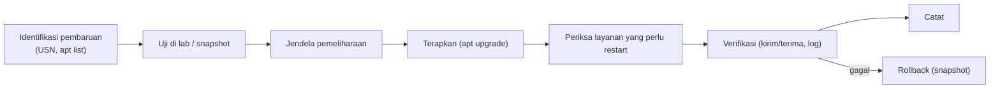

# Manajemen Patch dan Penilaian Kerentanan

!!! info "Identitas chapter"
    **ID:** `CH-10-03-03` · **Kategori/modul:** CAT-10 / MOD-10-03 (Deteksi, Koreksi, dan Pemeliharaan) · **Estimasi:** 120 menit · **Lingkungan:** lab lokal (VM) · [Lihat chapter ini di dashboard](../../../#CH-10-03-03)

!!! warning "Peringatan"
    Pembaruan dapat memulai ulang layanan email. Lakukan di jendela pemeliharaan setelah backup/snapshot, dan baca catatan pembaruan sebelum menerapkan. Belum dijalankan penulis pada VM (`verified_on: null`).

## 1. Ringkasan

Sebagian besar insiden berasal dari kerentanan yang sudah punya perbaikan. Anda membuat siklus patch yang terukur, memverifikasi kebutuhan restart, dan menilai kerentanan dasar pada server milik sendiri.

## 2. Tujuan Pembelajaran

1. Menjalankan siklus patch: identifikasi, uji, terapkan, verifikasi.
2. Menentukan layanan yang perlu restart setelah pembaruan.
3. Melakukan penilaian kerentanan dasar dan membaca pemberitahuan keamanan Ubuntu.

## 3. Prasyarat

- `CH-10-03-02` — Integritas Log, Akses Log, dan Retensi.
- Memahami APT (`CH-02-01-04`).

## 4. Materi Teori

### 4.1 Siklus



### 4.2 Pembaruan otomatis

Ubuntu Server dapat menerapkan pembaruan keamanan otomatis lewat `unattended-upgrades`. Itu mengurangi jendela kerentanan, tetapi dapat me-restart layanan tanpa pemberitahuan; sesuaikan dengan toleransi gangguan Anda.

### 4.3 Penilaian kerentanan

Mulai dari pemeriksaan sederhana: paket usang, port terbuka, konfigurasi (SSH/TLS). Pindai hanya sistem milik sendiri atau yang Anda berwenang untuk uji.

## 5. Praktik dan Implementasi

1. Catat inventaris versi (Postfix, Dovecot, Rspamd, OpenSSL, kernel).
2. Lihat pembaruan tersedia.
3. Terapkan di lab, uji, lalu terapkan di jendela.
4. Periksa layanan yang perlu restart.

## 6. Perintah Linux

```bash title="Inventaris dan pembaruan"
postconf mail_version
dovecot --version
apt list --upgradable 2>/dev/null | head -20
sudo apt update && apt list --upgradable 2>/dev/null | wc -l
```

```bash title="Status pembaruan otomatis dan restart"
systemctl status unattended-upgrades --no-pager | head -5
sudo needrestart -r l
sudo pro security-status
```

- `needrestart -r l` hanya mendaftar layanan yang perlu restart. Jika paket belum ada: `sudo apt install needrestart`.
- `pro security-status` merangkum paket yang menerima pembaruan keamanan; perintah tersedia bila klien Ubuntu Pro terpasang.
- Terapkan: `sudo apt upgrade`, lalu restart layanan yang direkomendasikan di jendela pemeliharaan.

## 7. Konfigurasi

```text title="/etc/apt/apt.conf.d/50unattended-upgrades (periksa baris origins-pattern)"
Unattended-Upgrade::Allowed-Origins { ... };
Unattended-Upgrade::Automatic-Reboot "false";
```

Kebijakan reboot otomatis harus disengaja (`false` aman di lab). Jangan menonaktifkan pembaruan keamanan otomatis tanpa pengganti proses manual yang terjadwal.

## 8. Verifikasi

- `apt list --upgradable` kosong untuk paket keamanan setelah jendela.
- `needrestart -r l` tidak menyisakan layanan krusial.
- Kirim/terima email dan login IMAP berfungsi setelah patch.

## 9. Troubleshooting

| Gejala | Kemungkinan penyebab | Tindakan |
|---|---|---|
| Layanan gagal setelah upgrade | Konfigurasi tidak kompatibel | Baca log, rollback |
| Paket ditahan | `apt-mark hold` | `apt-mark showhold` |
| Reboot tertunda | Kernel baru | Jadwalkan reboot |
| Pembaruan otomatis tak berjalan | Layanan/timer | `systemctl list-timers` |

## 10. Security Review

- Penundaan patch memperbesar jendela serangan; tetapkan SLA internal.
- Ubah konfigurasi hanya setelah backup.
- Pembaruan berasal dari repositori resmi; jangan menambah PPA tak dikenal di server produksi.

## 11. Latihan

1. Buat tabel inventaris versi dan sumber informasi keamanannya.
2. Latih satu siklus patch penuh di lab.
3. Tulis SLA patch (kritis, tinggi, sedang).

## 12. Assessment

1. Mengapa patch diuji dahulu?
2. Apa risiko pembaruan otomatis?
3. Apa fungsi `needrestart`?

**Kunci singkat.** (1) Hindari gangguan layanan. (2) Restart tak terduga. (3) Menunjukkan layanan yang butuh restart.

## 13. Checklist Kelulusan

- [ ] Siklus patch dijalankan dan didokumentasikan.
- [ ] Inventaris versi dibuat.
- [ ] SLA patch ditetapkan.

!!! note "Status belajar"
    Ubah status chapter secara manual di dashboard. Menyelesaikan checklist ini tidak mengubah status otomatis.

## 14. Referensi Resmi

- [Ubuntu Security Notices](https://ubuntu.com/security/notices)
- [Ubuntu Server: Mengelola pembaruan perangkat lunak](https://documentation.ubuntu.com/server/how-to/software/package-management/)
- [Ubuntu Server: Automatic updates](https://documentation.ubuntu.com/server/how-to/software/automatic-updates/)
- [needrestart](https://github.com/liske/needrestart)

Tautan referensi tidak diverifikasi otomatis pada build ini; periksa ketersediaannya sebelum dipakai.

---

[Kembali ke dashboard kurikulum](../../../#CH-10-03-03){ .md-button }
