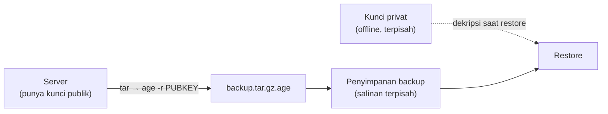

# Enkripsi Backup, Penghapusan Aman, dan Retensi

!!! info "Identitas chapter"
    **ID:** `CH-10-03-04` · **Kategori/modul:** CAT-10 / MOD-10-03 (Deteksi, Koreksi, dan Pemeliharaan) · **Estimasi:** 90 menit · **Lingkungan:** lab lokal (VM) · [Lihat chapter ini di dashboard](../../../#CH-10-03-04)

!!! warning "Peringatan"
    Kunci enkripsi yang hilang membuat backup tidak dapat dipulihkan selamanya. Simpan kunci privat terpisah dari backup dan uji dekripsi sebelum bergantung padanya. Belum dijalankan penulis pada VM (`verified_on: null`).

## 1. Ringkasan

Backup berisi seluruh email dan kunci; jika bocor, dampaknya sama dengan kebocoran server. Anda mengenkripsi backup dengan `age` (alternatif: `gpg`), mengelola kunci, serta menetapkan retensi dan penghapusan data.

## 2. Tujuan Pembelajaran

1. Mengenkripsi dan mendekripsi backup dengan kunci publik/privat.
2. Mengelola kunci: pembuatan, penyimpanan terpisah, dan rotasi.
3. Menetapkan kebijakan retensi dan penghapusan aman.

## 3. Prasyarat

- `CH-10-03-03` — Manajemen Patch dan Penilaian Kerentanan.
- Memahami izin berkas dan secrets (`CH-10-01-03`).

## 4. Materi Teori

### 4.1 Prinsip

Enkripsi dengan **kunci publik** memungkinkan server membuat backup terenkripsi tanpa menyimpan kunci pembuka. Kunci privat disimpan terpisah (offline atau pengelola rahasia), sehingga pencurian backup atau server tidak membuka isinya.



### 4.2 Retensi dan penghapusan

Simpan backup sesuai kebijakan (mis. harian 7, mingguan 4, bulanan 6; contoh ilustratif). Hapus yang kedaluwarsa. Pada SSD, sistem berkas modern, dan penyimpanan cloud, penimpaan (`shred`) tidak menjamin penghapusan; andalkan enkripsi dan hapus kunci (*crypto-erase*) bila kebutuhan penghapusan ketat.

### 4.3 Pilihan alat

`age` sederhana dan modern; `gpg` lebih luas fiturnya. Pilih satu, dokumentasikan, dan latih pemulihannya.

## 5. Praktik dan Implementasi

1. Pasang `age`.
2. Buat pasangan kunci di mesin **terpisah**, bukan server.
3. Salin hanya kunci publik ke server.
4. Enkripsi contoh backup dan uji dekripsi di mesin lain.
5. Tulis kebijakan retensi.

## 6. Perintah Linux

```bash title="Pembuatan kunci (di mesin terpisah)"
sudo apt install age
age-keygen -o kunci-backup.txt
```

Perintah mencetak kunci publik (diawali `age1...`); simpan `kunci-backup.txt` (privat) secara aman dan terpisah. Jangan taruh di server atau repositori.

```bash title="Enkripsi dan dekripsi (contoh dengan data uji)"
tar -czf - /etc/postfix | age -r age1<KUNCI-PUBLIK-ANDA> -o postfix-config.tar.gz.age
age -d -i kunci-backup.txt postfix-config.tar.gz.age | tar -tzf - | head
```

Ganti `age1<KUNCI-PUBLIK-ANDA>` dengan kunci publik nyata Anda. Hasil yang diharapkan: daftar berkas arsip. Pada backup nyata, sertakan hanya yang dibutuhkan dan lindungi arsip hasil.

## 7. Konfigurasi

Tidak ada konfigurasi layanan. Kebijakan tertulis (contoh isi): lokasi kunci publik di server (`/etc/backup/age-recipient.txt`, dapat dibaca), lokasi kunci privat (di luar server), jadwal rotasi kunci, dan retensi.

## 8. Verifikasi

- Dekripsi berhasil di mesin yang memiliki kunci privat dan gagal tanpanya.
- Isi arsip sesuai (`tar -t`).
- Kunci privat tidak ada di server atau repositori (`sudo find / -name 'kunci-backup*' 2>/dev/null` tidak menemukan apa pun di server).

## 9. Troubleshooting

| Gejala | Kemungkinan penyebab | Tindakan |
|---|---|---|
| Dekripsi gagal | Kunci salah / rusak | Pastikan pasangan kunci yang benar |
| Backup tak dapat dipulihkan | Kunci privat hilang | Kunci cadangan terpisah; uji restore berkala |
| Arsip tidak terenkripsi tersimpan | Skrip salah | Audit hasil, hapus aman |
| Retensi tidak berjalan | Skrip tak dijadwalkan | Jadwalkan (`CH-11-02-02`) |

## 10. Security Review

- Kunci privat di server yang sama dengan backup meniadakan enkripsi.
- Rotasi kunci memerlukan re-enkripsi backup lama atau tetap menyimpan kunci lama.
- Hapus arsip sementara tak terenkripsi; hindari menulis plaintext ke disk bila memungkinkan (gunakan pipa).

## 11. Latihan

1. Enkripsi dan dekripsi satu direktori uji di dua mesin.
2. Tulis kebijakan retensi dan penghapusan.
3. Simulasikan kehilangan kunci dan jelaskan dampak serta rencananya.

## 12. Assessment

1. Mengapa kunci privat tidak ditaruh di server?
2. Apa beda kunci publik dan privat pada enkripsi backup?
3. Mengapa `shred` tidak cukup?

**Kunci singkat.** (1) Pencurian server akan membuka backup. (2) Publik mengenkripsi, privat mendekripsi. (3) Tidak menjamin pada SSD/cloud.

## 13. Checklist Kelulusan

- [ ] Enkripsi dan dekripsi diuji pada mesin terpisah.
- [ ] Kunci privat tersimpan terpisah dan terdokumentasi lokasinya (bukan isinya).
- [ ] Kebijakan retensi tertulis.

!!! note "Status belajar"
    Ubah status chapter secara manual di dashboard. Menyelesaikan checklist ini tidak mengubah status otomatis.

## 14. Referensi Resmi

- [age: README](https://github.com/FiloSottile/age)
- [GnuPG: Dokumentasi](https://gnupg.org/documentation/)
- [NIST SP 800-88 Rev. 1 — Media Sanitization](https://csrc.nist.gov/pubs/sp/800/88/r1/final)

Tautan referensi tidak diverifikasi otomatis pada build ini; periksa ketersediaannya sebelum dipakai.

---

[Kembali ke dashboard kurikulum](../../../#CH-10-03-04){ .md-button }
