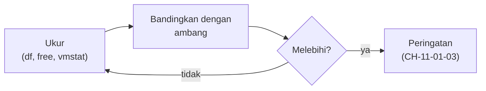

# Monitoring Sumber Daya, Disk, dan Inode

!!! info "Identitas chapter"
    **ID:** `CH-11-01-01` · **Kategori/modul:** CAT-11 / MOD-11-01 (Monitoring dan Alerting) · **Estimasi:** 90 menit · **Lingkungan:** lab lokal (VM) · [Lihat chapter ini di dashboard](../../../#CH-11-01-01)

!!! note "Status verifikasi"
    Isi chapter ini ditulis dari dokumentasi resmi dan belum dijalankan penulis pada VM (`verified_on: null`).

## 1. Ringkasan

Mail server jarang mati tiba-tiba; ia lebih sering melambat karena disk atau inode habis, memori kurang, atau CPU jenuh. Anda memantau sumber daya inti, memahami arti metriknya, dan menetapkan ambang peringatan awal.

## 2. Tujuan Pembelajaran

1. Membaca penggunaan CPU, memori, disk, dan inode dengan alat standar.
2. Mengenali tanda masalah: swap, load tinggi, inode habis.
3. Menetapkan ambang peringatan dan kritis berbasis data.

## 3. Prasyarat

- `CH-10-03-04` — Enkripsi Backup, Penghapusan Aman, dan Retensi.
- Memahami proses dan log (`CH-02-02-02`); layanan email aktif.

## 4. Materi Teori

### 4.1 Sumber daya dan dampaknya pada email

| Sumber daya | Gejala saat habis | Alat |
|---|---|---|
| Disk | Pesan ditolak/ditunda, Dovecot gagal menulis | `df -h` |
| Inode | "No space left" walau disk lega (Maildir = banyak berkas kecil) | `df -i` |
| Memori | Proses dimatikan (OOM), swap berlebihan | `free -h`, `vmstat` |
| CPU | Antrean tumbuh, filter lambat | `uptime`, `vmstat` |



### 4.2 Ambang

Ambang awal ilustratif: peringatan pada disk/inode 80%, kritis 90%; memori tersedia di bawah 15%; load rata-rata melebihi jumlah inti selama beberapa menit. Sesuaikan setelah Anda memiliki data dasar.

### 4.3 Maildir dan inode

Setiap pesan adalah satu berkas; ribuan pesan kecil menghabiskan inode lebih dulu daripada ruang disk. Pantau keduanya.

## 5. Praktik dan Implementasi

1. Rekam kondisi normal selama beberapa hari.
2. Tetapkan ambang dari data itu.
3. Tulis skrip pemeriksaan sederhana.
4. Latih kondisi penuh pada berkas uji di partisi lab.

## 6. Perintah Linux

```bash title="Pemeriksaan standar"
df -h /var /var/vmail
df -i /var /var/vmail
free -h
vmstat 1 5
uptime
nproc
```

`vmstat 1 5` mengambil lima sampel per detik; perhatikan kolom `si/so` (swap) dan `wa` (menunggu I/O). Keluaran bergantung pada server.

```bash title="Mencari kejadian OOM dan galat"
sudo journalctl -k --since "7 days ago" --no-pager | grep -i 'out of memory' | tail -3
sudo journalctl -p err --since "1 day ago" --no-pager | tail -10
```

## 7. Konfigurasi

Tidak ada konfigurasi layanan. Catat ambang pada dokumen operasional, mis.:

```text title="Contoh tabel ambang (ilustratif)"
disk /var/vmail   : warn 80%  crit 90%
inode /var/vmail  : warn 80%  crit 90%
memori tersedia   : warn <15% crit <8%
load (5 menit)    : warn > nproc  crit > 2 x nproc
```

## 8. Verifikasi

- Anda dapat menjelaskan nilai setiap kolom pada keluaran `free` dan `vmstat`.
- Ambang tertulis disertai alasan dan dasar data.
- Pemeriksaan berjalan tanpa error dan dapat dijadwalkan (`CH-11-02-02`).

## 9. Troubleshooting

| Gejala | Kemungkinan penyebab | Tindakan |
|---|---|---|
| Disk penuh tiba-tiba | Log/antrean membesar | `du -xh /var --max-depth=2` (urutkan dengan `sort -h`), periksa `mailq` |
| Inode habis | Banyak berkas kecil | Bersihkan, pindahkan, perbesar |
| Swap tinggi | Memori kurang / Rspamd/ClamAV | Tambah RAM, turunkan pemakaian |
| OOM menghentikan layanan | Memori habis | Tambah RAM, batasi proses |

## 10. Security Review

- Lonjakan sumber daya bisa merupakan tanda serangan atau penyalahgunaan.
- Jangan menjalankan alat diagnosis dari sumber tidak resmi dengan hak root.
- Metrik dapat membocorkan struktur sistem; batasi aksesnya.

## 11. Latihan

1. Buat tabel dasar (rata-rata dan puncak) selama tiga hari.
2. Hitung berapa lama disk penuh pada laju pertumbuhan saat ini.
3. Jelaskan mengapa inode perlu dipantau pada Maildir.

## 12. Assessment

1. Mengapa `df -i` penting?
2. Apa arti `wa` yang tinggi pada `vmstat`?
3. Bagaimana menetapkan ambang?

**Kunci singkat.** (1) Maildir menghabiskan inode. (2) CPU menunggu I/O. (3) Dari data dasar, bukan tebakan.

## 13. Checklist Kelulusan

- [ ] Pemeriksaan sumber daya dijalankan dan dipahami.
- [ ] Ambang berdasarkan data tertulis.

!!! note "Status belajar"
    Ubah status chapter secara manual di dashboard. Menyelesaikan checklist ini tidak mengubah status otomatis.

## 14. Referensi Resmi

- [Ubuntu Server: Monitoring](https://documentation.ubuntu.com/server/)
- [procps: vmstat(8)](https://man7.org/linux/man-pages/man8/vmstat.8.html)
- [coreutils: df](https://www.gnu.org/software/coreutils/manual/html_node/df-invocation.html)
- [kernel.org: Documentation OOM](https://docs.kernel.org/admin-guide/mm/concepts.html)

Tautan referensi tidak diverifikasi otomatis pada build ini; periksa ketersediaannya sebelum dipakai.

---

[Kembali ke dashboard kurikulum](../../../#CH-11-01-01){ .md-button }
