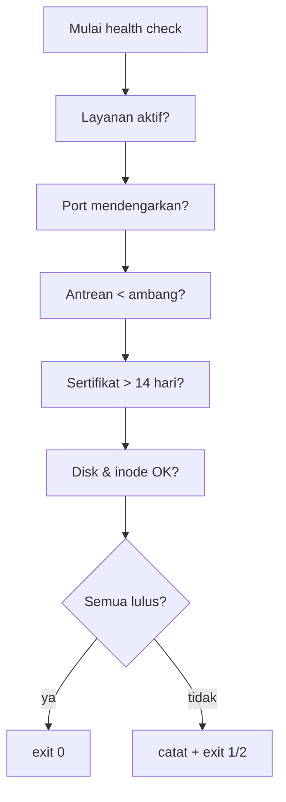

# Health Check Service, Antrian, dan Sertifikat

!!! info "Identitas chapter"
    **ID:** `CH-11-01-02` · **Kategori/modul:** CAT-11 / MOD-11-01 (Monitoring dan Alerting) · **Estimasi:** 120 menit · **Lingkungan:** lab lokal (VM) · [Lihat chapter ini di dashboard](../../../#CH-11-01-02)

!!! note "Status verifikasi"
    Isi chapter ini ditulis dari dokumentasi resmi dan belum dijalankan penulis pada VM (`verified_on: null`).

## 1. Ringkasan

Health check memeriksa bahwa layanan benar-benar bekerja, bukan sekadar berjalan. Anda membuat skrip yang memeriksa status service, port, antrean, dan masa berlaku sertifikat dengan kode keluar yang jelas.

## 2. Tujuan Pembelajaran

1. Memeriksa status layanan dan port yang mendengarkan.
2. Memantau ukuran antrean Postfix dengan `postqueue -j`.
3. Memeriksa kedaluwarsa sertifikat.
4. Menggabungkan semuanya dalam skrip dengan kode keluar bermakna.

## 3. Prasyarat

- `CH-11-01-01` — Monitoring Sumber Daya, Disk, dan Inode.
- `CH-11-01-01`; Bash dasar (`CH-02-01-05`).

## 4. Materi Teori

### 4.1 Tingkatan pemeriksaan

| Tingkat | Contoh | Menangkap |
|---|---|---|
| Proses | `systemctl is-active` | Layanan mati |
| Port | Koneksi ke 25/587/993 | Layanan hidup tapi tak menerima |
| Fungsional | Percakapan SMTP/IMAP sederhana | Layanan menerima tapi rusak |
| Dependensi | Sertifikat, DNS, disk | Penyebab tersembunyi |



### 4.2 Kode keluar

Konvensi umum: 0 = OK, 1 = peringatan, 2 = kritis. Skrip yang menjadwalkan dan memberi alert (`CH-11-01-03`) memakai kode itu.

## 5. Praktik dan Implementasi

1. Tulis skrip pemeriksaan dengan fungsi per pemeriksaan.
2. Uji pada kondisi sehat.
3. Sengaja hentikan satu layanan di lab dan lihat kode keluar.
4. Jadwalkan di chapter berikutnya.

## 6. Perintah Linux

```bash title="Pemeriksaan manual"
systemctl is-active postfix dovecot rspamd opendkim
sudo ss -tlnp | grep -E ':(25|465|587|993)\b'
postqueue -j | wc -l
openssl x509 -in /etc/letsencrypt/live/mail.example.com/fullchain.pem -noout -enddate
```

`systemctl is-active postfix` pada Ubuntu 24.04 dapat melaporkan unit `postfix` (pembungkus) berstatus `active`; unit instans `postfix@-` yang menjalankan daemon dapat diperiksa terpisah.

## 7. Konfigurasi

```bash title="/usr/local/sbin/mail-healthcheck.sh"
#!/usr/bin/env bash
set -euo pipefail
rc=0
for u in postfix dovecot; do
  systemctl is-active --quiet "$u" || { echo "KRITIS: $u tidak aktif"; rc=2; }
done
for p in 25 587 993; do
  ss -tln | grep -q ":$p " || { echo "KRITIS: port $p tidak mendengarkan"; rc=2; }
done
q=$(postqueue -j | wc -l)
[ "$q" -gt 200 ] && { echo "PERINGATAN: antrean $q"; [ $rc -lt 1 ] && rc=1; }
cert=/etc/letsencrypt/live/mail.example.com/fullchain.pem
openssl x509 -in "$cert" -noout -checkend $((14*24*3600)) >/dev/null || { echo "PERINGATAN: sertifikat < 14 hari"; [ $rc -lt 1 ] && rc=1; }
[ $rc -eq 0 ] && echo "OK"
exit $rc
```

- Ambang 200 pesan dan 14 hari hanyalah contoh.
- Skrip perlu hak membaca sertifikat sehingga dijalankan sebagai root lewat timer.
- Instal lewat `sudo install -m 0750 -o root -g root`.

## 8. Verifikasi

```bash title="Verifikasi"
sudo /usr/local/sbin/mail-healthcheck.sh; echo "exit=$?"
sudo systemctl stop dovecot; sudo /usr/local/sbin/mail-healthcheck.sh; echo "exit=$?"; sudo systemctl start dovecot
```

Hasil yang diharapkan: `OK` dan `exit=0` saat sehat; pesan `KRITIS` dan `exit=2` saat Dovecot dihentikan. Jalankan hanya di VM lab.

## 9. Troubleshooting

| Gejala | Kemungkinan penyebab | Tindakan |
|---|---|---|
| `postqueue -j` menghasilkan galat | Postfix tidak aktif | Periksa layanan |
| `exit` selalu 0 | Skrip tidak menaikkan `rc` | Periksa logika |
| `ss` tidak cocok | Format `ss` | Sesuaikan pola |
| Skrip gagal membaca sertifikat | Izin | Jalankan sebagai root |

## 10. Security Review

- Skrip berjalan sebagai root: izin `0750`, pemilik root, tidak dapat ditulis pengguna lain.
- Jangan menaruh kata sandi atau token di skrip.
- Pemeriksaan jangan mengirim email nyata ke pihak luar tanpa izin.

## 11. Latihan

1. Tambahkan pemeriksaan disk/inode dari `CH-11-01-01`.
2. Tambahkan percakapan SMTP sederhana ke `127.0.0.1:25` (`nc`).
3. Ubah ambang menjadi variabel di bagian atas skrip.

## 12. Assessment

1. Mengapa port dan fungsional perlu selain `is-active`?
2. Apa arti kode keluar 2?
3. Mengapa skrip dijalankan sebagai root?

**Kunci singkat.** (1) Layanan bisa aktif tetapi tidak menerima. (2) Kritis. (3) Perlu membaca sertifikat/antrean.

## 13. Checklist Kelulusan

- [ ] Skrip health check dibuat dan diuji pada kondisi sehat dan gagal.
- [ ] Kode keluar terdokumentasi.

!!! note "Status belajar"
    Ubah status chapter secara manual di dashboard. Menyelesaikan checklist ini tidak mengubah status otomatis.

## 14. Referensi Resmi

- [systemd: systemctl(1)](https://www.freedesktop.org/software/systemd/man/latest/systemctl.html)
- [Postfix: postqueue(1)](https://www.postfix.org/postqueue.1.html)
- [OpenSSL: x509](https://docs.openssl.org/3.0/man1/openssl-x509/)

Tautan referensi tidak diverifikasi otomatis pada build ini; periksa ketersediaannya sebelum dipakai.

---

[Kembali ke dashboard kurikulum](../../../#CH-11-01-02){ .md-button }
