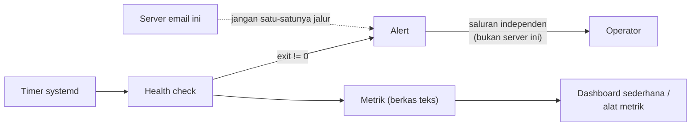

# Alerting, Metrik, dan Dashboard

!!! info "Identitas chapter"
    **ID:** `CH-11-01-03` · **Kategori/modul:** CAT-11 / MOD-11-01 (Monitoring dan Alerting) · **Estimasi:** 150 menit · **Lingkungan:** lab lokal (VM) · [Lihat chapter ini di dashboard](../../../#CH-11-01-03)

!!! warning "Peringatan"
    Peringatan yang dikirim lewat server email yang sedang dipantau gagal justru saat server bermasalah. Gunakan saluran peringatan yang independen dan uji jalur peringatan. Belum dijalankan penulis pada VM (`verified_on: null`).

## 1. Ringkasan

Pemeriksaan tanpa peringatan tidak ada gunanya. Anda mengirim alert saat kegagalan, menghindari ketergantungan melingkar, membatasi kebisingan, dan membuat dashboard metrik sederhana dari berkas teks.

## 2. Tujuan Pembelajaran

1. Mengirim alert dari skrip health check lewat saluran independen.
2. Membuat metrik sederhana dan membacanya.
3. Menghindari alert palsu dan kelelahan alert.

## 3. Prasyarat

- `CH-11-01-02` — Health Check Service, Antrian, dan Sertifikat.
- Skrip health check (`CH-11-01-02`).

## 4. Materi Teori

### 4.1 Jalur peringatan



### 4.2 Prinsip

- **Independen:** peringatan tidak boleh hanya bergantung pada server email yang dipantau; gunakan layanan eksternal atau akun email di penyedia lain, sesuai kebijakan Anda.
- **Actionable:** setiap alert punya tindakan jelas.
- **Deduplikasi:** hindari mengirim berulang untuk kondisi sama.
- **Heartbeat:** sinyal "masih hidup" berkala, sehingga diam dapat dikenali sebagai masalah.

### 4.3 Metrik

Alat metrik (mis. Prometheus dengan node exporter, atau alat lain) dipilih saat implementasi sesuai skala. Untuk belajar, tulis metrik ke berkas teks sederhana dan tampilkan ringkasannya.

## 5. Praktik dan Implementasi

1. Tentukan saluran peringatan independen.
2. Tambahkan pengiriman alert pada skrip dengan pembatas laju.
3. Tulis metrik ke berkas.
4. Uji dengan kegagalan terkontrol.

## 6. Perintah Linux

```bash title="Mengirim pesan alert sederhana (contoh; sesuaikan saluran)"
echo "Health check KRITIS di $(hostname) $(date -Is)" | mail -s "ALERT mail server" alert@contoh-penyedia-lain.invalid
```

Alamat `.invalid` adalah placeholder; ganti dengan alamat di penyedia **lain** milik Anda. Pasang `mailutils` bila perintah `mail` belum ada. Alternatif yang tidak bergantung email: webhook ke layanan chat yang Anda kelola (jangan tulis token di skrip; baca dari berkas 0600).

```bash title="Membaca metrik"
cat /var/lib/mail-metrics/health.prom
sort -t= -k1 /var/lib/mail-metrics/health.prom
```

## 7. Konfigurasi

```bash title="Potongan skrip: metrik dan deduplikasi alert"
set -euo pipefail
dir=/var/lib/mail-metrics; mkdir -p "$dir"
out="$dir/health.prom"
{
  echo "mail_queue_length=$(postqueue -j | wc -l)"
  echo "mail_disk_used_pct=$(df --output=pcent /var/vmail | tail -1 | tr -dc 0-9)"
  echo "mail_check_timestamp=$(date +%s)"
} > "$out.tmp" && mv "$out.tmp" "$out"
state=/var/lib/mail-metrics/last_alert
if [ "$rc" -ge 2 ] && [ ! -f "$state" -o $(( $(date +%s) - $(stat -c %Y "$state") )) -gt 3600 ]; then
  echo "KRITIS: $(hostname)" | mail -s "ALERT mail server" alert@contoh-penyedia-lain.invalid
  touch "$state"
fi
```

- Variabel `rc` berasal dari skrip health check di `CH-11-01-02`.
- Format `nama=nilai` di atas adalah format sederhana buatan sendiri, bukan format Prometheus; bila Anda memakai Prometheus, ikuti format teks eksposisinya.
- Satu alert per jam adalah contoh pembatas laju.

## 8. Verifikasi

- Menghentikan satu layanan di lab memicu tepat satu alert dalam jam itu.
- Pemulihan layanan menghentikan alert baru.
- Metrik terisi dan timestamp terbarui.

## 9. Troubleshooting

| Gejala | Kemungkinan penyebab | Tindakan |
|---|---|---|
| Alert tidak tiba | Jalur bergantung server mati / salah alamat | Gunakan saluran independen, uji |
| Alert berulang | Tidak ada deduplikasi | Tambah state/waktu |
| Metrik kosong | Izin/lokasi | Periksa direktori dan izin |
| Banyak alert tak penting | Ambang terlalu rendah | Sesuaikan, hapus yang tak actionable |

## 10. Security Review

- Token webhook/akun alert adalah rahasia: izin ketat, jangan di repositori.
- Alert dapat membocorkan informasi sistem; kirim ke penerima terbatas.
- Peringatan palsu atau diblokir adalah titik buta; uji jalurnya berkala.

## 11. Latihan

1. Uji jalur alert dengan menghentikan layanan di lab.
2. Tambahkan heartbeat harian.
3. Tulis tabel alert: kondisi, tingkat, tindakan, pemilik.

## 12. Assessment

1. Mengapa alert tidak boleh hanya lewat server yang dipantau?
2. Apa itu heartbeat?
3. Mengapa deduplikasi?

**Kunci singkat.** (1) Gagal saat paling dibutuhkan. (2) Sinyal hidup berkala. (3) Hindari kelelahan alert.

## 13. Checklist Kelulusan

- [ ] Alert terkirim lewat saluran independen pada uji kegagalan.
- [ ] Metrik tertulis dan terbaca.
- [ ] Tabel alert dengan pemilik tertulis.

!!! note "Status belajar"
    Ubah status chapter secara manual di dashboard. Menyelesaikan checklist ini tidak mengubah status otomatis.

## 14. Referensi Resmi

- [systemd: systemd.timer(5)](https://www.freedesktop.org/software/systemd/man/latest/systemd.timer.html)
- [Prometheus: Dokumentasi](https://prometheus.io/docs/introduction/overview/)
- [Google SRE Book: Monitoring Distributed Systems](https://sre.google/sre-book/monitoring-distributed-systems/)

Tautan referensi tidak diverifikasi otomatis pada build ini; periksa ketersediaannya sebelum dipakai.

---

[Kembali ke dashboard kurikulum](../../../#CH-11-01-03){ .md-button }
