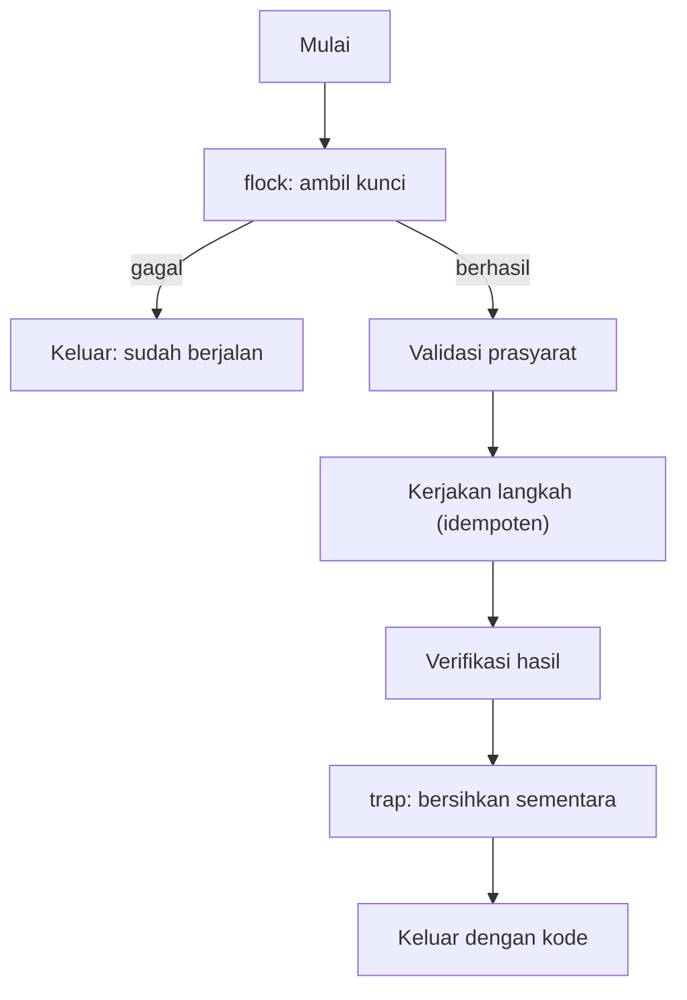

# Otomasi dengan Bash yang Aman

!!! info "Identitas chapter"
    **ID:** `CH-11-02-01` · **Kategori/modul:** CAT-11 / MOD-11-02 (Otomasi) · **Estimasi:** 120 menit · **Lingkungan:** lab lokal (VM) · [Lihat chapter ini di dashboard](../../../#CH-11-02-01)

!!! note "Status verifikasi"
    Isi chapter ini ditulis dari dokumentasi resmi dan belum dijalankan penulis pada VM (`verified_on: null`).

## 1. Ringkasan

Skrip operasi menjalankan perintah berhak tinggi secara berulang; kesalahan kecil menjadi dampak besar. Anda menulis Bash yang aman: berhenti saat galat, idempoten, terkunci dari eksekusi ganda, dan bebas rahasia tertanam.

## 2. Tujuan Pembelajaran

1. Menulis skrip dengan `set -euo pipefail`, kutipan variabel, dan `trap`.
2. Membuat skrip idempoten dan mencegah eksekusi ganda dengan `flock`.
3. Menganalisis skrip dengan `shellcheck`.
4. Menghindari secrets di skrip.

## 3. Prasyarat

- `CH-11-01-03` — Alerting, Metrik, dan Dashboard.
- Dasar shell scripting (`CH-02-01-05`).

## 4. Materi Teori

### 4.1 Praktik inti

| Praktik | Alasan |
|---|---|
| `set -euo pipefail` | Berhenti pada galat, variabel tak terdefinisi, kegagalan pipa |
| Kutip `"$var"` | Hindari pemisahan kata dan globbing |
| `mktemp` + `trap` | Bersihkan berkas sementara |
| `flock` | Cegah dua instans berjalan bersamaan |
| Fungsi kecil, log jelas | Mudah ditinjau dan di-debug |
| Tanpa rahasia di skrip | Skrip sering masuk Git atau cadangan |

### 4.2 Idempoten

Skrip idempoten aman dijalankan berulang: hasil akhir sama. Contoh: `mkdir -p`, `install -d`, `ln -sfn`. Hindari tambah-baris-ke-berkas tanpa memeriksa apakah sudah ada.



### 4.3 Analisis statis
`shellcheck` menemukan pola rawan (variabel tak dikutip, kondisi keliru). Jalankan sebelum memasang skrip.

## 5. Praktik dan Implementasi

1. Tulis kerangka skrip standar.
2. Analisis dengan `shellcheck`.
3. Uji idempotensi dengan menjalankan dua kali.
4. Uji penguncian dengan dua eksekusi paralel.

## 6. Perintah Linux

```bash title="Memasang dan menganalisis"
sudo apt install shellcheck
shellcheck /usr/local/sbin/mail-healthcheck.sh
bash -n /usr/local/sbin/mail-healthcheck.sh
```

`bash -n` hanya memeriksa sintaks; `shellcheck` memberi saran kualitas. Peringatan `shellcheck` perlu dipahami dan diperbaiki atau diberi alasan eksplisit.

## 7. Konfigurasi

```bash title="Kerangka skrip operasi (contoh)"
#!/usr/bin/env bash
set -euo pipefail

LOCK=/run/lock/contoh-tugas.lock
exec 9>"$LOCK"
flock -n 9 || { echo "sudah berjalan" >&2; exit 0; }

tmp=$(mktemp -d)
trap 'rm -rf "$tmp"' EXIT

log() { logger -t contoh-tugas "$*"; }

main() {
  install -d -m 0750 /var/lib/contoh-tugas
  log "mulai"
  # ... langkah idempoten ...
  log "selesai"
}
main "$@"
```

- Rahasia (token, kata sandi) dibaca dari berkas berizin 0600, bukan ditulis di skrip atau argumen.
- Jangan menjalankan `rm -rf` dengan variabel yang mungkin kosong tanpa pelindung (`${var:?}`).

## 8. Verifikasi

- `shellcheck` bersih atau terdokumentasi.
- Menjalankan skrip dua kali menghasilkan keadaan sama.
- Eksekusi kedua saat yang pertama berjalan keluar dengan pesan "sudah berjalan".

## 9. Troubleshooting

| Gejala | Kemungkinan penyebab | Tindakan |
|---|---|---|
| Skrip berhenti tak terduga | `set -e` + perintah gagal diharapkan | Tangani dengan `||` yang disengaja |
| Variabel tak terdefinisi | Salah nama | `set -u` menangkap; perbaiki |
| Lock macet | Berkas kunci salah | Gunakan `flock` pada deskriptor, bukan sekadar berkas |
| Perintah berbahaya dengan variabel kosong | Tanpa pelindung | `${var:?pesan}` |

## 10. Security Review

- Skrip berhak root: izin 0750, pemilik root.
- Hati-hati dengan input yang masuk ke perintah (injeksi); kutip dan validasi.
- Riwayat dan `ps` memperlihatkan argumen; jangan taruh rahasia di sana.

## 11. Latihan

1. Ubah skrip health check sesuai kerangka ini.
2. Tulis uji idempotensi dan penguncian.
3. Periksa skrip dengan `shellcheck` dan jelaskan satu temuan.

## 12. Assessment

1. Apa fungsi `set -euo pipefail`?
2. Apa itu idempoten dan mengapa penting?
3. Mengapa menghindari rahasia di argumen?

**Kunci singkat.** (1) Berhenti pada galat/variabel/pipa. (2) Aman diulang. (3) Terlihat pada daftar proses/riwayat.

## 13. Checklist Kelulusan

- [ ] Skrip memakai pola aman dan lolos `shellcheck`.
- [ ] Idempotensi dan penguncian diuji.

!!! note "Status belajar"
    Ubah status chapter secara manual di dashboard. Menyelesaikan checklist ini tidak mengubah status otomatis.

## 14. Referensi Resmi

- [GNU Bash Reference Manual](https://www.gnu.org/software/bash/manual/bash.html)
- [ShellCheck](https://www.shellcheck.net/)
- [util-linux: flock(1)](https://man7.org/linux/man-pages/man1/flock.1.html)

Tautan referensi tidak diverifikasi otomatis pada build ini; periksa ketersediaannya sebelum dipakai.

---

[Kembali ke dashboard kurikulum](../../../#CH-11-02-01){ .md-button }
