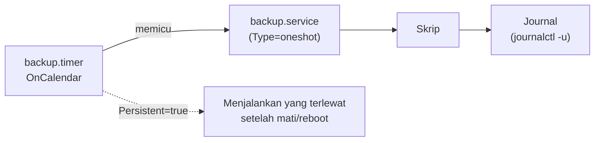

# Scheduled Jobs: systemd Timer dan Cron

!!! info "Identitas chapter"
    **ID:** `CH-11-02-02` · **Kategori/modul:** CAT-11 / MOD-11-02 (Otomasi) · **Estimasi:** 90 menit · **Lingkungan:** lab lokal (VM) · [Lihat chapter ini di dashboard](../../../#CH-11-02-02)

!!! note "Status verifikasi"
    Isi chapter ini ditulis dari dokumentasi resmi dan belum dijalankan penulis pada VM (`verified_on: null`).

## 1. Ringkasan

Tugas rutin (health check, backup, rotasi, pembaruan) harus dijalankan otomatis. Anda menjadwalkan tugas dengan systemd timer dan membandingkannya dengan cron.

## 2. Tujuan Pembelajaran

1. Membuat pasangan unit `.service` dan `.timer`.
2. Memeriksa jadwal dengan `systemd-analyze calendar` dan `systemctl list-timers`.
3. Membandingkan timer dan cron untuk memilih alat yang tepat.

## 3. Prasyarat

- `CH-11-02-01` — Otomasi dengan Bash yang Aman.
- Skrip operasi (`CH-11-02-01`).

## 4. Materi Teori

### 4.1 Timer vs cron

| Aspek | systemd timer | cron |
|---|---|---|
| Log | Journal per unit | Email/syslog |
| Menangkap jadwal terlewat | `Persistent=true` | Tidak (kecuali anacron) |
| Ketergantungan | Dapat bergantung pada unit lain | Tidak |
| Sandbox/hak | Opsi systemd per unit | Terbatas |
| Kesederhanaan | Dua berkas | Satu baris |



### 4.2 Pemilihan

Gunakan timer untuk tugas di server modern karena pencatatan dan penanganan jadwal terlewat. Cron wajar untuk tugas sederhana atau lingkungan yang sudah terbiasa.

## 5. Praktik dan Implementasi

1. Buat service oneshot untuk health check.
2. Buat timer tiap 5 menit.
3. Aktifkan dan periksa.
4. Bandingkan dengan satu baris cron setara.

## 6. Perintah Linux

```bash title="Memeriksa dan mengaktifkan"
systemd-analyze calendar '*:0/5'
sudo systemctl daemon-reload
sudo systemctl enable --now mail-healthcheck.timer
systemctl list-timers mail-healthcheck.timer
sudo journalctl -u mail-healthcheck.service --since "15 min ago" --no-pager
```

`systemd-analyze calendar` menampilkan kapan ekspresi berikutnya berjalan, jadi Anda memvalidasi jadwal sebelum mengaktifkan.

## 7. Konfigurasi

```text title="/etc/systemd/system/mail-healthcheck.service"
[Unit]
Description=Health check mail server

[Service]
Type=oneshot
ExecStart=/usr/local/sbin/mail-healthcheck.sh
```

```text title="/etc/systemd/system/mail-healthcheck.timer"
[Unit]
Description=Jadwal health check mail server

[Timer]
OnCalendar=*:0/5
Persistent=true
RandomizedDelaySec=30

[Install]
WantedBy=timers.target
```

```text title="Padanan cron (/etc/cron.d/mail-healthcheck)"
*/5 * * * * root /usr/local/sbin/mail-healthcheck.sh
```

- Jangan mengaktifkan timer **dan** cron untuk tugas yang sama.
- `RandomizedDelaySec` menyebarkan beban bila banyak server memakai jadwal sama.
- Service `oneshot` dengan kode keluar bukan 0 ditandai gagal; manfaatkan ini untuk alert.

## 8. Verifikasi

- `list-timers` menampilkan `NEXT` dan `LAST` yang masuk akal.
- Journal menunjukkan eksekusi berkala.
- Setelah mematikan VM sebentar, `Persistent=true` menjalankan tugas terlewat.

## 9. Troubleshooting

| Gejala | Kemungkinan penyebab | Tindakan |
|---|---|---|
| Timer tidak berjalan | Belum `enable --now` | Aktifkan, `daemon-reload` |
| Jadwal salah | Ekspresi keliru | Uji dengan `systemd-analyze calendar` |
| Service gagal | Skrip error | `journalctl -u ...` |
| Eksekusi ganda | Timer dan cron aktif | Pilih salah satu |

## 10. Security Review

- Service berjalan sebagai root secara bawaan; tambahkan `User=` bila tidak perlu root.
- Pertimbangkan opsi sandbox (`ProtectSystem=`, `PrivateTmp=`) setelah menguji.
- Berkas unit berizin 0644 milik root.

## 11. Latihan

1. Jadwalkan skrip pembersihan harian pukul 03:00.
2. Bandingkan log timer dan cron.
3. Uji `Persistent=true` dengan menghentikan timer lalu menyalakannya.

## 12. Assessment

1. Apa fungsi `Persistent=true`?
2. Mengapa memvalidasi dengan `systemd-analyze calendar`?
3. Kapan cron masih wajar?

**Kunci singkat.** (1) Menjalankan jadwal yang terlewat. (2) Memastikan ekspresi benar. (3) Tugas sederhana/legacy.

## 13. Checklist Kelulusan

- [ ] Timer aktif dan terbukti berjalan.
- [ ] Perbandingan timer vs cron tertulis.

!!! note "Status belajar"
    Ubah status chapter secara manual di dashboard. Menyelesaikan checklist ini tidak mengubah status otomatis.

## 14. Referensi Resmi

- [systemd: systemd.timer(5)](https://www.freedesktop.org/software/systemd/man/latest/systemd.timer.html)
- [systemd: systemd.time(7)](https://www.freedesktop.org/software/systemd/man/latest/systemd.time.html)
- [cron(8)](https://man7.org/linux/man-pages/man8/cron.8.html)

Tautan referensi tidak diverifikasi otomatis pada build ini; periksa ketersediaannya sebelum dipakai.

---

[Kembali ke dashboard kurikulum](../../../#CH-11-02-02){ .md-button }
