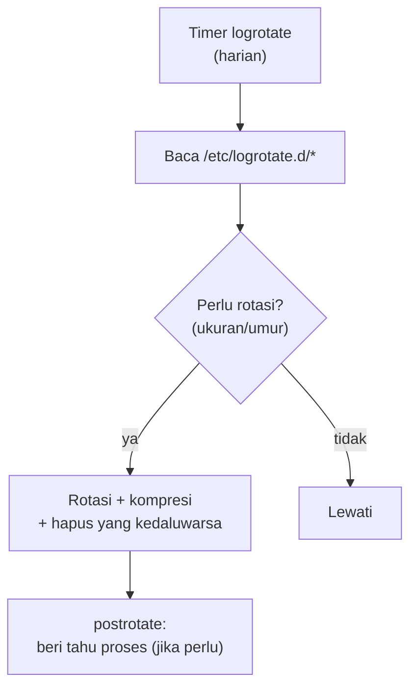

# Log Rotation

!!! info "Identitas chapter"
    **ID:** `CH-11-02-03` · **Kategori/modul:** CAT-11 / MOD-11-02 (Otomasi) · **Estimasi:** 60 menit · **Lingkungan:** lab lokal (VM) · [Lihat chapter ini di dashboard](../../../#CH-11-02-03)

!!! note "Status verifikasi"
    Isi chapter ini ditulis dari dokumentasi resmi dan belum dijalankan penulis pada VM (`verified_on: null`).

## 1. Ringkasan

Log yang tidak dirotasi akan menghabiskan disk. Anda mengonfigurasi `logrotate` untuk log kustom (skrip operasi dan aplikasi), memverifikasi dengan mode uji, dan memahami bahwa log layanan email ada di journal sehingga retensinya diatur di journald.

## 2. Tujuan Pembelajaran

1. Menulis konfigurasi `logrotate` untuk berkas log kustom.
2. Memverifikasi dengan `logrotate -d` sebelum menerapkan.
3. Membedakan yang diurus `logrotate` dan yang diurus `journald`.

## 3. Prasyarat

- `CH-11-02-02` — Scheduled Jobs: systemd Timer dan Cron.
- Retensi jurnal (`CH-10-03-02`); skrip yang menulis log (`CH-11-02-01`).

## 4. Materi Teori

### 4.1 Pembagian tugas

| Log | Dirotasi oleh |
|---|---|
| Journal (Postfix, Dovecot, SSH, systemd) | `journald` (`SystemMaxUse`, `MaxRetentionSec`) |
| `/var/log/nginx/`, `/var/log/roundcube/` | `logrotate` (konfigurasi paket) |
| Log skrip buatan sendiri | `logrotate` (konfigurasi Anda) |



### 4.2 Opsi penting

`daily|weekly`, `rotate N`, `compress`, `delaycompress`, `missingok`, `notifempty`, `create MODE USER GROUP`, `postrotate ... endscript`. `copytruncate` menyalin lalu mengosongkan berkas tanpa memberi sinyal proses, namun berisiko kehilangan baris di antaranya; gunakan hanya bila proses tidak bisa membuka ulang log.

## 5. Praktik dan Implementasi

1. Pastikan skrip menulis ke `/var/log/mail-health.log`.
2. Tulis konfigurasi logrotate.
3. Uji dengan `-d`.
4. Paksa satu rotasi di lab dan periksa hasilnya.

## 6. Perintah Linux

```bash title="Uji dan paksa rotasi"
sudo logrotate -d /etc/logrotate.d/mail-health
sudo logrotate -f /etc/logrotate.d/mail-health
ls -l /var/log/mail-health.log*
systemctl list-timers logrotate.timer
```

`-d` adalah mode debug (tidak mengubah apa pun) dan menampilkan keputusan yang akan diambil; `-f` memaksa rotasi.

## 7. Konfigurasi

```text title="/etc/logrotate.d/mail-health"
/var/log/mail-health.log {
    weekly
    rotate 8
    compress
    delaycompress
    missingok
    notifempty
    create 0640 root adm
}
```

- Skrip yang menulis ke log harus membuka berkas setiap kali (mis. `>>`), bukan menahan deskriptor, supaya aman setelah rotasi.
- Ukuran `rotate 8` dan mingguan hanya contoh; sesuaikan dengan retensi (`CH-10-03-02`).
- Status rotasi tersimpan di `/var/lib/logrotate/status`.

## 8. Verifikasi

- `logrotate -d` tidak menampilkan galat dan memutuskan rotasi sesuai harapan.
- Setelah `-f`, ada berkas `.1` dan berkas baru berizin sesuai.
- Skrip tetap menulis ke berkas baru.

## 9. Troubleshooting

| Gejala | Kemungkinan penyebab | Tindakan |
|---|---|---|
| `error: skipping ... insecure permissions` | Direktori dapat ditulis grup | Perketat izin direktori |
| Log baru tidak dibuat | Tidak ada `create` | Tambahkan `create` |
| Proses menulis ke berkas lama | Deskriptor terbuka | `postrotate` / buka ulang |
| Disk tetap penuh | Log lain / journal | Periksa `journalctl --disk-usage`, `du` |

## 10. Security Review

- Log dapat memuat data pribadi; izin 0640 dan retensi terbatas.
- Konfigurasi logrotate berjalan sebagai root; perhatikan jalur dan wildcard.
- Hapus log lama sesuai kebijakan retensi, bukan menunggu disk penuh.

## 11. Latihan

1. Tulis konfigurasi untuk dua log berbeda.
2. Simulasikan pertumbuhan log dan amati rotasi.
3. Jelaskan kapan memakai `copytruncate`.

## 12. Assessment

1. Mengapa log Postfix tidak dirotasi dengan logrotate?
2. Apa fungsi `-d`?
3. Apa risiko `copytruncate`?

**Kunci singkat.** (1) Ada di journal. (2) Uji tanpa perubahan. (3) Kehilangan baris saat penyalinan.

## 13. Checklist Kelulusan

- [ ] Rotasi log kustom terkonfigurasi dan teruji.
- [ ] Pembagian logrotate vs journald dipahami.

!!! note "Status belajar"
    Ubah status chapter secara manual di dashboard. Menyelesaikan checklist ini tidak mengubah status otomatis.

## 14. Referensi Resmi

- [logrotate(8)](https://man7.org/linux/man-pages/man8/logrotate.8.html)
- [systemd: journald.conf(5)](https://www.freedesktop.org/software/systemd/man/latest/journald.conf.html)

Tautan referensi tidak diverifikasi otomatis pada build ini; periksa ketersediaannya sebelum dipakai.

---

[Kembali ke dashboard kurikulum](../../../#CH-11-02-03){ .md-button }
