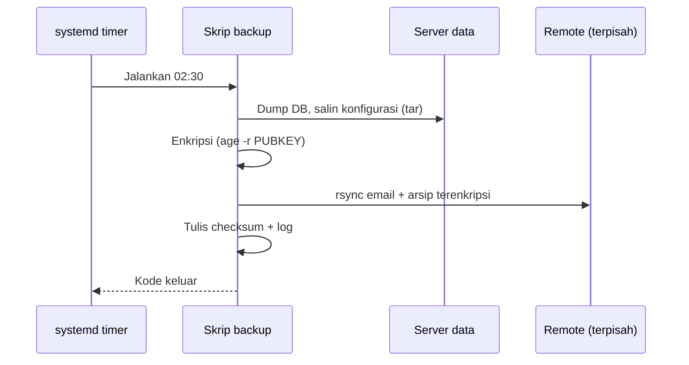

# Strategi dan Otomasi Backup

!!! info "Identitas chapter"
    **ID:** `CH-11-03-01` · **Kategori/modul:** CAT-11 / MOD-11-03 (Backup dan Disaster Recovery) · **Estimasi:** 150 menit · **Lingkungan:** lab lokal (VM) · [Lihat chapter ini di dashboard](../../../#CH-11-03-01)

!!! warning "Peringatan"
    Backup berisi seluruh email, kunci TLS, dan kunci DKIM. Enkripsi sebelum meninggalkan server (`CH-10-03-04`), pisahkan kunci dekripsi, dan jangan pernah menganggap backup valid sebelum diuji restore. Belum dijalankan penulis pada VM (`verified_on: null`).

## 1. Ringkasan

Anda menentukan apa yang perlu di-backup dari mail server, memilih cara menyalin yang konsisten, dan mengotomasi backup terenkripsi dengan salinan di lokasi terpisah.

## 2. Tujuan Pembelajaran

1. Menyusun inventaris data yang di-backup dan frekuensinya.
2. Mengotomasi backup dengan `rsync` dan `tar` terenkripsi.
3. Menerapkan prinsip 3-2-1 secara proporsional.

## 3. Prasyarat

- `CH-11-02-03` — Log Rotation.
- Enkripsi backup (`CH-10-03-04`) dan skrip aman (`CH-11-02-01`).

## 4. Materi Teori

### 4.1 Inventaris

| Data | Lokasi umum | Frekuensi | Catatan |
|---|---|---|---|
| Email | `/var/vmail` | Harian (inkremental) | Terbesar |
| Konfigurasi Postfix/Dovecot | `/etc/postfix`, `/etc/dovecot` | Setiap perubahan + harian | Kecil, kritis |
| Kunci DKIM | `/etc/opendkim` | Harian | Rahasia |
| Sertifikat/kunci TLS | `/etc/letsencrypt` | Harian | Rahasia (dapat diterbitkan ulang) |
| Rspamd (`local.d`) | `/etc/rspamd` | Harian | Bayes opsional (Redis) |
| Webmail | `/etc/roundcube` + database | Harian | `CH-09-01-04` |
| Unit/skrip kustom | `/etc/systemd/system`, `/usr/local/sbin` | Harian | Mudah hilang |
| Dokumentasi/runbook | Repositori | Di repositori | Tanpa rahasia |

### 4.2 Konsistensi

Maildir aman disalin saat server berjalan karena pesan ditulis atomik; berkas indeks Dovecot dapat dibangun ulang. Basis data perlu dump konsisten. Untuk snapshot konsisten sempurna, gunakan snapshot sistem berkas/LVM atau hentikan sebentar pada jendela pemeliharaan.



### 4.3 Prinsip 3-2-1

Tiga salinan, dua media berbeda, satu di luar lokasi. Proporsionalkan terhadap RPO (`CH-11-03-03`).

## 5. Praktik dan Implementasi

1. Tentukan daftar data dan target.
2. Siapkan akun/kunci SSH khusus untuk backup di host remote.
3. Tulis skrip backup.
4. Uji kering dengan `rsync -n`.
5. Jadwalkan dengan timer.

## 6. Perintah Linux

```bash title="Uji kering (tidak menyalin apa pun)"
sudo rsync -aHn --delete --stats /var/vmail/ backup@backup.example.com:/srv/backup/vmail/
```

`-n` adalah dry-run; `--delete` menghapus di tujuan berkas yang sudah tidak ada di sumber, jadi **jangan pernah** mengarahkannya ke tujuan salah. Ganti `backup.example.com` dengan host Anda. Setelah yakin, jalankan tanpa `-n`.

```bash title="Backup konfigurasi terenkripsi"
tar -czf - /etc/postfix /etc/dovecot /etc/opendkim /etc/rspamd/local.d /etc/roundcube /usr/local/sbin \
  | age -r age1<KUNCI-PUBLIK-ANDA> -o /var/backups/config-$(date +%F).tar.gz.age
```

## 7. Konfigurasi

```bash title="/usr/local/sbin/mail-backup.sh (kerangka)"
#!/usr/bin/env bash
set -euo pipefail
exec 9>/run/lock/mail-backup.lock; flock -n 9 || exit 0
DEST=backup@backup.example.com:/srv/backup
RECIP=/etc/backup/age-recipient.txt
d=$(date +%F)
install -d -m 0700 /var/backups
tar -czf - /etc/postfix /etc/dovecot /etc/opendkim /etc/rspamd/local.d /etc/roundcube /usr/local/sbin \
  | age -R "$RECIP" -o "/var/backups/config-$d.tar.gz.age"
( cd /var/backups && sha256sum "config-$d.tar.gz.age" >> SHA256SUMS )
rsync -aH --delete /var/vmail/ "$DEST/vmail/"
rsync -a /var/backups/ "$DEST/config/"
logger -t mail-backup "selesai $d"
```

- Backup email ke remote melalui `rsync` berjalan **tidak terenkripsi di penyimpanan**; enkripsi di sisi remote (disk terenkripsi) atau gunakan alat backup yang mengenkripsi sebelum kirim. Putuskan dan dokumentasikan.
- Kunci SSH backup hanya untuk akun backup; batasi dengan `restrict`/`command=` di `authorized_keys` remote.
- Backup database webmail mengikuti `CH-09-01-04`.
- Jadwalkan dengan timer (`CH-11-02-02`).

## 8. Verifikasi

- Skrip berjalan sukses dan menulis log; checksum tercatat.
- File di remote ada dan ukurannya wajar.
- Restore diuji di `CH-11-03-02`; **backup yang belum diuji restore belum dapat dianggap valid**.

## 9. Troubleshooting

| Gejala | Kemungkinan penyebab | Tindakan |
|---|---|---|
| `rsync` gagal autentikasi | Kunci SSH / izin | Periksa akun/kunci backup |
| Backup lambat | Banyak berkas kecil | Inkremental, jadwalkan di jam sepi |
| Disk lokal penuh | Arsip tak dihapus | Retensi (`CH-10-03-04`) |
| Hapus tak sengaja di remote | `--delete` ke tujuan salah | Uji `-n`, pisahkan tujuan, simpan versi |

## 10. Security Review

- Backup yang bocor = server bocor; enkripsi dan batasi akses.
- Kunci backup tidak boleh sama dengan kunci administrasi.
- Pisahkan akun penghapus: agar peretas server tidak dapat menghapus backup (penyimpanan append-only/immutable bila tersedia).

## 11. Latihan

1. Isi tabel inventaris sesuai server Anda dengan RPO tiap data.
2. Jalankan backup pertama dan catat durasi serta ukuran.
3. Rancang proteksi agar server yang diretas tidak dapat menghapus backup.

## 12. Assessment

1. Mengapa email aman disalin saat berjalan?
2. Apa risiko `rsync --delete`?
3. Apa arti 3-2-1?

**Kunci singkat.** (1) Maildir menulis atomik; indeks dapat dibangun ulang. (2) Menghapus di tujuan. (3) 3 salinan, 2 media, 1 di luar lokasi.

## 13. Checklist Kelulusan

- [ ] Inventaris dan frekuensi backup tertulis.
- [ ] Backup terenkripsi berjalan terjadwal.
- [ ] Salinan terpisah dari server utama.

!!! note "Status belajar"
    Ubah status chapter secara manual di dashboard. Menyelesaikan checklist ini tidak mengubah status otomatis.

## 14. Referensi Resmi

- [rsync(1)](https://download.samba.org/pub/rsync/rsync.1)
- [age: README](https://github.com/FiloSottile/age)
- [Dokumentasi Dovecot 2.3: Maildir](https://doc.dovecot.org/2.3/admin_manual/mailbox_formats/maildir/)
- [CISA: Data Backup Options](https://www.cisa.gov/sites/default/files/publications/data_backup_options.pdf)

Tautan referensi tidak diverifikasi otomatis pada build ini; periksa ketersediaannya sebelum dipakai.

---

[Kembali ke dashboard kurikulum](../../../#CH-11-03-01){ .md-button }
