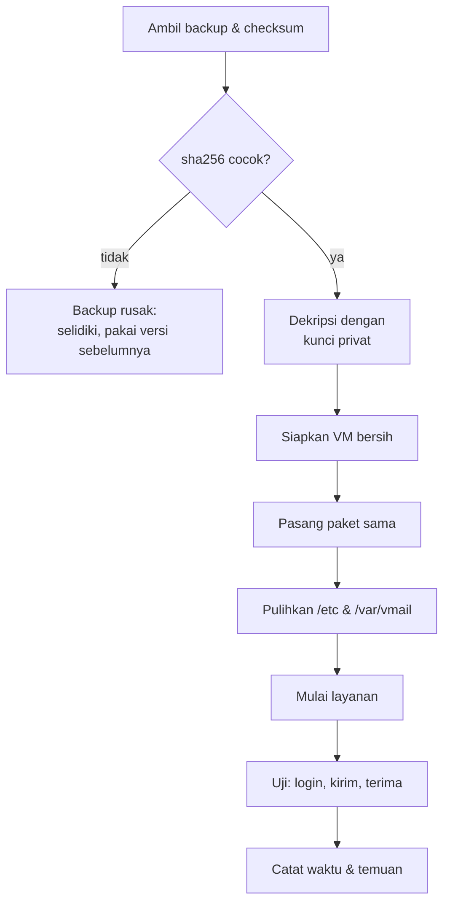

# Validasi Integritas dan Uji Restore

!!! info "Identitas chapter"
    **ID:** `CH-11-03-02` · **Kategori/modul:** CAT-11 / MOD-11-03 (Backup dan Disaster Recovery) · **Estimasi:** 120 menit · **Lingkungan:** lab lokal (VM) · [Lihat chapter ini di dashboard](../../../#CH-11-03-02)

!!! note "Status verifikasi"
    Isi chapter ini ditulis dari dokumentasi resmi dan belum dijalankan penulis pada VM (`verified_on: null`).

## 1. Ringkasan

Backup yang tidak pernah dipulihkan hanyalah harapan. Anda memverifikasi integritas dengan checksum, memulihkan ke sistem bersih, dan membuktikan layanan email berfungsi setelah restore.

## 2. Tujuan Pembelajaran

1. Memverifikasi integritas backup dengan `sha256sum`.
2. Memulihkan ke VM bersih mengikuti runbook.
3. Memverifikasi hasil restore: mailbox, konfigurasi, kirim/terima.
4. Mendokumentasikan hasil dan waktu pemulihan.

## 3. Prasyarat

- `CH-11-03-01` — Strategi dan Otomasi Backup.
- Backup berjalan (`CH-11-03-01`).

## 4. Materi Teori

### 4.1 Tingkat verifikasi

| Tingkat | Menjawab |
|---|---|
| Checksum cocok | Berkas utuh dan tidak berubah |
| Dapat didekripsi | Kunci dan arsip benar |
| Dapat diekstrak | Format arsip valid |
| Layanan berfungsi | Pemulihan nyata berhasil |



### 4.2 Pemulihan bersih

Uji pada VM **baru**, bukan di server produksi, untuk membuktikan runbook cukup lengkap. Catat apa yang perlu dilakukan di luar backup (paket, DNS, sertifikat).

## 5. Praktik dan Implementasi

1. Pilih backup acak dari seminggu lalu.
2. Verifikasi checksum dan dekripsi.
3. Pulihkan ke VM bersih.
4. Jalankan checklist verifikasi.
5. Tulis laporan restore.

## 6. Perintah Linux

```bash title="Integritas"
sha256sum -c SHA256SUMS
age -d -i kunci-backup.txt config-2026-01-15.tar.gz.age | tar -tzf - | head
```

Sesuaikan nama berkas dengan backup Anda. Hasil yang diharapkan: `OK` untuk setiap berkas dan daftar isi arsip.

```bash title="Perbandingan dry-run terhadap sumber (tanpa mengubah)"
sudo rsync -ain --checksum /var/vmail/ backup@backup.example.com:/srv/backup/vmail/ | head
```

Hasil kosong berarti sama. `-i` menampilkan perbedaan per berkas.

```bash title="Verifikasi setelah restore (di VM uji)"
sudo doveadm user '*'
sudo doveadm mailbox status -u ani@example.com messages INBOX
sudo postfix check && sudo doveconf -n >/dev/null && echo konfigurasi-valid
```

`doveadm user '*'` memerlukan userdb yang dapat diiterasi; bila tidak, gunakan akun uji yang diketahui.

## 7. Konfigurasi

Tidak ada konfigurasi layanan. Tulis laporan restore: tanggal, backup yang dipakai, durasi, langkah manual tambahan, kegagalan, dan perbaikan runbook.

## 8. Verifikasi

- Checksum `OK`; dekripsi dan ekstraksi berhasil.
- Layanan berjalan di VM bersih; login IMAP dan pengiriman/penerimaan uji berhasil.
- Jumlah pesan sesuai harapan untuk akun uji.
- Durasi pemulihan tercatat (masukan bagi RTO, `CH-11-03-03`).

## 9. Troubleshooting

| Gejala | Kemungkinan penyebab | Tindakan |
|---|---|---|
| Checksum tidak cocok | Berkas rusak/berubah | Gunakan backup sebelumnya, selidiki |
| Dekripsi gagal | Kunci salah | Gunakan pasangan kunci benar |
| Layanan gagal start | Paket/izin/UID berbeda | Samakan UID `vmail`, pulihkan izin |
| Sertifikat tidak ada | Tidak di backup / kedaluwarsa | Terbitkan ulang |

## 10. Security Review

- VM uji berisi data nyata: isolasi, hapus setelah uji, jangan sambungkan ke internet.
- Kunci dekripsi hanya ada pada operator berwenang.
- Hapus hasil dekripsi sementara setelah selesai.

## 11. Latihan

1. Lakukan uji restore penuh dan ukur waktunya.
2. Perbarui runbook dari temuan.
3. Jadwalkan uji restore berkala (mis. kuartalan).

## 12. Assessment

1. Mengapa uji restore di VM baru?
2. Apa yang dibuktikan checksum, dan apa yang tidak?
3. Mengapa mencatat durasi?

**Kunci singkat.** (1) Membuktikan runbook lengkap. (2) Keutuhan, bukan kegunaan. (3) Dasar RTO.

## 13. Checklist Kelulusan

- [ ] Restore penuh di VM bersih berhasil dengan bukti.
- [ ] Laporan restore dan perbaikan runbook ada.
- [ ] Uji restore dijadwalkan berkala.

!!! note "Status belajar"
    Ubah status chapter secara manual di dashboard. Menyelesaikan checklist ini tidak mengubah status otomatis.

## 14. Referensi Resmi

- [sha256sum (GNU coreutils)](https://www.gnu.org/software/coreutils/manual/html_node/sha2-utilities.html)
- [rsync(1)](https://download.samba.org/pub/rsync/rsync.1)
- [Dokumentasi Dovecot 2.3: doveadm](https://doc.dovecot.org/2.3/)

Tautan referensi tidak diverifikasi otomatis pada build ini; periksa ketersediaannya sebelum dipakai.

---

[Kembali ke dashboard kurikulum](../../../#CH-11-03-02){ .md-button }
