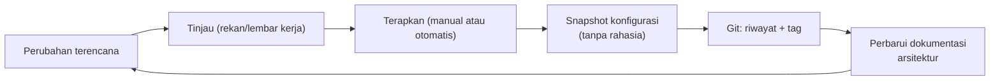

# Manajemen Konfigurasi dan Dokumentasi Infrastruktur

!!! info "Identitas chapter"
    **ID:** `CH-11-03-04` · **Kategori/modul:** CAT-11 / MOD-11-03 (Backup dan Disaster Recovery) · **Estimasi:** 90 menit · **Lingkungan:** lab lokal (VM) · [Lihat chapter ini di dashboard](../../../#CH-11-03-04)

!!! note "Status verifikasi"
    Isi chapter ini ditulis dari dokumentasi resmi dan belum dijalankan penulis pada VM (`verified_on: null`).

## 1. Ringkasan

Server yang hanya "hidup di kepala administrator" tidak dapat dipulihkan atau diaudit. Chapter ini memperkenalkan manajemen konfigurasi dan dokumentasi infrastruktur yang terawat: apa yang dicatat, bagaimana versi dan perubahan dilacak tanpa membocorkan rahasia.

## 2. Tujuan Pembelajaran

1. Menjelaskan manajemen konfigurasi dan konsep *infrastructure as code*.
2. Membuat snapshot konfigurasi yang bersih dari rahasia.
3. Menjaga dokumentasi arsitektur tetap mutakhir dengan proses perubahan.

## 3. Prasyarat

- `CH-11-03-03` — RTO, RPO, dan Rencana Disaster Recovery.
- Pemahaman keseluruhan komponen (Level 5 sampai `CH-11-03-03`).

## 4. Materi Teori

### 4.1 Mengapa

| Masalah | Akibat |
|---|---|
| Perubahan manual tak tercatat | Tidak bisa mengulang/memulihkan |
| Konfigurasi menyimpang antar server | Perilaku tak terduga |
| Dokumentasi usang | Insiden diperlambat |

### 4.2 Tingkat kematangan

| Tingkat | Contoh |
|---|---|
| Dokumen manual | Wiki/Markdown berisi langkah dan nilai |
| Snapshot konfigurasi | `postconf -n`, `doveconf -n` disimpan di Git |
| Otomasi deklaratif | Alat seperti Ansible menerapkan konfigurasi berulang |



### 4.3 Aturan rahasia

Repositori konfigurasi tidak boleh memuat kunci privat, hash kata sandi, token, atau `des_key`. Simpan rahasia di tempat terpisah dengan kontrol akses, dan di repositori cukup catat *lokasi* dan *cara membuatnya*.

## 5. Praktik dan Implementasi

1. Buat snapshot konfigurasi bersih.
2. Periksa tidak ada rahasia tersisa.
3. Simpan di repositori internal.
4. Perbarui diagram arsitektur.
5. Tetapkan proses perubahan: catat, tinjau, terapkan, verifikasi.

## 6. Perintah Linux

```bash title="Snapshot konfigurasi efektif (tanpa komentar/bawaan)"
mkdir -p ~/snapshot-konfigurasi
postconf -n > ~/snapshot-konfigurasi/postfix-main.cf
postconf -Mf > ~/snapshot-konfigurasi/postfix-master.cf
sudo doveconf -n > ~/snapshot-konfigurasi/dovecot.conf
grep -riE 'pass|secret|key|token' ~/snapshot-konfigurasi || echo "tidak ada kata kunci rahasia"
```

`grep` hanya pemeriksaan cepat; tinjau manual sebelum menyimpan. Jangan memakai alat yang menyimpan seluruh `/etc` ke Git tanpa memeriksa isi rahasia (mis. pengelola `/etc` otomatis akan ikut menyimpan berkas rahasia).

## 7. Konfigurasi

```text title="Contoh struktur repositori dokumentasi/konfigurasi"
infra/
  README.md          # ringkasan arsitektur + diagram
  snapshot/          # keluaran postconf -n, doveconf -n (disanitasi)
  runbooks/          # prosedur (restore, rotasi kunci, insiden)
  decisions/         # catatan keputusan (mengapa X dipilih)
  CHANGELOG.md       # setiap perubahan produksi
```

## 8. Verifikasi

- Snapshot dapat dibandingkan antar waktu (`diff`) dan tidak memuat rahasia.
- Diagram arsitektur sesuai kenyataan (diperiksa terhadap `ss`, `postconf -n`).
- Setiap perubahan produksi memiliki entri di `CHANGELOG`.

## 9. Troubleshooting

| Gejala | Kemungkinan penyebab | Tindakan |
|---|---|---|
| Dokumentasi tak cocok kenyataan | Perubahan tak dicatat | Wajibkan entri sebelum menutup perubahan |
| Rahasia terlanjur di Git | Salah komit | Rotasi rahasia, bersihkan riwayat sesuai prosedur |
| Snapshot terlalu besar | Menyertakan bawaan | Gunakan `-n` |
| Konfigurasi berbeda antar server | Perubahan manual | Otomasi atau audit berkala |

## 10. Security Review

- Rahasia yang pernah di-commit dianggap bocor: rotasi, bukan sekadar hapus.
- Akses ke repositori infrastruktur dibatasi seperti akses server.
- Diagram dan inventaris mengungkap permukaan serangan; jangan publikasikan ke publik.

## 11. Latihan

1. Buat snapshot dan periksa dua kali tidak ada rahasia.
2. Gambar diagram arsitektur terkini dengan Mermaid.
3. Tulis proses perubahan satu halaman.

## 12. Assessment

1. Apa manfaat snapshot konfigurasi?
2. Mengapa rahasia tidak boleh di Git?
3. Apa itu infrastructure as code?

**Kunci singkat.** (1) Melacak dan memulihkan. (2) Riwayat Git bersifat permanen. (3) Konfigurasi dideklarasikan dalam kode yang diterapkan berulang.

## 13. Checklist Kelulusan

- [ ] Snapshot bersih rahasia dibuat dan disimpan.
- [ ] Diagram dan runbook dimutakhirkan.
- [ ] Proses perubahan tertulis.

!!! note "Status belajar"
    Ubah status chapter secara manual di dashboard. Menyelesaikan checklist ini tidak mengubah status otomatis.

## 14. Referensi Resmi

- [Postfix: postconf(1)](https://www.postfix.org/postconf.1.html)
- [Dokumentasi Dovecot 2.3: doveconf](https://doc.dovecot.org/2.3/)
- [Ansible: Dokumentasi](https://docs.ansible.com/)

Tautan referensi tidak diverifikasi otomatis pada build ini; periksa ketersediaannya sebelum dipakai.

---

[Kembali ke dashboard kurikulum](../../../#CH-11-03-04){ .md-button }
