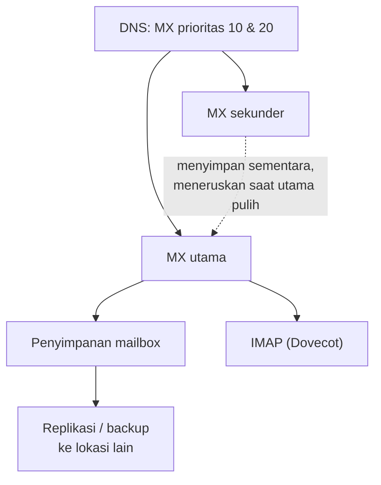

# Perencanaan Kapasitas dan Konsep High Availability

!!! info "Identitas chapter"
    **ID:** `CH-11-03-05` · **Kategori/modul:** CAT-11 / MOD-11-03 (Backup dan Disaster Recovery) · **Estimasi:** 90 menit · **Lingkungan:** lab lokal (VM) · [Lihat chapter ini di dashboard](../../../#CH-11-03-05)

!!! note "Status verifikasi"
    Isi chapter ini ditulis dari dokumentasi resmi dan belum dijalankan penulis pada VM (`verified_on: null`).

## 1. Ringkasan

Pertumbuhan email bersifat stabil tetapi tidak berhenti. Anda memproyeksikan kebutuhan storage dan beban, lalu memahami konsep redundansi dan *high availability* (HA) beserta kapan penerapannya masuk akal. HA di sini konseptual; implementasinya di luar cakupan Level 10 dan harus didahului backup serta restore yang terbukti.

## 2. Tujuan Pembelajaran

1. Memproyeksikan pertumbuhan storage dan beban dari data nyata.
2. Mengidentifikasi titik kegagalan tunggal (*single point of failure*).
3. Menjelaskan opsi redundansi email beserta risiko dan biayanya.

## 3. Prasyarat

- `CH-11-03-04` — Manajemen Konfigurasi dan Dokumentasi Infrastruktur.
- Pemantauan sumber daya (`CH-11-01-01`) dan RTO/RPO (`CH-11-03-03`).

## 4. Materi Teori

### 4.1 Proyeksi

Ukur pertumbuhan harian (`du`, `df`) selama beberapa minggu. Pertumbuhan linear sederhana: `sisa_ruang / laju_harian = hari_tersisa`. Tambahkan margin dan perhatikan lonjakan musiman.

### 4.2 Titik kegagalan tunggal

| Komponen | Jika gagal | Opsi mitigasi |
|---|---|---|
| Server tunggal | Layanan mati | Server siaga / bangun ulang cepat |
| Disk | Data hilang | RAID/backup, replikasi |
| DNS | Email tak terkirim/masuk | Beberapa nameserver |
| Koneksi/IP | Tidak terjangkau | Penyedia ganda (rumit untuk reputasi IP) |
| Penyedia tunggal | Semua hilang | Backup lokasi lain |



Diagram menggambarkan **konsep**, bukan konfigurasi yang diimplementasikan pada kurikulum ini.

### 4.3 Catatan penting HA email

- **MX sekunder** menerima dan mengantre saat MX utama mati, tetapi harus menerapkan validasi penerima yang sama; jika tidak, ia menerima lalu menolak belakangan dan menghasilkan *backscatter*.
- SMTP sudah tahan gangguan sementara: pengirim sah mengantre dan mencoba lagi berhari-hari, sehingga MX sekunder tidak selalu diperlukan.
- **IMAP/penyimpanan** adalah bagian tersulit: butuh replikasi atau penyimpanan bersama dengan konsistensi tertentu. Dovecot menyediakan mekanisme replikasi (`dsync`); pelajari dokumentasinya sebelum mempertimbangkan.
- Penyeimbang beban untuk SMTP/IMAP menambah kompleksitas TLS, reputasi IP, dan sesi.
- Kompleksitas HA sendiri adalah sumber kegagalan; pilih yang sesuai RTO.

## 5. Praktik dan Implementasi

1. Ambil data pertumbuhan penyimpanan 1–4 minggu.
2. Hitung proyeksi 6 dan 12 bulan.
3. Identifikasi titik kegagalan tunggal pada arsitektur Anda.
4. Bandingkan opsi mitigasi terhadap RTO/RPO Anda.

## 6. Perintah Linux

```bash title="Mengukur pertumbuhan"
df -h /var/vmail
sudo du -sh /var/vmail/* | sort -h | tail
echo "$(date +%F) $(df --output=used -B1 /var/vmail | tail -1)" | sudo tee -a /var/lib/mail-metrics/growth.log
```

Jalankan pencatatan tiap hari (timer) dan hitung selisih. Contoh perhitungan kasar: jika 40 GB tersisa dan laju 0,5 GB/hari, sisa sekitar 80 hari.

## 7. Konfigurasi

Tidak ada berkas konfigurasi yang diubah pada chapter ini.

## 8. Verifikasi

- Proyeksi tertulis dengan metode dan asumsinya.
- Daftar titik kegagalan tunggal dan keputusan menerima/memitigasinya.
- Rencana kapasitas disetujui bersama pemangku kepentingan.

## 9. Troubleshooting

| Gejala | Kemungkinan penyebab | Tindakan |
|---|---|---|
| Proyeksi meleset | Pola tidak linear | Gunakan data lebih panjang, tambah margin |
| Disk penuh lebih cepat | Lonjakan lampiran/penyalahgunaan | Pasang alert pertumbuhan |
| MX sekunder menimbulkan backscatter | Validasi penerima tak sama | Samakan atau tidak pakai MX sekunder |
| HA lebih rumit dari manfaatnya | Target RTO longgar | Cukup backup + restore cepat |

## 10. Security Review

- MX sekunder yang menerima semua alamat dapat menjadi relay spam.
- Replikasi menyalin juga kerusakan dan penghapusan; bukan pengganti backup.
- Kunci TLS/DKIM pada beberapa server memperbanyak titik pencurian.

## 11. Latihan

1. Hitung kapan disk penuh pada tiga laju pertumbuhan berbeda.
2. Gambar arsitektur dengan redundansi yang sesuai RTO 4 jam vs 15 menit.
3. Jelaskan mengapa replikasi bukan backup.

## 12. Assessment

1. Apa risiko MX sekunder yang tidak memvalidasi penerima?
2. Mengapa replikasi tidak menggantikan backup?
3. Mengapa HA harus didahului backup yang teruji?

**Kunci singkat.** (1) Backscatter. (2) Menyalin kesalahan/penghapusan. (3) HA tidak melindungi dari kerusakan logis/manusia.

## 13. Checklist Kelulusan

- [ ] Proyeksi kapasitas dan titik kegagalan tunggal terdokumentasi.
- [ ] Keputusan tentang redundansi dikaitkan dengan RTO/RPO.

!!! note "Status belajar"
    Ubah status chapter secara manual di dashboard. Menyelesaikan checklist ini tidak mengubah status otomatis.

## 14. Referensi Resmi

- [RFC 5321 — SMTP (antrean dan percobaan ulang)](https://www.rfc-editor.org/rfc/rfc5321)
- [Dokumentasi Dovecot 2.3: Replication](https://doc.dovecot.org/2.3/configuration_manual/replication/)
- [Postfix: STANDARD_CONFIGURATION_README](https://www.postfix.org/STANDARD_CONFIGURATION_README.html)
- [Google SRE Book: Embracing Risk](https://sre.google/sre-book/embracing-risk/)

Tautan referensi tidak diverifikasi otomatis pada build ini; periksa ketersediaannya sebelum dipakai.

---

[Kembali ke dashboard kurikulum](../../../#CH-11-03-05){ .md-button }
