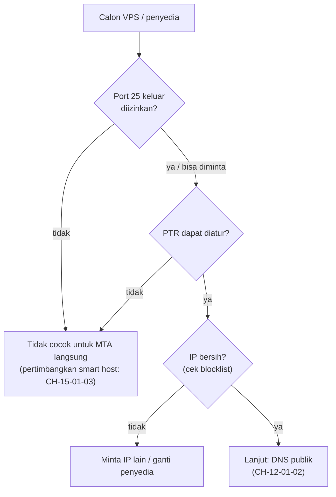

# Memilih VPS dan Memahami Pembatasan Port SMTP

!!! info "Identitas chapter"
    **ID:** `CH-12-01-01` · **Kategori/modul:** CAT-12 / MOD-12-01 (Persiapan Infrastruktur Publik) · **Estimasi:** 90 menit · **Lingkungan:** uji publik (VPS, IP publik, domain) · [Lihat chapter ini di dashboard](../../../#CH-12-01-01)

!!! warning "Peringatan"
    Level ini menyentuh internet publik. Server publik yang salah konfigurasi dapat menjadi open relay atau masuk daftar hitam. Jangan membuka port ke publik sebelum uji relay lulus (`CH-06-01-04`). Belum dijalankan penulis pada VM (`verified_on: null`).

## 1. Ringkasan

Server email publik bergantung pada hal yang tidak ada di lab: IP statis yang bersih, hak mengirim lewat port 25, dan kendali atas rDNS (PTR). Chapter ini membahas cara menilai VPS atau penyedia sebelum Anda membangun di atasnya.

## 2. Tujuan Pembelajaran

1. Menjelaskan mengapa banyak penyedia membatasi port 25 keluar.
2. Menilai penyedia berdasarkan kriteria teknis dan kebijakan.
3. Menjelaskan mengapa koneksi rumah dan IP dinamis bermasalah untuk email.
4. Menguji konektivitas keluar port 25 sebelum berkomitmen.

## 3. Prasyarat

- `CH-11-03-05` — Perencanaan Kapasitas dan Konsep High Availability.
- Semua kontrol lab selesai (Level 10), termasuk backup dan restore teruji.

## 4. Materi Teori

### 4.1 Mengapa port 25 dibatasi

Spam banyak dikirim dari mesin yang dibajak atau akun murah. Karena itu penyedia sering menutup port 25 keluar secara bawaan dan hanya membukanya setelah permintaan, verifikasi akun, atau tidak sama sekali. Blok alamat rumahan/dinamis juga lazim masuk daftar kebijakan (mis. daftar IP yang tidak seharusnya mengirim email langsung), sehingga email dari sana sering ditolak.

### 4.2 Kriteria penilaian

| Kriteria | Pertanyaan | Mengapa penting |
|---|---|---|
| Port 25 keluar | Dibuka bawaan, atas permintaan, atau diblokir? | Tanpa itu server tidak bisa mengirim langsung |
| IP statis | Tetap sepanjang masa layanan? | Reputasi melekat pada IP |
| rDNS/PTR | Dapat Anda atur sendiri? | Syarat FCrDNS (`CH-12-01-02`) |
| Riwayat IP | IP bekas siapa? | IP baru bisa sudah masuk daftar hitam |
| IPv6 | Disediakan dengan PTR? | Konsistensi `AAAA`/PTR |
| Kebijakan abuse | Jelas dan toleran terhadap email sah? | `CH-12-02-04` |
| Snapshot/backup | Tersedia? | Rollback dan pemulihan |



### 4.3 Kebijakan penyedia berubah

Syarat di atas harus dibaca dari dokumentasi dan syarat layanan penyedia **saat Anda mendaftar**; jangan mengandalkan ingatan atau tabel pihak ketiga.

## 5. Praktik dan Implementasi

1. Buat daftar tiga calon penyedia dan baca kebijakan port 25, PTR, dan abuse masing-masing.
2. Isi tabel kriteria untuk tiap calon.
3. Setelah memilih, uji konektivitas keluar port 25 dari VPS.
4. Catat alamat IP dan periksa apakah ia ada di daftar blokir (`CH-12-02-02`).

## 6. Perintah Linux

```bash title="Uji koneksi keluar ke port 25 (dari VPS)"
dig +short MX domain-penerima-uji.example
nc -vz -w 5 <HOST-MX-DARI-HASIL-DIG> 25
```

Ganti `domain-penerima-uji.example` dengan domain mailbox uji milik Anda di penyedia lain dan gunakan host MX dari hasil `dig`. Hasil yang diharapkan: `succeeded` (terbuka) atau `timed out`/`refused` (diblokir). Perintah hanya membuka koneksi TCP dan tidak mengirim email.

## 7. Konfigurasi

Tidak ada berkas konfigurasi yang diubah pada chapter ini.

## 8. Verifikasi

- Tabel kriteria terisi dengan sumber (tautan dokumentasi penyedia).
- Uji `nc` memberi bukti port 25 keluar terbuka atau tertutup.
- Keputusan penyedia tertulis dengan alasan.

## 9. Troubleshooting

| Gejala | Kemungkinan penyebab | Tindakan |
|---|---|---|
| `nc` timeout | Port 25 diblokir penyedia | Ajukan pembukaan atau pilih penyedia lain |
| PTR tidak dapat diubah | Panel tidak menyediakan | Hubungi dukungan atau ganti penyedia |
| IP sudah di blocklist | IP bekas disalahgunakan | Minta IP baru |
| Koneksi berhasil tapi email ditolak | Reputasi/aturan penerima | `CH-12-02-02` |

## 10. Security Review

- Jangan menjalankan MTA publik di jaringan rumah dengan IP dinamis.
- Simpan akses panel penyedia dengan MFA; akun penyedia yang bocor setara dengan server bocor.
- Jangan menaruh kredensial penyedia di repositori.

## 11. Latihan

1. Bandingkan tiga penyedia dengan tabel 4.2 dan pilih satu.
2. Tulis rencana jika penyedia memblokir port 25 setelah Anda berjalan.
3. Jelaskan perbedaan MTA langsung dan penggunaan smart host.

## 12. Assessment

1. Mengapa penyedia membatasi port 25?
2. Mengapa PTR dapat diatur sendiri itu penting?
3. Mengapa IP dinamis rumahan bermasalah?

**Kunci singkat.** (1) Mengurangi spam dari mesin bobol. (2) Untuk FCrDNS. (3) Sering terdaftar dalam kebijakan penolakan dan reputasinya buruk.

## 13. Checklist Kelulusan

- [ ] Penyedia dipilih berdasarkan kriteria tertulis.
- [ ] Konektivitas keluar port 25 teruji.
- [ ] IP dicatat dan diperiksa terhadap blocklist.

!!! note "Status belajar"
    Ubah status chapter secara manual di dashboard. Menyelesaikan checklist ini tidak mengubah status otomatis.

## 14. Referensi Resmi

- [RFC 5321 — SMTP](https://www.rfc-editor.org/rfc/rfc5321)
- [RFC 6409 — Message Submission](https://www.rfc-editor.org/rfc/rfc6409)
- [M3AAWG: Dokumen praktik terbaik](https://www.m3aawg.org/published-documents)
- [Spamhaus: Policy Block List (PBL)](https://www.spamhaus.org/blocklists/policy-blocklist/)

Tautan referensi tidak diverifikasi otomatis pada build ini; periksa ketersediaannya sebelum dipakai.

---

[Kembali ke dashboard kurikulum](../../../#CH-12-01-01){ .md-button }
