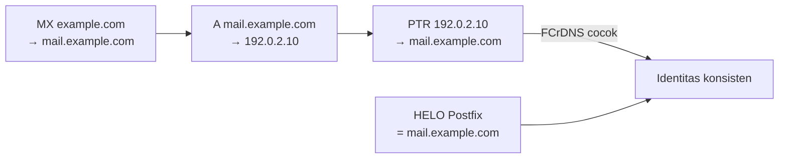

# DNS Publik dan Koordinasi PTR

!!! info "Identitas chapter"
    **ID:** `CH-12-01-02` · **Kategori/modul:** CAT-12 / MOD-12-01 (Persiapan Infrastruktur Publik) · **Estimasi:** 90 menit · **Lingkungan:** uji publik (VPS, IP publik, domain) · [Lihat chapter ini di dashboard](../../../#CH-12-01-02)

!!! warning "Peringatan"
    Perubahan DNS di domain nyata berdampak ke luar lab. Turunkan TTL dahulu, catat nilai lama, dan ubah satu hal pada satu waktu. Belum dijalankan penulis pada VM (`verified_on: null`).

## 1. Ringkasan

Anda menyelaraskan record A/AAAA, MX, dan PTR di DNS publik sehingga nama host, alamat IP, dan reverse DNS saling cocok (FCrDNS), lalu memverifikasinya dari luar jaringan Anda.

## 2. Tujuan Pembelajaran

1. Menyusun tabel record publik yang konsisten (A, AAAA, MX, PTR, HELO).
2. Memverifikasi FCrDNS dengan `dig` dan `host`.
3. Memeriksa dari beberapa resolver dan dari nameserver otoritatif.

## 3. Prasyarat

- `CH-12-01-01` — Memilih VPS dan Memahami Pembatasan Port SMTP.
- VPS dengan IP statis dan PTR dapat diatur (`CH-12-01-01`); konsep DNS `CAT-05`.

## 4. Materi Teori

### 4.1 Tabel keselarasan

| Item | Contoh | Harus cocok dengan |
|---|---|---|
| `myhostname` / HELO | `mail.example.com` | A/AAAA dan PTR |
| A | `mail.example.com → 192.0.2.10` | PTR `10.2.0.192.in-addr.arpa` |
| PTR | `192.0.2.10 → mail.example.com` | A (FCrDNS) |
| MX | `example.com → mail.example.com` | Host yang menerima di port 25 |
| AAAA (opsional) | `mail.example.com → 2001:db8::10` | PTR IPv6 dan SPF `ip6:` |

Alamat di atas adalah alamat dokumentasi (RFC 5737/3849); ganti dengan milik Anda.



### 4.2 IPv6

Jika Anda mempublikasikan AAAA, server benar-benar akan menerima/mengirim lewat IPv6 dan penerima menilai PTR serta SPF IPv6. Bila IPv6 tidak siap, jangan publikasikan AAAA atau nonaktifkan dengan sadar (`inet_protocols = ipv4`).

### 4.3 TTL dan pemeriksaan

Turunkan TTL record yang akan diubah sebelum perubahan (mis. 300 detik) agar kesalahan cepat dapat dibatalkan. Periksa dari beberapa resolver publik dan dari nameserver otoritatif (`+norecurse`).

## 5. Praktik dan Implementasi

1. Tulis tabel keselarasan untuk domain Anda.
2. Atur A/AAAA/MX di DNS dan PTR di panel penyedia.
3. Pastikan `myhostname` sama dengan nama A.
4. Verifikasi dengan `dig` dan `host` dari luar.

## 6. Perintah Linux

```bash title="Verifikasi forward dan reverse"
dig +short A mail.example.com
dig +short -x 192.0.2.10
host 192.0.2.10
dig +short MX example.com
postconf myhostname inet_protocols
```

```bash title="Beberapa resolver dan nameserver otoritatif"
dig @1.1.1.1 +short A mail.example.com
dig @9.9.9.9 +short A mail.example.com
dig +short NS example.com
dig +norecurse @ns1.example.com A mail.example.com
```

Ganti dengan domain, IP, dan nameserver Anda. Hasil yang diharapkan: A mengembalikan IP server, `-x` mengembalikan `mail.example.com.`, dan semua sumber konsisten setelah TTL lewat.

## 7. Konfigurasi

Tidak ada berkas konfigurasi yang diubah pada chapter ini.

## 8. Verifikasi

- A → IP dan PTR → nama yang sama (FCrDNS).
- MX menunjuk ke nama yang mempunyai A/AAAA, bukan ke CNAME.
- Dua resolver publik dan nameserver otoritatif memberi jawaban sama.

## 9. Troubleshooting

| Gejala | Kemungkinan penyebab | Tindakan |
|---|---|---|
| PTR tidak berubah | Diatur di penyedia, bukan di DNS Anda | Ubah di panel penyedia |
| Resolver berbeda jawaban | TTL/cache | Tunggu TTL, uji otoritatif |
| FCrDNS gagal | Nama PTR ≠ nama A | Samakan |
| MX menunjuk CNAME | Pelanggaran praktik | Arahkan ke nama dengan A |

## 10. Security Review

- Perubahan DNS yang salah dapat mengalihkan email Anda; gunakan MFA dan catat setiap perubahan.
- Jangan mempublikasikan nama host internal yang tidak perlu.
- PTR yang tidak cocok menurunkan reputasi dan menyebabkan penolakan.

## 11. Latihan

1. Isi tabel keselarasan untuk dua nama host.
2. Uji perubahan TTL dan ukur waktu penyebaran.
3. Jelaskan keputusan Anda tentang IPv6.

## 12. Assessment

1. Apa itu FCrDNS?
2. Mengapa MX tidak boleh menunjuk CNAME?
3. Mengapa menurunkan TTL sebelum perubahan?

**Kunci singkat.** (1) A dan PTR saling cocok. (2) Praktik standar menuntut nama dengan A/AAAA. (3) Rollback cepat.

## 13. Checklist Kelulusan

- [ ] A, MX, dan PTR konsisten dan terverifikasi dari luar.
- [ ] Keputusan IPv6 terdokumentasi.

!!! note "Status belajar"
    Ubah status chapter secara manual di dashboard. Menyelesaikan checklist ini tidak mengubah status otomatis.

## 14. Referensi Resmi

- [RFC 1912 — Common DNS Operational and Configuration Errors](https://www.rfc-editor.org/rfc/rfc1912)
- [RFC 5321 — SMTP (bagian MX)](https://www.rfc-editor.org/rfc/rfc5321)
- [Postfix: postconf — inet_protocols](https://www.postfix.org/postconf.5.html#inet_protocols)

Tautan referensi tidak diverifikasi otomatis pada build ini; periksa ketersediaannya sebelum dipakai.

---

[Kembali ke dashboard kurikulum](../../../#CH-12-01-02){ .md-button }
