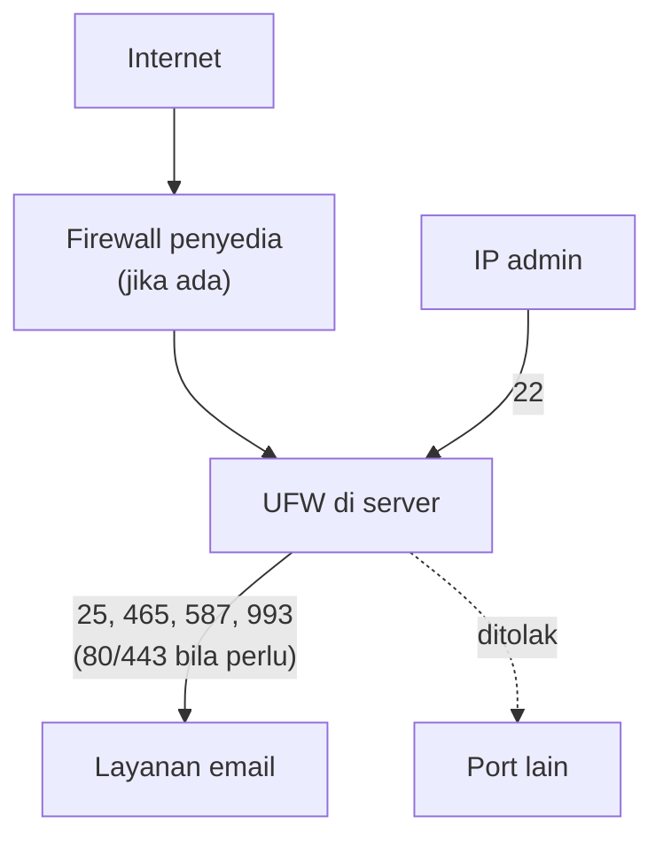

# Aturan Firewall dan Eksposur Layanan Publik

!!! info "Identitas chapter"
    **ID:** `CH-12-01-03` · **Kategori/modul:** CAT-12 / MOD-12-01 (Persiapan Infrastruktur Publik) · **Estimasi:** 90 menit · **Lingkungan:** uji publik (VPS, IP publik, domain) · [Lihat chapter ini di dashboard](../../../#CH-12-01-03)

!!! danger "Peringatan keras"
    Firewall salah konfigurasi dapat mengunci Anda dari server publik. Pastikan akses konsol penyedia, buka sesi SSH kedua, dan izinkan SSH sebelum mengaktifkan UFW. Belum dijalankan penulis pada VM (`verified_on: null`).

## 1. Ringkasan

Anda menetapkan daftar port yang boleh terbuka di server publik, menerapkannya di UFW (dan firewall penyedia), lalu membuktikan dari host eksternal bahwa tidak ada eksposur tak terduga.

## 2. Tujuan Pembelajaran

1. Menyusun matriks port: wajib, opsional, dan tidak boleh terbuka.
2. Menerapkan aturan UFW termasuk IPv6.
3. Memverifikasi dengan `ss` dari dalam dan `nmap` dari luar.

## 3. Prasyarat

- `CH-12-01-02` — DNS Publik dan Koordinasi PTR.
- Hardening SSH (`CH-10-01-02`); DNS publik (`CH-12-01-02`).

## 4. Materi Teori

### 4.1 Matriks port

| Port | Layanan | Status |
|---|---|---|
| 22 | SSH | Terbatas ke IP administrator bila memungkinkan |
| 25 | SMTP (antar-MTA) | Wajib terbuka |
| 465, 587 | Submission | Terbuka bagi pengguna |
| 993 | IMAPS | Terbuka bagi pengguna |
| 80, 443 | ACME / webmail | Hanya bila dipakai |
| 143, 110, 995 | IMAP/POP3 polos / POP3S | Tutup kecuali dibutuhkan |
| 3306, 5432, 6379, 11334 | Database, Redis, kontroler Rspamd | **Jangan** terbuka |



### 4.2 Dua lapis

Firewall penyedia dan UFW bekerja bersama; samakan keduanya dan catat. Pastikan IPv6 diatur juga (`IPV6=yes` di `/etc/default/ufw`), sebab layanan yang terbuka di IPv6 sering terlupa.

## 5. Praktik dan Implementasi

**Checklist persiapan**

- [ ] Konsol penyedia dapat diakses; sesi SSH kedua terbuka.
- [ ] IP administrator diketahui (statis) atau diputuskan tidak dibatasi.

**Langkah**

1. Tetapkan matriks port.
2. Atur aturan UFW (default deny incoming).
3. Aktifkan, lalu uji dari host lain.

## 6. Perintah Linux

```bash title="Aturan UFW (sesuaikan alamat admin)"
sudo ufw default deny incoming
sudo ufw default allow outgoing
sudo ufw allow from <IP-ADMIN-ANDA> to any port 22 proto tcp
sudo ufw allow 25/tcp
sudo ufw allow 465/tcp
sudo ufw allow 587/tcp
sudo ufw allow 993/tcp
sudo ufw enable
sudo ufw status verbose
```

Ganti `<IP-ADMIN-ANDA>`. Bila IP admin berubah-ubah, jangan membatasinya sampai ada VPN/bastion, atau Anda akan terkunci. Port 80/443 hanya ditambahkan bila ACME/webmail memakainya.

```bash title="Dari dalam: layanan yang mendengarkan"
sudo ss -tulnp
```

```bash title="Dari HOST LAIN, hanya server milik sendiri"
nmap -Pn -p 1-1024,3306,5432,6379,11334 mail.example.com
nmap -Pn -6 -p 25,465,587,993 mail.example.com
```

## 7. Konfigurasi

```text title="/etc/default/ufw (potongan)"
IPV6=yes
```

Perubahan ini berlaku setelah `sudo ufw disable && sudo ufw enable`; lakukan hanya dengan sesi cadangan terbuka.

## 8. Verifikasi

- `ufw status verbose` menunjukkan default deny dan aturan sesuai matriks.
- `ss` tidak menampilkan layanan di antarmuka publik selain yang direncanakan.
- `nmap` dari luar hanya menemukan port rencana terbuka, termasuk di IPv6.

## 9. Troubleshooting

| Gejala | Kemungkinan penyebab | Tindakan |
|---|---|---|
| Terkunci dari SSH | Aturan 22 salah | Konsol penyedia, perbaiki UFW |
| Port tertutup padahal aturan ada | Firewall penyedia | Samakan aturan |
| Layanan terbuka di IPv6 | `IPV6=no` / tidak diaudit | Aktifkan, audit |
| `nmap` menunjukkan `filtered` | Firewall menjatuhkan paket | Normal untuk port tertutup |

## 10. Security Review

- Redis, database, dan kontroler Rspamd tidak boleh terjangkau dari internet.
- Pindai hanya aset milik sendiri.
- Perubahan firewall dicatat dan ditinjau (`CH-13-03-02`).

## 11. Latihan

1. Buat tabel port rencana vs `ss` vs `nmap` (IPv4 dan IPv6).
2. Jelaskan konsekuensi membuka 143 dan 110.
3. Rancang prosedur pemulihan jika IP admin berubah.

## 12. Assessment

1. Mengapa default deny?
2. Mengapa IPv6 perlu diaudit?
3. Mengapa memindai dari host lain?

**Kunci singkat.** (1) Hanya yang diizinkan terbuka. (2) Sering terbuka tanpa disadari. (3) Perspektif penyerang.

## 13. Checklist Kelulusan

- [ ] Matriks port tertulis dan diterapkan.
- [ ] Eksposur diverifikasi dari luar (IPv4 dan IPv6).
- [ ] Prosedur pemulihan akses tertulis.

!!! note "Status belajar"
    Ubah status chapter secara manual di dashboard. Menyelesaikan checklist ini tidak mengubah status otomatis.

## 14. Referensi Resmi

- [Ubuntu Server: Firewall (UFW)](https://documentation.ubuntu.com/server/how-to/security/firewalls/)
- [Nmap: Dokumentasi](https://nmap.org/docs.html)
- [Postfix: Hardening](https://www.postfix.org/SMTPD_ACCESS_README.html)

Tautan referensi tidak diverifikasi otomatis pada build ini; periksa ketersediaannya sebelum dipakai.

---

[Kembali ke dashboard kurikulum](../../../#CH-12-01-03){ .md-button }
