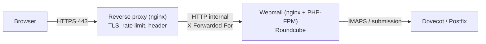

# Reverse Proxy dan Keamanan Webmail Publik

!!! info "Identitas chapter"
    **ID:** `CH-12-01-04` · **Kategori/modul:** CAT-12 / MOD-12-01 (Persiapan Infrastruktur Publik) · **Estimasi:** 90 menit · **Lingkungan:** uji publik (VPS, IP publik, domain) · [Lihat chapter ini di dashboard](../../../#CH-12-01-04)

!!! note "Status verifikasi"
    Isi chapter ini ditulis dari dokumentasi resmi dan belum dijalankan penulis pada VM (`verified_on: null`).

## 1. Ringkasan

Webmail publik adalah permukaan serangan terbesar yang bisa dijangkau siapa pun. Anda menimbang kapan menempatkan reverse proxy di depannya dan menerapkan pembatasan laju, pembatasan akses halaman administratif, dan penerusan alamat klien yang benar.

## 2. Tujuan Pembelajaran

1. Menjelaskan manfaat dan biaya reverse proxy untuk webmail.
2. Menerapkan pembatasan laju login dan pembatasan akses di nginx.
3. Mengonfigurasi penerusan alamat klien dan mempercayai proxy di Roundcube.

## 3. Prasyarat

- `CH-12-01-03` — Aturan Firewall dan Eksposur Layanan Publik.
- Roundcube dengan HTTPS (`CH-09-01-03`); firewall (`CH-12-01-03`).

## 4. Materi Teori

### 4.1 Pilihan topologi

| Topologi | Kelebihan | Kekurangan |
|---|---|---|
| nginx langsung di server webmail | Sederhana | Satu mesin menanggung semuanya |
| Reverse proxy terpisah di depan | Satu titik kebijakan TLS/laju, aplikasi tidak langsung terpapar | Satu komponen lagi, alamat klien harus diteruskan |



### 4.2 Alamat klien

Di belakang proxy, Roundcube dan log hanya melihat alamat proxy kecuali header `X-Forwarded-For` diteruskan dan dipercaya. Percayai header itu **hanya** dari proxy Anda, jika tidak penyerang dapat memalsukan alamatnya dan menghindari pembatasan.

### 4.3 Pembatasan laju
`limit_req` memperlambat percobaan login berulang dan melengkapi Fail2ban; keduanya tidak menggantikan kata sandi kuat.

## 5. Praktik dan Implementasi

1. Putuskan topologi dan catat alasan.
2. Tambahkan zona pembatasan laju untuk halaman login.
3. Batasi halaman administratif atau instalasi.
4. Atur `proxy_whitelist` dan header bila memakai proxy terpisah.
5. Uji dengan permintaan berulang.

## 6. Perintah Linux

```bash title="Menguji header dan pembatasan"
curl -sI https://mail.example.com/ | grep -iE 'HTTP/|strict|x-content|x-frame|referrer'
for i in $(seq 1 12); do curl -s -o /dev/null -w "%{http_code} " -X POST https://mail.example.com/ -d 'uji=1'; done; echo
sudo nginx -t && sudo systemctl reload nginx
```

Perulangan POST menguji server Anda sendiri; hasil yang diharapkan: awalnya `200`/`4xx` biasa, lalu `503` (kode bawaan `limit_req`) setelah melewati batas. Jangan menjalankan uji beban terhadap host pihak lain.

## 7. Konfigurasi

```text title="nginx (di blok http)"
limit_req_zone $binary_remote_addr zone=weblogin:10m rate=5r/m;
```

```text title="nginx (di blok server webmail)"
location = / {
    limit_req zone=weblogin burst=5 nodelay;
    try_files $uri /index.php$is_args$args;
}
```

```text title="Proxy terpisah (potongan)"
location / {
    proxy_pass http://10.0.0.20:80;
    proxy_set_header Host $host;
    proxy_set_header X-Forwarded-For $remote_addr;
    proxy_set_header X-Forwarded-Proto https;
}
```

```text title="/etc/roundcube/config.inc.php (hanya bila memakai proxy)"
$config['proxy_whitelist'] = array('10.0.0.10');
```

- `10.0.0.10` dan `10.0.0.20` adalah contoh alamat internal; ganti dengan alamat nyata.
- Hubungan proxy ke aplikasi sebaiknya lewat jaringan privat atau TLS; tautan polos melintasi jaringan tak tepercaya membocorkan kata sandi.
- Nilai `rate` dan `burst` hanyalah contoh; pengguna di belakang NAT berbagi satu alamat.

## 8. Verifikasi

- Header keamanan tetap ada setelah proxy.
- Pembatasan laju memberi respons terbatas setelah melewati ambang.
- Log aplikasi menampilkan alamat klien asli, bukan alamat proxy.

## 9. Troubleshooting

| Gejala | Kemungkinan penyebab | Tindakan |
|---|---|---|
| Semua klien tampak berasal dari proxy | Header tidak diteruskan/dipercaya | Atur `X-Forwarded-For` dan `proxy_whitelist` |
| Pengguna sah terkena `503` | `rate` terlalu rendah / NAT | Naikkan `burst`/`rate` |
| Redirect loop | `X-Forwarded-Proto` hilang | Teruskan header |
| Halaman admin terbuka | Tidak dibatasi | Batasi dengan `allow`/`deny` |

## 10. Security Review

- Header `X-Forwarded-For` hanya dipercaya dari proxy sendiri.
- Hubungan proxy→aplikasi tidak boleh melintasi jaringan publik tanpa TLS.
- Batasi akses halaman administratif dan alat instalasi.

## 11. Latihan

1. Ukur dampak `limit_req` pada pengguna normal dan penyerang.
2. Gambar topologi pilihan Anda dengan alamat internal.
3. Jelaskan risiko jika proxy tidak diberi daftar kepercayaan.

## 12. Assessment

1. Mengapa `X-Forwarded-For` perlu dipercaya hanya dari proxy?
2. Apa kekurangan reverse proxy?
3. Apa fungsi `limit_req`?

**Kunci singkat.** (1) Agar tidak dapat dipalsukan. (2) Komponen tambahan dan alamat klien. (3) Membatasi laju permintaan.

## 13. Checklist Kelulusan

- [ ] Topologi dipilih dan didokumentasikan.
- [ ] Pembatasan laju dan akses admin teruji.
- [ ] Alamat klien asli tercatat di log.

!!! note "Status belajar"
    Ubah status chapter secara manual di dashboard. Menyelesaikan checklist ini tidak mengubah status otomatis.

## 14. Referensi Resmi

- [nginx: ngx_http_limit_req_module](https://nginx.org/en/docs/http/ngx_http_limit_req_module.html)
- [nginx: ngx_http_proxy_module](https://nginx.org/en/docs/http/ngx_http_proxy_module.html)
- [Roundcube: Konfigurasi](https://github.com/roundcube/roundcubemail/wiki/Configuration)

Tautan referensi tidak diverifikasi otomatis pada build ini; periksa ketersediaannya sebelum dipakai.

---

[Kembali ke dashboard kurikulum](../../../#CH-12-01-04){ .md-button }
