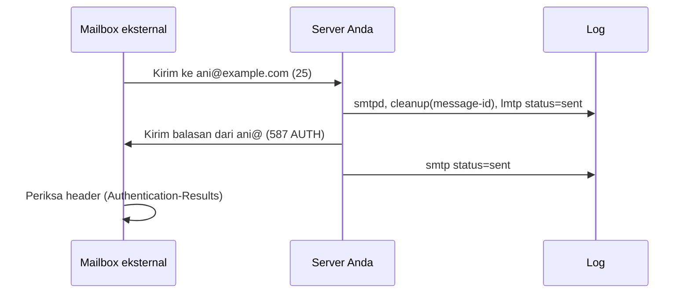

# Pengujian Konektivitas Masuk dan Keluar

!!! info "Identitas chapter"
    **ID:** `CH-12-02-01` · **Kategori/modul:** CAT-12 / MOD-12-02 (Pengujian dan Go-Live) · **Estimasi:** 90 menit · **Lingkungan:** uji publik (VPS, IP publik, domain) · [Lihat chapter ini di dashboard](../../../#CH-12-02-01)

!!! warning "Peringatan"
    Pengujian keluar mengirim email nyata. Kirim hanya ke mailbox uji milik Anda dan dalam jumlah kecil; uji massal merusak reputasi IP baru. Belum dijalankan penulis pada VM (`verified_on: null`).

## 1. Ringkasan

Sebelum go-live Anda membuktikan, dari luar, bahwa setiap jalur bekerja: koneksi masuk di 25, submission di 587/465, IMAPS di 993, pengiriman keluar dan penerimaan masuk, dengan bukti di log.

## 2. Tujuan Pembelajaran

1. Menguji port 25, 587, 465, dan 993 dari host eksternal.
2. Menguji penerimaan masuk dari mailbox eksternal dan pengiriman keluar ke mailbox eksternal.
3. Melacak setiap pesan uji di log dengan Message-ID.

## 3. Prasyarat

- `CH-12-01-04` — Reverse Proxy dan Keamanan Webmail Publik.
- DNS publik dan firewall (`CH-12-01-02`, `CH-12-01-03`); sertifikat valid (Level 7).

## 4. Materi Teori

### 4.1 Matriks uji

| Uji | Dari | Ke | Bukti |
|---|---|---|---|
| Koneksi 25 | Host luar | Server | Banner `220` |
| STARTTLS 587 | Host luar | Server | Sertifikat valid, `AUTH` setelah TLS |
| TLS 465/993 | Host luar | Server | Rantai valid |
| Masuk | Mailbox eksternal | `ani@example.com` | Pesan di Maildir, log `status=sent` |
| Keluar | `ani@example.com` | Mailbox eksternal | Log `status=sent`, header di penerima |
| Relay tertutup | Host luar tanpa AUTH | Domain eksternal | `554 5.7.1 Relay access denied` |



### 4.2 swaks (opsional)

`swaks` adalah alat uji SMTP. Jangan menaruh kata sandi di argumen perintah (terlihat di daftar proses dan riwayat); baca opsi masukan kata sandi pada dokumentasi swaks atau gunakan klien email biasa untuk uji terautentikasi.

## 5. Praktik dan Implementasi

1. Jalankan uji koneksi dari host eksternal.
2. Kirim 3 pesan masuk dari mailbox eksternal dan 3 pesan keluar.
3. Catat Message-ID tiap pesan.
4. Cari Message-ID di log server.
5. Uji relay anonim ke domain eksternal (harus ditolak).

## 6. Perintah Linux

```bash title="Dari host eksternal"
nc -vz mail.example.com 25
openssl s_client -connect mail.example.com:587 -starttls smtp -servername mail.example.com </dev/null 2>/dev/null | openssl x509 -noout -subject -dates
openssl s_client -connect mail.example.com:993 -servername mail.example.com </dev/null 2>/dev/null | openssl x509 -noout -subject -dates
```

```bash title="Uji relay anonim (percakapan manual, ketik baris setelah banner)"
nc mail.example.com 25
```

Ketik: `EHLO uji.invalid`, `MAIL FROM:<a@uji.invalid>`, `RCPT TO:<orang@domain-eksternal.example>`, lalu `QUIT`. Hasil yang diharapkan pada `RCPT TO`: `554 5.7.1 ... Relay access denied`. Ganti domain eksternal dengan domain milik Anda di penyedia lain, dan jangan menyelesaikan `DATA`.

```bash title="Di server: melacak pesan"
sudo journalctl -u 'postfix@-' --since "30 min ago" --no-pager | grep -E 'message-id=|status=' | tail -20
```

## 7. Konfigurasi

Tidak ada berkas konfigurasi yang diubah pada chapter ini.

## 8. Verifikasi

- 3 uji masuk dan 3 uji keluar, masing-masing dengan Message-ID terlacak di log.
- Relay anonim ditolak.
- Sertifikat valid pada 587/465/993 dari luar.

## 9. Troubleshooting

| Gejala | Kemungkinan penyebab | Tindakan |
|---|---|---|
| Koneksi 25 timeout | Firewall penyedia / blokir | Periksa `CH-12-01-03` dan `CH-12-01-01` |
| Pesan masuk tidak tiba | MX salah / TLS / firewall | `dig MX`, log `smtpd` |
| Pesan keluar ditunda | Penerima menolak / blokir | Baca `status=deferred` |
| `Relay access denied` pada pengguna sah | Tidak terautentikasi | Gunakan AUTH di 587/465 |

## 10. Security Review

- Jangan menguji dengan alamat acak atau pihak ketiga tanpa izin.
- Kata sandi hanya diketik interaktif.
- Hapus pesan uji dan catatan yang memuat data pribadi setelah selesai.

## 11. Latihan

1. Buat laporan uji dengan Message-ID, waktu, dan hasil.
2. Simulasikan satu kegagalan (mis. tutup port sementara di lab) dan catat gejalanya.
3. Jelaskan mengapa uji relay tidak menyelesaikan `DATA`.

## 12. Assessment

1. Mengapa uji dari host eksternal?
2. Bagaimana melacak satu pesan di log?
3. Mengapa tidak mengirim banyak pesan uji?

**Kunci singkat.** (1) Meniru perspektif pengirim nyata. (2) Dengan Message-ID/queue ID. (3) Menjaga reputasi IP baru.

## 13. Checklist Kelulusan

- [ ] Matriks uji terisi dengan bukti.
- [ ] 3 masuk dan 3 keluar terlacak.
- [ ] Relay anonim terbukti ditolak.

!!! note "Status belajar"
    Ubah status chapter secara manual di dashboard. Menyelesaikan checklist ini tidak mengubah status otomatis.

## 14. Referensi Resmi

- [Postfix: SMTPD_ACCESS_README](https://www.postfix.org/SMTPD_ACCESS_README.html)
- [swaks (jetmore.org)](https://jetmore.org/john/code/swaks/)
- [RFC 3463 — Enhanced Status Codes](https://www.rfc-editor.org/rfc/rfc3463)

Tautan referensi tidak diverifikasi otomatis pada build ini; periksa ketersediaannya sebelum dipakai.

---

[Kembali ke dashboard kurikulum](../../../#CH-12-02-01){ .md-button }
