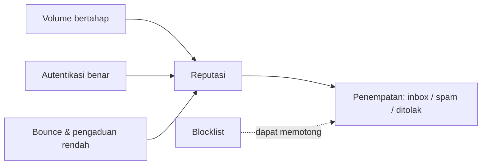

# Reputasi Server dan Uji Pengiriman ke Penyedia Eksternal

!!! info "Identitas chapter"
    **ID:** `CH-12-02-02` · **Kategori/modul:** CAT-12 / MOD-12-02 (Pengujian dan Go-Live) · **Estimasi:** 120 menit · **Lingkungan:** uji publik (VPS, IP publik, domain) · [Lihat chapter ini di dashboard](../../../#CH-12-02-02)

!!! note "Status verifikasi"
    Isi chapter ini ditulis dari dokumentasi resmi dan belum dijalankan penulis pada VM (`verified_on: null`).

## 1. Ringkasan

Penerima menilai pengirim dari reputasi IP dan domain. Reputasi dibangun bertahap dan tidak dapat dijamin. Chapter ini membahas faktor reputasi, cara memeriksa daftar blokir, dan cara menguji pengiriman ke penyedia besar tanpa mengklaim jaminan inbox.

## 2. Tujuan Pembelajaran

1. Menjelaskan faktor yang membentuk reputasi IP dan domain.
2. Memeriksa status IP pada daftar blokir (DNSBL) dengan benar.
3. Menjalankan pemanasan volume yang bertahap dan aman.
4. Menafsirkan hasil uji pengiriman tanpa overklaim.

## 3. Prasyarat

- `CH-12-02-01` — Pengujian Konektivitas Masuk dan Keluar.
- Pengujian konektivitas (`CH-12-02-01`).

## 4. Materi Teori

### 4.1 Faktor reputasi

| Faktor | Efek |
|---|---|
| Riwayat IP | IP yang pernah disalahgunakan membawa citra buruk |
| Volume dan konsistensi | Lonjakan mendadak mencurigakan |
| Tingkat pengaduan dan bounce | Tinggi = reputasi turun |
| Autentikasi (SPF/DKIM/DMARC) | Pondasi, bukan jaminan |
| PTR/HELO konsisten | Tanda server yang dikelola |
| Konten dan tautan | Memicu filter konten |



### 4.2 Pemeriksaan DNSBL

Daftar blokir diperiksa dengan kueri DNS terhadap alamat IP yang dibalik (`4.3.2.1.zona.dnsbl`). Beberapa layanan membatasi kueri dari resolver publik besar dan memberi jawaban khusus yang bukan "terdaftar"; baca kebijakan penggunaan tiap daftar sebelum menafsirkan hasil.

### 4.3 Pemanasan (*warm-up*)

Mulai dengan volume kecil ke penerima yang berinteraksi (membalas, membuka), naikkan bertahap selama berminggu-minggu, dan hentikan jika bounce atau penolakan meningkat. Angka pastinya bergantung pada penerima; tidak ada jadwal universal.

## 5. Praktik dan Implementasi

1. Periksa IP Anda terhadap beberapa daftar utama.
2. Daftar di layanan pantau reputasi milik penyedia besar bila tersedia.
3. Rencanakan pemanasan volume.
4. Kirim ke beberapa mailbox uji milik Anda di penyedia berbeda dan catat penempatannya.

## 6. Perintah Linux

```bash title="Memeriksa IP 192.0.2.10 (contoh) pada suatu DNSBL"
dig +short 10.2.0.192.<ZONA-DNSBL>
```

Ganti `<ZONA-DNSBL>` dengan zona dari dokumentasi daftar yang Anda pakai dan balik oktet IP Anda. Tidak ada jawaban (NXDOMAIN) berarti tidak terdaftar; jawaban `127.0.0.x` berarti terdaftar (arti kode ada di dokumentasi daftar). Jawaban `127.255.255.x` pada beberapa daftar berarti kueri ditolak, bukan terdaftar.

```bash title="Memeriksa konsistensi identitas"
dig +short -x 192.0.2.10
postconf myhostname smtp_helo_name
```

## 7. Konfigurasi

Tidak ada berkas konfigurasi yang diubah pada chapter ini.

## 8. Verifikasi

- IP tidak muncul di daftar yang diperiksa, atau penyebabnya diketahui dan ada rencana penghapusan.
- Rencana pemanasan tertulis dengan kriteria berhenti (mis. bounce naik).
- Hasil uji penempatan dicatat apa adanya, tanpa klaim jaminan.

## 9. Troubleshooting

| Gejala | Kemungkinan penyebab | Tindakan |
|---|---|---|
| IP terdaftar di blocklist | Riwayat/penyalahgunaan | Cari penyebab, ikuti proses penghapusan daftar tersebut |
| Semua email ke penyedia X ditolak | Reputasi/kebijakan | Baca kode penolakan dan dokumentasinya |
| Hasil DNSBL membingungkan | Kueri diblokir | Baca kebijakan penggunaan, gunakan resolver sendiri |
| Reputasi turun setelah lonjakan | Volume mendadak | Turunkan volume, perbaiki penyebab |

## 10. Security Review

- Jangan membeli daftar alamat atau mengirim massal untuk "memanaskan".
- Pengiriman tidak diminta merusak reputasi dan melanggar hukum di banyak yurisdiksi.
- Jangan membayar layanan "penghapusan dari blacklist" tanpa memahami penyebabnya.

## 11. Latihan

1. Periksa tiga daftar blokir dan catat hasilnya.
2. Susun rencana pemanasan 4 minggu dengan kriteria berhenti.
3. Jelaskan mengapa lolos inbox pada satu penyedia tidak membuktikan reputasi baik.

## 12. Assessment

1. Mengapa reputasi tidak dapat dijamin?
2. Bagaimana cara kerja pemeriksaan DNSBL?
3. Apa risiko lonjakan volume?

**Kunci singkat.** (1) Ditentukan penerima, bukan pengirim. (2) Kueri DNS terhadap IP terbalik. (3) Tampak seperti penyalahgunaan.

## 13. Checklist Kelulusan

- [ ] IP diperiksa pada daftar blokir dan hasilnya dicatat.
- [ ] Rencana pemanasan ada.
- [ ] Tidak ada klaim jaminan inbox.

!!! note "Status belajar"
    Ubah status chapter secara manual di dashboard. Menyelesaikan checklist ini tidak mengubah status otomatis.

## 14. Referensi Resmi

- [RFC 5782 — DNS Blacklists dan Whitelists](https://www.rfc-editor.org/rfc/rfc5782)
- [Google Postmaster Tools](https://postmaster.google.com/)
- [Microsoft SNDS](https://sendersupport.olc.protection.outlook.com/snds/)
- [M3AAWG: Dokumen praktik terbaik](https://www.m3aawg.org/published-documents)

Tautan referensi tidak diverifikasi otomatis pada build ini; periksa ketersediaannya sebelum dipakai.

---

[Kembali ke dashboard kurikulum](../../../#CH-12-02-02){ .md-button }
