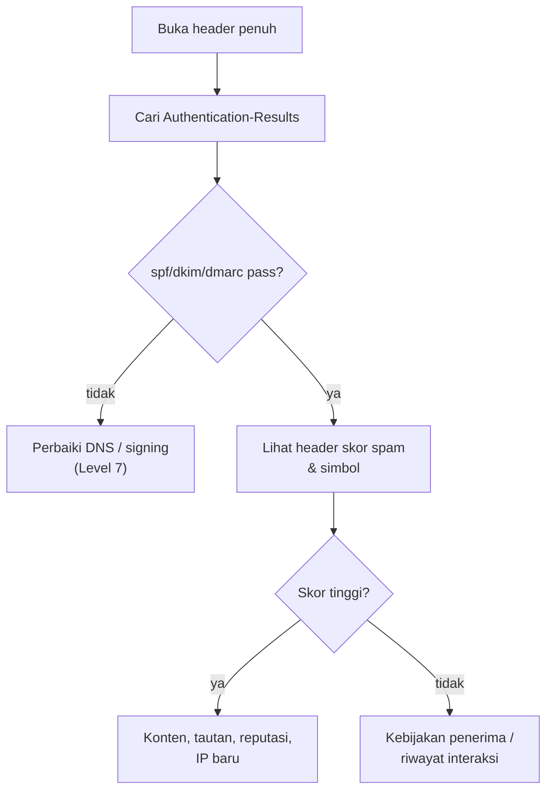

# Analisis Header dan Diagnosis Folder Spam

!!! info "Identitas chapter"
    **ID:** `CH-12-02-03` · **Kategori/modul:** CAT-12 / MOD-12-02 (Pengujian dan Go-Live) · **Estimasi:** 90 menit · **Lingkungan:** uji publik (VPS, IP publik, domain) · [Lihat chapter ini di dashboard](../../../#CH-12-02-03)

!!! note "Status verifikasi"
    Isi chapter ini ditulis dari dokumentasi resmi dan belum dijalankan penulis pada VM (`verified_on: null`).

## 1. Ringkasan

Header pesan menceritakan jalurnya: siapa yang menerima, kapan, dan apa hasil autentikasi. Anda membaca header `Received`, `Authentication-Results`, dan header spam untuk mendiagnosis mengapa pesan masuk folder spam.

## 2. Tujuan Pembelajaran

1. Membaca rantai `Received` dari bawah ke atas.
2. Menafsirkan `Authentication-Results` dan header skor spam.
3. Menyusun tabel penyebab umum pesan masuk spam dan tindakannya.

## 3. Prasyarat

- `CH-12-02-02` — Reputasi Server dan Uji Pengiriman ke Penyedia Eksternal.
- Hasil autentikasi (`CH-08-02-04`).

## 4. Materi Teori

### 4.1 Rantai Received

Setiap server yang menangani pesan **menambahkan** header `Received` di bagian atas, sehingga hop pertama ada di bagian bawah. Selisih waktu antar hop menunjukkan tempat keterlambatan.

```text
Contoh BENTUK (ilustrasi, bukan keluaran nyata):
Received: from mail.penerima.example by mx.penerima.example; Tue, 14 Jan 2026 08:00:12 +0000   <- hop terakhir
Received: from mail.example.com (mail.example.com [192.0.2.10]) by mx.penerima.example; Tue, 14 Jan 2026 08:00:10 +0000
```



### 4.2 Penyebab umum

| Gejala di header | Penyebab | Tindakan |
|---|---|---|
| `spf=fail/softfail` | IP tidak di SPF | Perbarui SPF |
| `dkim=none/fail` | Tidak ditandatangani / berubah | Periksa milter dan selector |
| `dmarc=fail` | Tidak selaras | Selaraskan domain |
| PTR/HELO tidak cocok | Identitas inkonsisten | `CH-12-01-02` |
| IP baru tanpa riwayat | Reputasi belum ada | Pemanasan |
| Konten/tautan mencurigakan | Filter konten | Ubah konten uji |

Header di sisi penerima dipasang oleh penerima; nama header dan formatnya bervariasi antar penyedia.

## 5. Praktik dan Implementasi

1. Kirim pesan dari server Anda ke dua mailbox eksternal milik Anda.
2. Ambil header penuh (menu "tampilkan sumber/asli").
3. Gambar rantai hop dan hitung selisih waktu.
4. Catat hasil `spf`, `dkim`, `dmarc` dan header spam.
5. Sunting header (hapus IP dan alamat sensitif) sebelum membagikannya.

## 6. Perintah Linux

```bash title="Mengambil header dari Maildir lokal untuk analisis"
sudo sed -n '1,/^$/p' /var/vmail/example.com/ani/Maildir/new/<NAMA-BERKAS> | less
sudo grep -iE '^(Received|Authentication-Results|X-Spamd-Bar|DKIM-Signature):' /var/vmail/example.com/ani/Maildir/new/<NAMA-BERKAS>
```

Ganti `<NAMA-BERKAS>` dengan berkas pesan uji. Perintah dijalankan sebagai root pada mailbox akun uji saja.

## 7. Konfigurasi

Tidak ada berkas konfigurasi yang diubah pada chapter ini.

## 8. Verifikasi

- Anda dapat menunjukkan setiap hop beserta waktunya.
- Anda dapat menyebut hasil `spf/dkim/dmarc` dan menjelaskan penyebab bila ada yang gagal.
- Tabel penyebab terisi dengan contoh dari pesan nyata Anda.

## 9. Troubleshooting

| Gejala | Kemungkinan penyebab | Tindakan |
|---|---|---|
| Header tidak lengkap | Klien memotong | Gunakan "tampilkan sumber asli" |
| Tidak ada `Authentication-Results` | Penerima tak menambahkan | Cek penyedia lain |
| Waktu antar hop aneh | Zona waktu / jam server | Periksa NTP |
| Skor tinggi tanpa simbol jelas | Filter penerima tertutup | Uji variasi konten |

## 10. Security Review

- Header memuat IP, nama host, dan alamat; sunting sebelum dibagikan.
- Jangan membuka pesan orang lain untuk analisis tanpa izin.
- Waspadai header `Received` palsu yang ditulis pengirim di bagian bawah.

## 11. Latihan

1. Analisis tiga pesan dan buat tabel penyebab.
2. Jelaskan bagaimana membedakan hop sendiri dari hop yang bisa dipalsukan.
3. Buat templat laporan diagnosis header.

## 12. Assessment

1. Dari mana membaca rantai Received?
2. Apa yang diindikasikan `dkim=fail`?
3. Mengapa header perlu disunting sebelum dibagikan?

**Kunci singkat.** (1) Dari bawah ke atas. (2) Tanda tangan tidak valid/berubah. (3) Berisi data sensitif.

## 13. Checklist Kelulusan

- [ ] Header tiga pesan dianalisis.
- [ ] Tabel penyebab spam dibuat.

!!! note "Status belajar"
    Ubah status chapter secara manual di dashboard. Menyelesaikan checklist ini tidak mengubah status otomatis.

## 14. Referensi Resmi

- [RFC 5322 — Internet Message Format](https://www.rfc-editor.org/rfc/rfc5322)
- [RFC 8601 — Authentication-Results](https://www.rfc-editor.org/rfc/rfc8601)
- [Rspamd: Dokumentasi](https://docs.rspamd.com/)

Tautan referensi tidak diverifikasi otomatis pada build ini; periksa ketersediaannya sebelum dipakai.

---

[Kembali ke dashboard kurikulum](../../../#CH-12-02-03){ .md-button }
