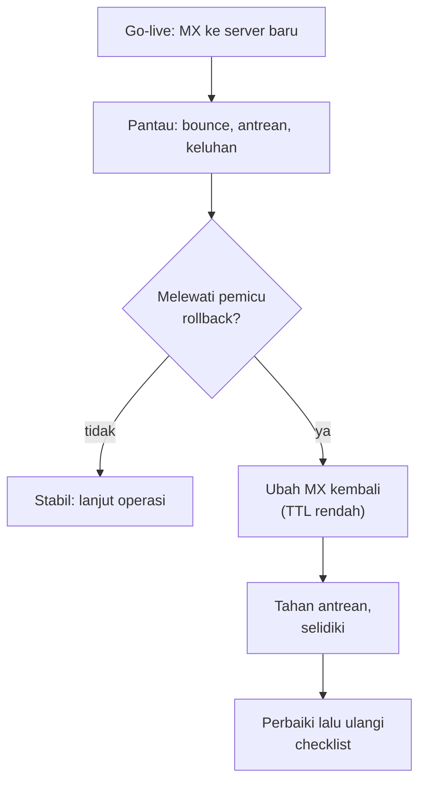

# Kebijakan Abuse Penyedia, Checklist Go-Live, dan Rollback

!!! info "Identitas chapter"
    **ID:** `CH-12-02-04` · **Kategori/modul:** CAT-12 / MOD-12-02 (Pengujian dan Go-Live) · **Estimasi:** 120 menit · **Lingkungan:** uji publik (VPS, IP publik, domain) · [Lihat chapter ini di dashboard](../../../#CH-12-02-04)

!!! note "Catatan"
    Chapter ini konseptual. Checklist dan rencana rollback harus disesuaikan dengan lingkungan Anda dan disetujui sebelum perubahan produksi. Belum dijalankan penulis pada VM (`verified_on: null`).

## 1. Ringkasan

Sebelum go-live Anda memahami kebijakan penggunaan yang dapat diterima (AUP) penyedia, menyusun checklist go-live yang terukur, dan menyiapkan rencana rollback yang bisa dijalankan.

## 2. Tujuan Pembelajaran

1. Menjelaskan isi dan dampak kebijakan abuse penyedia.
2. Menyusun checklist go-live dengan kriteria lulus/gagal.
3. Menyusun rencana rollback dengan pemicu, langkah, dan waktu.

## 3. Prasyarat

- `CH-12-02-03` — Analisis Header dan Diagnosis Folder Spam.
- Seluruh pengujian di CAT-12 modul 1 dan 2.

## 4. Materi Teori

### 4.1 Kebijakan abuse

Penyedia dapat menangguhkan layanan tanpa peringatan panjang bila IP Anda dilaporkan mengirim spam. Baca AUP, ketahui saluran pelaporan abuse mereka, dan siapkan alamat `abuse@` dan `postmaster@` pada domain Anda yang benar-benar dipantau (RFC 2142).

### 4.2 Checklist go-live (contoh)

| # | Item | Bukti |
|---|---|---|
| 1 | Relay anonim ditolak dari luar | Hasil uji `CH-12-02-01` |
| 2 | FCrDNS valid | `dig` dari dua resolver |
| 3 | TLS valid di 25 (STARTTLS), 587, 465, 993 | `openssl s_client` |
| 4 | SPF, DKIM, DMARC lulus pada pesan uji | Header |
| 5 | Backup dan restore teruji | Laporan restore |
| 6 | Monitoring dan alert diterima | Alert uji |
| 7 | `abuse@` dan `postmaster@` aktif | Pesan uji diterima |
| 8 | Firewall sesuai matriks | `nmap` luar |
| 9 | Rencana rollback disetujui | Dokumen |

### 4.3 Rollback

Rollback email berbeda dari web: pesan yang sudah diterima di sistem baru tidak otomatis ikut kembali. Rencana harus mencakup cara menyatukan atau memindahkan pesan itu.

## 5. Praktik dan Implementasi

1. Baca AUP penyedia dan catat poin yang relevan.
2. Lengkapi checklist dengan bukti untuk setiap item.
3. Tulis pemicu rollback (mis. bounce di atas ambang, antrean tidak turun) dan langkahnya.
4. Turunkan TTL MX beberapa hari sebelum go-live.
5. Simulasikan rollback di lab.

## 6. Perintah Linux

Chapter ini konseptual; tidak ada perintah yang mengubah sistem.

## 7. Konfigurasi

Tidak ada berkas konfigurasi yang diubah pada chapter ini.

## 8. Verifikasi

- Setiap item checklist punya bukti yang dapat dirujuk.
- Rencana rollback dilatih sekali di lab dan waktunya dicatat.
- Persetujuan Go/No-Go ditandatangani pihak berwenang (atau tercatat).

## 9. Troubleshooting

| Gejala | Kemungkinan penyebab | Tindakan |
|---|---|---|
| Checklist tidak lengkap | Item tak terukur | Tambah kriteria dan bukti |
| Rollback gagal | Prosedur belum dilatih | Latih dan perbaiki |
| Penyedia menangguhkan layanan | Pelanggaran AUP / laporan abuse | Jawab sesuai saluran abuse, selidiki penyebab |
| `abuse@` tidak dibaca | Alias tidak dipantau | Pastikan terkirim ke manusia |

## 10. Security Review

- Go-live tanpa uji relay adalah risiko tertinggi: server menjadi sumber spam dalam hitungan jam.
- Rencana rollback tidak boleh menyertakan rahasia.
- Akses perubahan DNS terakhir yang menentukan keberhasilan rollback harus tersedia (MFA aktif, cadangan akses).

## 11. Latihan

1. Lengkapi checklist dengan bukti nyata dari lab publik Anda.
2. Tulis pemicu rollback dengan angka.
3. Latih rollback dan catat waktu.

## 12. Assessment

1. Mengapa `abuse@` dan `postmaster@` perlu dipantau?
2. Apa pemicu rollback yang baik?
3. Mengapa rollback email tidak sesederhana web?

**Kunci singkat.** (1) Memenuhi RFC dan menerima laporan. (2) Terukur dan disepakati sebelumnya. (3) Pesan yang sudah diterima perlu disatukan.

## 13. Checklist Kelulusan

- [ ] Checklist go-live terisi dengan bukti.
- [ ] Rencana rollback dilatih dan waktu tercatat.
- [ ] Keputusan Go/No-Go tertulis.

!!! note "Status belajar"
    Ubah status chapter secara manual di dashboard. Menyelesaikan checklist ini tidak mengubah status otomatis.

## 14. Referensi Resmi

- [RFC 2142 — Mailbox Names for Common Services](https://www.rfc-editor.org/rfc/rfc2142)
- [M3AAWG: Dokumen praktik terbaik](https://www.m3aawg.org/published-documents)
- [Google SRE Book: Launching](https://sre.google/sre-book/reliable-product-launches/)

Tautan referensi tidak diverifikasi otomatis pada build ini; periksa ketersediaannya sebelum dipakai.

---

[Kembali ke dashboard kurikulum](../../../#CH-12-02-04){ .md-button }
