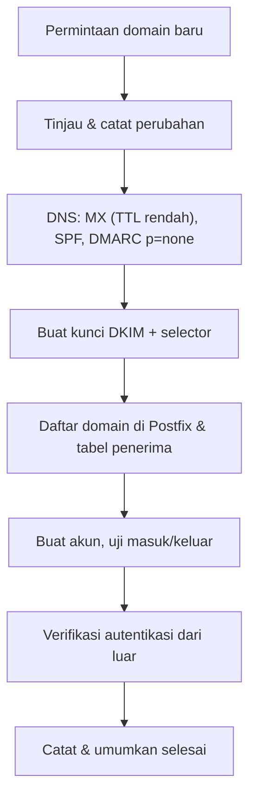

# Menambah dan Menghapus Domain

!!! info "Identitas chapter"
    **ID:** `CH-13-01-01` · **Kategori/modul:** CAT-13 / MOD-13-01 (Administrasi Domain dan Akun) · **Estimasi:** 90 menit · **Lingkungan:** produksi · [Lihat chapter ini di dashboard](../../../#CH-13-01-01)

!!! warning "Peringatan"
    Operasi ini mengubah produksi. Terapkan lewat jendela perubahan, buat backup konfigurasi, dan ikuti urutan: DNS dan kunci dahulu, penerimaan email terakhir. Prosedur ini belum dijalankan penulis. Belum dijalankan penulis pada VM (`verified_on: null`).

## 1. Ringkasan

Menambah domain bukan sekadar satu baris di Postfix: ia mencakup DNS, kunci DKIM, kebijakan DMARC, mailbox, dan verifikasi. Menghapus domain sama pentingnya dan lebih berisiko karena menyangkut data pengguna.

## 2. Tujuan Pembelajaran

1. Menjalankan prosedur penambahan domain dari DNS sampai uji kirim/terima.
2. Menjalankan penghapusan domain tanpa kehilangan data atau meninggalkan DNS yang menggantung.
3. Mencatat setiap perubahan untuk audit.

## 3. Prasyarat

- `CH-12-02-04` — Kebijakan Abuse Penyedia, Checklist Go-Live, dan Rollback.
- Mailbox virtual (`CH-07-01-01`), SPF/DKIM/DMARC (Level 7), backup (Level 10).

## 4. Materi Teori

### 4.1 Urutan penambahan



Urutan itu penting: bila MX sudah menunjuk ke server sebelum domain dikenali, email masuk ditolak atau tersesat.

### 4.2 Urutan penghapusan

Hentikan penerimaan (ubah MX/tanda "tidak menerima"), beri waktu untuk pesan tertinggal dan antrean, ekspor atau arsipkan data sesuai retensi, hapus akun dan alias, hapus konfigurasi dan kunci DKIM, lalu bersihkan DNS (MX, SPF, DKIM, DMARC). Hapus data hanya setelah retensi terpenuhi.

## 5. Praktik dan Implementasi

1. Siapkan formulir permintaan perubahan.
2. Backup `/etc/postfix` dan `/etc/opendkim`.
3. Tambahkan domain contoh `contoh-baru.example`.
4. Uji, lalu latih penghapusannya.

## 6. Perintah Linux

```bash title="Menambah domain"
sudo cp -a /etc/postfix /root/backup-postfix-$(date +%F)
sudo postconf virtual_mailbox_domains
sudo postconf -e 'virtual_mailbox_domains = example.com, contoh-baru.example'
echo 'info@contoh-baru.example contoh-baru.example/info/' | sudo tee -a /etc/postfix/vmailbox >/dev/null
sudo postmap /etc/postfix/vmailbox
sudo postfix check && sudo systemctl reload postfix
```

```bash title="Kunci DKIM untuk domain baru"
sudo mkdir -p /etc/opendkim/keys/contoh-baru.example
sudo opendkim-genkey -b 2048 -d contoh-baru.example -D /etc/opendkim/keys/contoh-baru.example -s 202610
sudo chown -R opendkim:opendkim /etc/opendkim/keys/contoh-baru.example
echo '*@contoh-baru.example 202610._domainkey.contoh-baru.example' | sudo tee -a /etc/opendkim/signing.table >/dev/null
echo '202610._domainkey.contoh-baru.example contoh-baru.example:202610:/etc/opendkim/keys/contoh-baru.example/202610.private' | sudo tee -a /etc/opendkim/key.table >/dev/null
sudo systemctl restart opendkim
```

Publikasikan isi `202610.txt` di DNS domain baru (`CH-08-02-02`), kemudian `opendkim-testkey -d contoh-baru.example -s 202610 -vvv`.

## 7. Konfigurasi

```text title="Catatan perubahan (contoh isi)"
Tanggal/jam : 2026-xx-xx
Perubahan   : tambah domain contoh-baru.example
DNS         : MX, SPF, DKIM selector 202610, DMARC p=none
Konfigurasi : virtual_mailbox_domains, vmailbox, signing/key table
Rollback    : hapus entri, kembalikan backup /root/backup-postfix-...
Verifikasi  : uji masuk, keluar, Authentication-Results
Pelaksana   : <nama/peran>
```

Untuk penghapusan: kebalikannya, dengan langkah ekspor/arsip data lebih dulu.

## 8. Verifikasi

```bash title="Verifikasi"
sudo postconf virtual_mailbox_domains
sudo postmap -q info@contoh-baru.example hash:/etc/postfix/vmailbox
opendkim-testkey -d contoh-baru.example -s 202610 -vvv
dig +short MX contoh-baru.example
```

Hasil yang diharapkan: domain tercantum, penerima dikenal, kunci DKIM valid, MX benar. Uji kirim/terima dan baca `Authentication-Results`.

## 9. Troubleshooting

| Gejala | Kemungkinan penyebab | Tindakan |
|---|---|---|
| `User unknown` untuk domain baru | Tabel penerima belum di-`postmap` | Jalankan `postmap`, reload |
| DKIM `fail` domain baru | Record DNS salah/belum menyebar | `dig`, tunggu TTL |
| Email tertolak setelah MX diubah | Domain belum didaftarkan | Urutan: konfigurasi dulu, DNS kemudian |
| DNS lama menggantung | Record tidak dibersihkan | Audit zona |

## 10. Security Review

- Domain yang dihapus tetapi MX-nya masih menunjuk ke Anda dapat menerima email pihak lain.
- Catat siapa yang mengubah apa dan kapan.
- Kunci DKIM domain yang dihapus dimusnahkan; kunci lama tidak dibiarkan beredar.

## 11. Latihan

1. Tambahkan lalu hapus domain uji dan catat waktu tiap langkah.
2. Tulis templat permintaan perubahan.
3. Jelaskan risiko jika data dihapus sebelum retensi terpenuhi.

## 12. Assessment

1. Mengapa konfigurasi dilakukan sebelum MX diubah?
2. Apa yang dibersihkan saat domain dihapus?
3. Mengapa kunci DKIM lama dimusnahkan?

**Kunci singkat.** (1) Agar email masuk tidak ditolak. (2) Akun, alias, konfigurasi, kunci, DNS. (3) Mencegah penyalahgunaan.

## 13. Checklist Kelulusan

- [ ] Domain uji ditambahkan dan teruji lengkap dengan autentikasi.
- [ ] Penghapusan dilatih, termasuk pembersihan DNS.
- [ ] Catatan perubahan terisi.

!!! note "Status belajar"
    Ubah status chapter secara manual di dashboard. Menyelesaikan checklist ini tidak mengubah status otomatis.

## 14. Referensi Resmi

- [Postfix: VIRTUAL_README](https://www.postfix.org/VIRTUAL_README.html)
- [Postfix: virtual_mailbox_domains](https://www.postfix.org/postconf.5.html#virtual_mailbox_domains)
- [RFC 6376 — DKIM](https://www.rfc-editor.org/rfc/rfc6376)

Tautan referensi tidak diverifikasi otomatis pada build ini; periksa ketersediaannya sebelum dipakai.

---

[Kembali ke dashboard kurikulum](../../../#CH-13-01-01){ .md-button }
