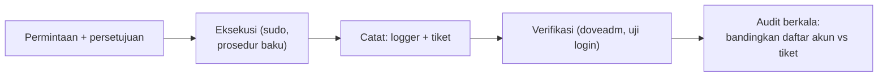

# Membuat, Menonaktifkan, dan Menghapus Akun

!!! info "Identitas chapter"
    **ID:** `CH-13-01-02` · **Kategori/modul:** CAT-13 / MOD-13-01 (Administrasi Domain dan Akun) · **Estimasi:** 90 menit · **Lingkungan:** produksi · [Lihat chapter ini di dashboard](../../../#CH-13-01-02)

!!! note "Status verifikasi"
    Isi chapter ini ditulis dari dokumentasi resmi dan belum dijalankan penulis pada VM (`verified_on: null`).

## 1. Ringkasan

Chapter `CH-07-01-03` menunjukkan mekanismenya; di produksi yang penting adalah **konsistensi dan jejak audit**: siapa membuat, menonaktifkan, atau menghapus akun, kapan, dan atas permintaan siapa.

## 2. Tujuan Pembelajaran

1. Menjalankan pembuatan, penonaktifan, dan penghapusan akun lewat prosedur baku.
2. Menjaga jejak audit di sistem dan dokumen.
3. Memeriksa konsistensi antara direktori akun dan penyimpanan.

## 3. Prasyarat

- `CH-13-01-01` — Menambah dan Menghapus Domain.
- Siklus hidup akun (`CH-07-01-03`).

## 4. Materi Teori

### 4.1 Prinsip operasi akun

| Prinsip | Wujud |
|---|---|
| Satu pintu | Perubahan hanya lewat prosedur/skrip yang disepakati |
| Dua pasang mata | Permintaan tertulis dan persetujuan |
| Jejak audit | Catatan tindakan: siapa, apa, kapan, alasan |
| Reversibel dahulu | Nonaktifkan sebelum menghapus |



### 4.2 Sumber jejak

`sudo` mencatat perintah administrator di journal; `logger -t` memungkinkan Anda menambahkan baris catatan sendiri. Catatan tambahan ini bukan bukti kuat terhadap penyerang berhak root, tetapi cukup untuk disiplin operasional.

## 5. Praktik dan Implementasi

1. Tetapkan prosedur baku dan formulir permintaan.
2. Buat akun uji lewat prosedur, nonaktifkan, lalu hapus.
3. Periksa jejak di journal dan di tiket.
4. Lakukan audit daftar akun vs permintaan.

## 6. Perintah Linux

```bash title="Mencatat tindakan dan memeriksa jejak sudo"
logger -t mail-admin "buat akun uji1@example.com atas tiket T-123 oleh $(whoami)"
sudo journalctl _COMM=sudo --since today --no-pager | tail -10
sudo journalctl -t mail-admin --since today --no-pager
```

```bash title="Daftar akun dan konsistensi"
cut -d: -f1 /etc/dovecot/users | sort > /tmp/akun-dovecot.txt
awk '{print $1}' /etc/postfix/vmailbox | sort > /tmp/akun-postfix.txt
diff /tmp/akun-dovecot.txt /tmp/akun-postfix.txt && echo konsisten
rm -f /tmp/akun-*.txt
```

Perbedaan menunjukkan akun yang ada di satu sisi saja. Berkas `/tmp` dihapus karena memuat daftar alamat.

## 7. Konfigurasi

Tidak ada berkas konfigurasi yang diubah pada chapter ini.

## 8. Verifikasi

- Setiap perubahan akun punya tiket dan catatan `mail-admin`.
- Daftar Dovecot dan Postfix konsisten.
- Akun yang dihapus tidak dapat login dan tidak menerima email.

## 9. Troubleshooting

| Gejala | Kemungkinan penyebab | Tindakan |
|---|---|---|
| Akun ada di satu sisi saja | Langkah terlewat | Lengkapi / hapus sisa |
| Tidak ada jejak | Perubahan di luar prosedur | Wajibkan lewat prosedur baku |
| Penghapusan tak sengaja | Tidak ada tahap nonaktif | Pulihkan dari backup, perketat prosedur |
| Akun yatim di penyimpanan | Hapus data terlewat | Audit `/var/vmail` |

## 10. Security Review

- Batasi siapa yang boleh `sudo` untuk administrasi akun.
- Jangan menaruh kata sandi pada tiket atau `logger`.
- Audit rutin menangkap akun hantu (akun tak dikenal).

## 11. Latihan

1. Susun formulir permintaan akun.
2. Jalankan audit dan temukan satu ketidakkonsistenan buatan.
3. Rancang aturan persetujuan untuk akun berhak istimewa.

## 12. Assessment

1. Mengapa menonaktifkan sebelum menghapus?
2. Apa kegunaan audit daftar akun?
3. Apa batas jejak yang dicatat dengan `logger`?

**Kunci singkat.** (1) Dapat dibalik. (2) Menemukan akun tak sah/yatim. (3) Tidak tahan terhadap pelaku berhak root.

## 13. Checklist Kelulusan

- [ ] Prosedur akun baku dan jejak audit berjalan.
- [ ] Audit konsistensi dilakukan.

!!! note "Status belajar"
    Ubah status chapter secara manual di dashboard. Menyelesaikan checklist ini tidak mengubah status otomatis.

## 14. Referensi Resmi

- [Dokumentasi Dovecot 2.3](https://doc.dovecot.org/2.3/)
- [systemd: journalctl(1)](https://www.freedesktop.org/software/systemd/man/latest/journalctl.html)
- [logger(1)](https://man7.org/linux/man-pages/man1/logger.1.html)

Tautan referensi tidak diverifikasi otomatis pada build ini; periksa ketersediaannya sebelum dipakai.

---

[Kembali ke dashboard kurikulum](../../../#CH-13-01-02){ .md-button }
