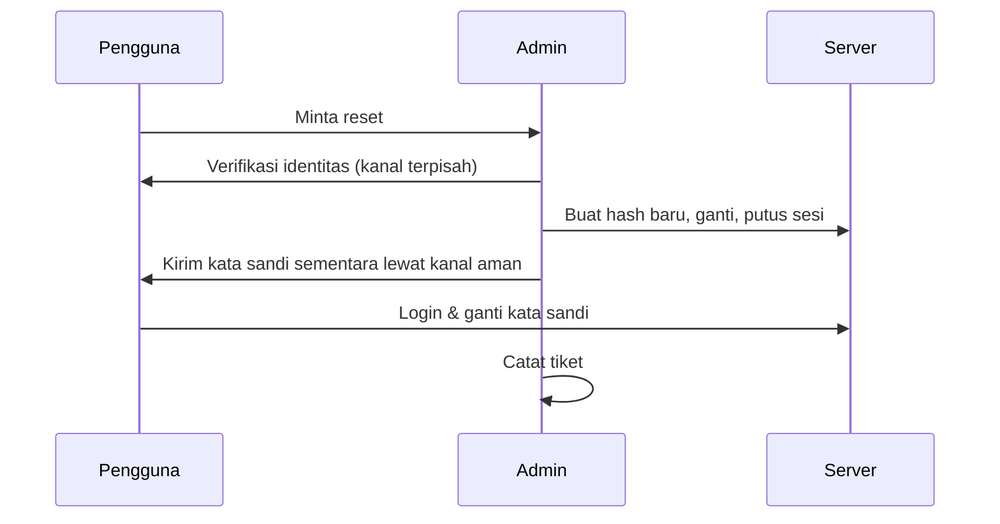

# Reset Password, Pemulihan Akses, dan Pengguna Tidak Bisa Login

!!! info "Identitas chapter"
    **ID:** `CH-13-01-03` · **Kategori/modul:** CAT-13 / MOD-13-01 (Administrasi Domain dan Akun) · **Estimasi:** 90 menit · **Lingkungan:** produksi · [Lihat chapter ini di dashboard](../../../#CH-13-01-03)

!!! warning "Peringatan"
    Reset kata sandi dapat disalahgunakan untuk pengambilalihan akun. Verifikasi identitas peminta lewat kanal terpisah sebelum mereset. Belum dijalankan penulis pada VM (`verified_on: null`).

## 1. Ringkasan

Pengguna "tidak bisa login" adalah tiket paling sering. Anda memverifikasi identitas, mereset kata sandi dengan aman, memutus sesi lama, dan mendiagnosis login yang gagal secara sistematis.

## 2. Tujuan Pembelajaran

1. Menjalankan reset kata sandi dengan verifikasi identitas.
2. Memutus sesi yang ada setelah reset.
3. Mendiagnosis kegagalan login dengan `doveadm auth test` dan log.

## 3. Prasyarat

- `CH-13-01-02` — Membuat, Menonaktifkan, dan Menghapus Akun.
- Log autentikasi (`CH-07-02-03`); penghapusan sesi tidak dibahas sebelumnya.

## 4. Materi Teori

### 4.1 Alur reset aman



### 4.2 Diagnosis login

| Gejala | Periksa |
|---|---|
| Kata sandi benar tetapi gagal | Format nama pengguna, hash/skema |
| Hanya satu perangkat gagal | Kata sandi tersimpan lama di perangkat |
| Banyak pengguna gagal | TLS/sertifikat, layanan auth |
| Ditolak oleh pembatasan | Fail2ban (`fail2ban-client status`) |

## 5. Praktik dan Implementasi

1. Verifikasi identitas akun uji.
2. Buat hash baru dan ganti pada `users`.
3. Putus sesi aktif.
4. Uji login dan catat tiket.

## 6. Perintah Linux

```bash title="Menghasilkan hash (interaktif) dan memeriksa"
doveadm pw -s SHA512-CRYPT
sudo doveadm auth test ani@example.com
sudo doveadm auth lookup ani@example.com
```

`auth lookup` menampilkan data pencarian pengguna tanpa kata sandi. Ganti hash di `/etc/dovecot/users` (lihat `CH-07-01-03`).

```bash title="Memutus sesi dan melihat sesi aktif"
sudo doveadm who
sudo doveadm kick ani@example.com
sudo fail2ban-client status dovecot
```

`doveadm kick` memutus koneksi aktif pengguna sehingga kata sandi lama tak berlaku lagi di sesi berjalan. Bila IP pengguna terblokir Fail2ban, buka dengan `fail2ban-client set dovecot unbanip <IP>`.

## 7. Konfigurasi

Tidak ada berkas konfigurasi yang diubah pada chapter ini.

## 8. Verifikasi

- Login dengan kata sandi baru berhasil; kata sandi lama gagal.
- `doveadm who` tidak lagi menunjukkan sesi lama.
- Tiket mencatat verifikasi identitas tanpa menyimpan kata sandi.

## 9. Troubleshooting

| Gejala | Kemungkinan penyebab | Tindakan |
|---|---|---|
| Login tetap gagal | Hash salah / skema tak cocok | Buat ulang dengan skema yang sama |
| Sesi lama masih aktif | Tidak dipanggil `kick` | Jalankan |
| IP pengguna terblokir | Fail2ban | `unbanip` |
| Pengguna berkali-kali lupa | Tidak ada pengelola kata sandi | Edukasi |

## 10. Security Review

- Kata sandi sementara dikirim lewat kanal terpisah dan wajib diganti.
- Jangan membacakan kata sandi lewat telepon tanpa verifikasi.
- Reset mendadak tanpa permintaan sah adalah tanda serangan rekayasa sosial.

## 11. Latihan

1. Tulis prosedur verifikasi identitas yang sesuai ukuran organisasi Anda.
2. Latih reset beserta pemutusan sesi.
3. Tulis tiga pertanyaan diagnosis "tidak bisa login".

## 12. Assessment

1. Mengapa memutus sesi setelah reset?
2. Apa fungsi `doveadm auth lookup`?
3. Apa risiko reset tanpa verifikasi?

**Kunci singkat.** (1) Agar sesi lama tak tetap sah. (2) Memeriksa pencarian pengguna. (3) Pengambilalihan akun.

## 13. Checklist Kelulusan

- [ ] Reset dengan verifikasi dan pemutusan sesi dilatih.
- [ ] Alur diagnosis login tertulis.

!!! note "Status belajar"
    Ubah status chapter secara manual di dashboard. Menyelesaikan checklist ini tidak mengubah status otomatis.

## 14. Referensi Resmi

- [Dokumentasi Dovecot 2.3: doveadm](https://doc.dovecot.org/2.3/)
- [Dokumentasi Dovecot 2.3: Password schemes](https://doc.dovecot.org/2.3/configuration_manual/authentication/password_schemes/)
- [NIST SP 800-63B](https://pages.nist.gov/800-63-3/sp800-63b.html)

Tautan referensi tidak diverifikasi otomatis pada build ini; periksa ketersediaannya sebelum dipakai.

---

[Kembali ke dashboard kurikulum](../../../#CH-13-01-03){ .md-button }
