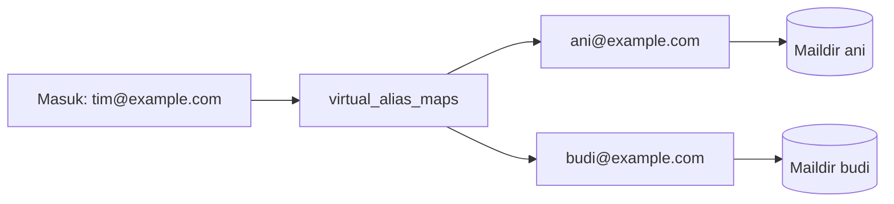

# Alias, Distribution Address, Forwarding, dan Shared Mailbox

!!! info "Identitas chapter"
    **ID:** `CH-13-01-04` · **Kategori/modul:** CAT-13 / MOD-13-01 (Administrasi Domain dan Akun) · **Estimasi:** 120 menit · **Lingkungan:** produksi · [Lihat chapter ini di dashboard](../../../#CH-13-01-04)

!!! warning "Peringatan"
    Forwarding ke alamat eksternal dapat merusak SPF/DMARC dan menjadi saluran kebocoran data. Catch-all menarik spam. Setiap alias adalah keputusan kebijakan, bukan sekadar konfigurasi. Belum dijalankan penulis pada VM (`verified_on: null`).

## 1. Ringkasan

Anda mengelola alias, alamat distribusi, forwarding, dan shared mailbox: apa yang aman, apa yang berisiko, dan bagaimana mencatatnya.

## 2. Tujuan Pembelajaran

1. Membuat alias dan alamat distribusi lewat `virtual_alias_maps`.
2. Menilai risiko forwarding eksternal dan catch-all.
3. Menjelaskan opsi shared mailbox dan ACL Dovecot.

## 3. Prasyarat

- `CH-13-01-03` — Reset Password, Pemulihan Akses, dan Pengguna Tidak Bisa Login.
- Alias Postfix (`CH-06-01-05`), mailbox virtual (`CH-07-01-01`).

## 4. Materi Teori

### 4.1 Jenis

| Jenis | Contoh | Catatan |
|---|---|---|
| Alias | `info@` → `ani@` | Satu tujuan |
| Distribusi | `tim@` → `ani@, budi@` | Banyak tujuan |
| Forward eksternal | `ani@` → alamat luar | Risiko DMARC/SPF dan kebocoran |
| Catch-all | `*@domain` | Menarik spam; hindari |
| Shared mailbox | Satu kotak surat banyak pengguna | Perlu ACL / namespace Dovecot |



### 4.2 Forwarding eksternal

Pesan yang diteruskan memiliki pengirim asli tetapi berasal dari IP Anda, sehingga SPF penerima akhir gagal; DKIM asli dapat tetap lulus bila pesan tidak diubah. Forward ke penyedia besar dari domain Anda yang berkebijakan `reject` dapat membuat pesan Anda sendiri ditolak. Pertimbangkan membiarkan pengguna menambahkan akun eksternal ke klien mereka sebagai pengganti forward otomatis.

### 4.3 Shared mailbox
Dovecot mendukung berbagi folder lewat plugin ACL dan namespace bersama. Konfigurasinya spesifik versi dan lingkungan; ikuti dokumentasi resmi sebelum menerapkan.

## 5. Praktik dan Implementasi

1. Buat alias dan distribusi uji.
2. Uji pengiriman ke alias.
3. Tinjau semua forward yang ada dan putuskan kebijakan.
4. Catat setiap alias di daftar dengan pemilik dan alasan.

## 6. Perintah Linux

```bash title="Alias dan distribusi"
sudo postconf -e 'virtual_alias_maps = hash:/etc/postfix/virtual'
printf 'info@example.com ani@example.com\ntim@example.com ani@example.com, budi@example.com\n' | sudo tee /etc/postfix/virtual >/dev/null
sudo postmap /etc/postfix/virtual
sudo postfix check && sudo systemctl reload postfix
sudo postmap -q tim@example.com hash:/etc/postfix/virtual
```

Hasil yang diharapkan pada `postmap -q`: `ani@example.com, budi@example.com`. Alamat sumber alias harus ada di domain yang dilayani (`virtual_alias_domains` atau `virtual_mailbox_domains`).

```bash title="Memeriksa ACL (bila plugin aktif)"
sudo doveadm acl get -u ani@example.com INBOX
```

Perintah hanya bermakna bila plugin `acl` diaktifkan.

## 7. Konfigurasi

Tidak ada berkas konfigurasi yang diubah pada chapter ini.

## 8. Verifikasi

- `postmap -q` menampilkan tujuan benar dan pesan uji tiba di semua penerima.
- Daftar alias tercatat dengan pemilik dan alasan.
- Tidak ada catch-all atau forward eksternal tanpa persetujuan.

## 9. Troubleshooting

| Gejala | Kemungkinan penyebab | Tindakan |
|---|---|---|
| Alias tidak bekerja | Belum di-`postmap` / domain tak dilayani | Periksa tabel dan domain |
| Loop alias | Alias menunjuk ke dirinya | Periksa rantai |
| Forward ditolak penerima | DMARC/SPF gagal | Jangan forward otomatis; alternatif |
| Spam melonjak | Catch-all | Hapus catch-all |

## 10. Security Review

- Forward eksternal otomatis dapat membocorkan data bila akun dikompromikan; penyerang sering menambahkan forward diam-diam (`CH-14-02-02`).
- Audit alias dan forward secara berkala.
- Shared mailbox memperluas dampak kompromi satu akun.

## 11. Latihan

1. Audit alias untuk menemukan forward eksternal.
2. Tulis kebijakan forwarding.
3. Rancang skema shared mailbox untuk tim dukungan dengan ACL.

## 12. Assessment

1. Mengapa forwarding eksternal merusak SPF?
2. Mengapa menghindari catch-all?
3. Mengapa alias diaudit?

**Kunci singkat.** (1) IP forwarder tidak diizinkan SPF pengirim asli. (2) Menarik spam. (3) Penyerang dapat menambah forward diam-diam.

## 13. Checklist Kelulusan

- [ ] Alias dan distribusi teruji.
- [ ] Kebijakan forwarding tertulis.
- [ ] Daftar alias beserta pemilik ada.

!!! note "Status belajar"
    Ubah status chapter secara manual di dashboard. Menyelesaikan checklist ini tidak mengubah status otomatis.

## 14. Referensi Resmi

- [Postfix: virtual_alias_maps](https://www.postfix.org/postconf.5.html#virtual_alias_maps)
- [Postfix: VIRTUAL_README](https://www.postfix.org/VIRTUAL_README.html)
- [Dokumentasi Dovecot 2.3: ACL](https://doc.dovecot.org/2.3/configuration_manual/acl/)
- [RFC 8617 — ARC](https://www.rfc-editor.org/rfc/rfc8617)

Tautan referensi tidak diverifikasi otomatis pada build ini; periksa ketersediaannya sebelum dipakai.

---

[Kembali ke dashboard kurikulum](../../../#CH-13-01-04){ .md-button }
