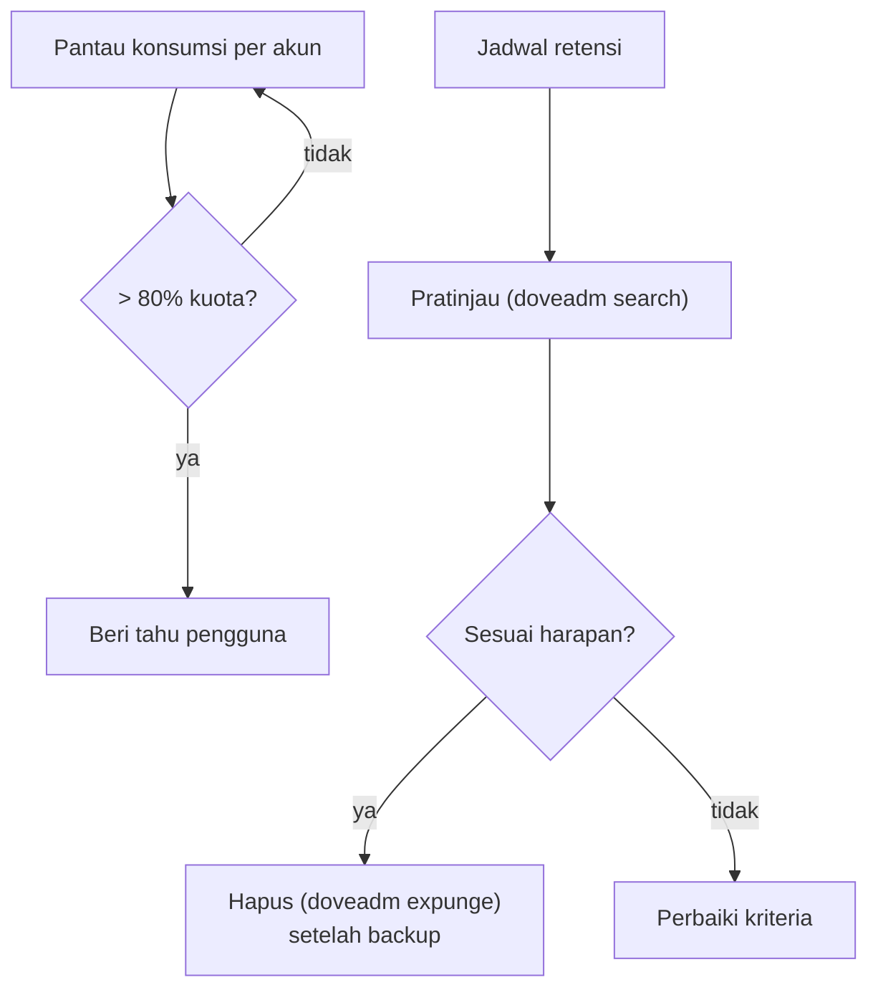

# Quota, Konsumsi Storage, dan Kebijakan Retensi

!!! info "Identitas chapter"
    **ID:** `CH-13-01-05` · **Kategori/modul:** CAT-13 / MOD-13-01 (Administrasi Domain dan Akun) · **Estimasi:** 90 menit · **Lingkungan:** produksi · [Lihat chapter ini di dashboard](../../../#CH-13-01-05)

!!! warning "Peringatan"
    Penghapusan berdasarkan umur bersifat permanen dan mungkin diatur hukum atau kebijakan organisasi. Pastikan kebijakan retensi disetujui, lakukan pratinjau dulu, dan backup sebelum menghapus. Belum dijalankan penulis pada VM (`verified_on: null`).

## 1. Ringkasan

Storage adalah sumber daya yang paling pasti habis. Anda memantau konsumsi per akun, menerapkan kuota, dan membuat kebijakan retensi (mis. mengosongkan Trash/Junk lama) yang terukur dan dapat dibalik.

## 2. Tujuan Pembelajaran

1. Memantau konsumsi storage per akun dan tren.
2. Mempratinjau lalu menjalankan pembersihan berdasarkan umur pada folder tertentu.
3. Menulis kebijakan retensi yang selaras dengan kuota dan kewajiban.

## 3. Prasyarat

- `CH-13-01-04` — Alias, Distribution Address, Forwarding, dan Shared Mailbox.
- Kuota (`CH-07-01-04`); kapasitas (`CH-11-03-05`).

## 4. Materi Teori

### 4.1 Kebijakan retensi (contoh)

| Folder | Retensi contoh | Catatan |
|---|---|---|
| Trash | 30 hari | Pengguna telah memutuskan menghapus |
| Junk | 30–60 hari | Tinjau false positive dulu |
| Inbox/Sent | Ditentukan pengguna / kebijakan | Hukum dapat mewajibkan penyimpanan |

Angka-angka ini ilustratif, bukan rekomendasi hukum.



## 5. Praktik dan Implementasi

1. Ukur konsumsi seluruh akun.
2. Tulis kebijakan retensi dan minta persetujuan.
3. Pratinjau pesan Trash yang lebih tua dari 30 hari pada akun uji.
4. Hapus pada akun uji setelah backup.

## 6. Perintah Linux

```bash title="Konsumsi"
sudo doveadm quota get -u ani@example.com
sudo du -sh /var/vmail/*/* 2>/dev/null | sort -h | tail
```

```bash title="Pratinjau lalu hapus berdasarkan umur (akun uji)"
sudo doveadm search -u ani@example.com mailbox Trash savedbefore 30d | head
sudo doveadm expunge -u ani@example.com mailbox Trash savedbefore 30d
```

`search` menampilkan pesan yang akan dihapus (GUID dan UID) tanpa mengubah apa pun; `expunge` menghapusnya **permanen**. Jalankan `expunge` hanya setelah pratinjau sesuai dan backup tersedia.

## 7. Konfigurasi

Tidak ada berkas konfigurasi yang diubah pada chapter ini.

## 8. Verifikasi

- Pratinjau menampilkan jumlah masuk akal; setelah `expunge`, jumlah pesan Trash turun.
- Kebijakan tertulis dengan persetujuan.
- Konsumsi tren dicatat bulanan.

## 9. Troubleshooting

| Gejala | Kemungkinan penyebab | Tindakan |
|---|---|---|
| `search` kosong | Kriteria atau nama folder salah | Periksa dengan `doveadm mailbox list` |
| Pesan sah terhapus | Kriteria terlalu luas | Pulihkan dari backup, perketat |
| Kuota tetap penuh | Folder lain/lampiran besar | Analisis per folder |
| Penghapusan berjalan terlalu lama | Banyak pesan | Jadwalkan di luar jam sibuk |

## 10. Security Review

- Retensi bukan alat untuk menyembunyikan data; hapus sesuai kebijakan tertulis.
- Hindari menghapus bukti selama insiden berjalan (`CH-14-02-01`).
- Akses `doveadm expunge` sebagai root bisa menghapus email siapa pun; batasi dan catat.

## 11. Latihan

1. Tulis kebijakan retensi Trash/Junk dan ujilah di akun uji.
2. Hitung penghematan storage perkiraan dari kebijakan itu.
3. Jelaskan bagaimana kebijakan mengecualikan akun dalam penahanan hukum.

## 12. Assessment

1. Mengapa pratinjau sebelum `expunge`?
2. Mengapa retensi perlu persetujuan tertulis?
3. Kapan penghapusan harus ditunda?

**Kunci singkat.** (1) Penghapusan permanen. (2) Dampak hukum dan pengguna. (3) Saat insiden atau penahanan hukum.

## 13. Checklist Kelulusan

- [ ] Konsumsi dipantau dan dicatat.
- [ ] Kebijakan retensi disetujui dan diuji di akun uji.

!!! note "Status belajar"
    Ubah status chapter secara manual di dashboard. Menyelesaikan checklist ini tidak mengubah status otomatis.

## 14. Referensi Resmi

- [Dokumentasi Dovecot 2.3: Quota](https://doc.dovecot.org/2.3/configuration_manual/quota_plugin/)

Tautan referensi tidak diverifikasi otomatis pada build ini; periksa ketersediaannya sebelum dipakai.

---

[Kembali ke dashboard kurikulum](../../../#CH-13-01-05){ .md-button }
