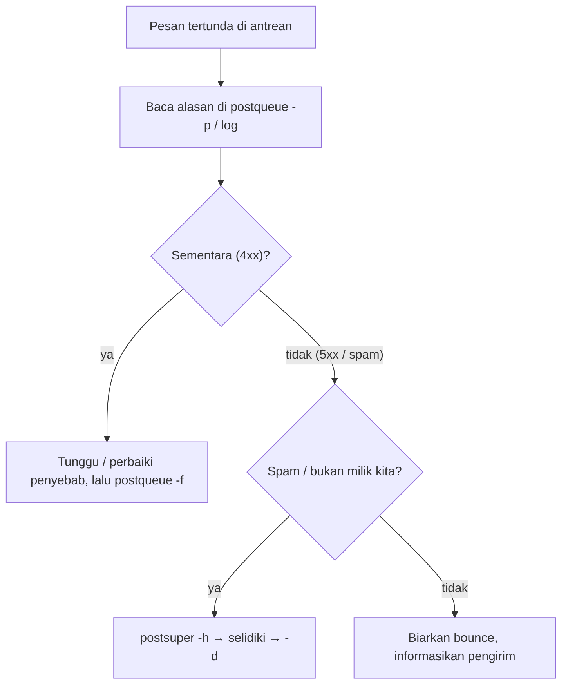

# Inspeksi dan Manajemen Antrian yang Aman

!!! info "Identitas chapter"
    **ID:** `CH-13-02-01` · **Kategori/modul:** CAT-13 / MOD-13-02 (Antrian dan Pengiriman) · **Estimasi:** 90 menit · **Lingkungan:** produksi · [Lihat chapter ini di dashboard](../../../#CH-13-02-01)

!!! danger "Peringatan keras"
    `postsuper -d` menghapus pesan permanen dan tidak dapat dibatalkan. Periksa isi dan penyebab sebelum menghapus, dan pilih `-h` (tahan) bila ragu. Belum dijalankan penulis pada VM (`verified_on: null`).

## 1. Ringkasan

Antrean adalah bukti kesehatan pengiriman. Anda memeriksa antrean tanpa merusaknya, membaca isi pesan tersangkut, dan memilih tindakan yang tepat: tunggu, kirim ulang, tahan, atau hapus.

## 2. Tujuan Pembelajaran

1. Memeriksa antrean (`postqueue -p/-j`) dan isi pesan (`postcat`).
2. Menerapkan hold, release, requeue, dan hapus dengan benar.
3. Mengikuti alur keputusan yang aman.

## 3. Prasyarat

- `CH-13-01-05` — Quota, Konsumsi Storage, dan Kebijakan Retensi.
- Antrean dasar dan log (`CH-06-01-06`); deteksi volume (`CH-10-03-01`).

## 4. Materi Teori

### 4.1 Perintah dan dampaknya

| Perintah | Dampak |
|---|---|
| `postqueue -p` | Daftar antrean (baca-saja) |
| `postcat -q ID` | Tampilkan isi/envelope pesan (baca-saja) |
| `postqueue -i ID` | Coba kirim satu pesan segera |
| `postqueue -f` | Coba kirim ulang semua antrean tertunda |
| `postsuper -h ID` | Tahan (tidak dikirim) |
| `postsuper -H ID` | Lepas tahanan |
| `postsuper -r ID` | Antre ulang (hitung ulang alamat) |
| `postsuper -d ID` | **Hapus permanen** |



### 4.2 Aturan emas
Baca, tahan, putuskan, baru hapus. Catat ID yang dihapus dan alasannya.

## 5. Praktik dan Implementasi

1. Lihat ringkasan dan daftar antrean.
2. Pilih satu pesan tersangkut dan baca isinya.
3. Tahan, lepas, lalu requeue.
4. Hapus hanya pesan uji.

## 6. Perintah Linux

```bash title="Memeriksa"
postqueue -p | head -20
postqueue -j | head -3
sudo postcat -q <QUEUE-ID> | head -40
```

`postqueue -j` menghasilkan JSON per baris. Ganti `<QUEUE-ID>` dengan ID nyata dari `postqueue -p`; `postcat` menampilkan isi email sehingga memuat data pribadi, jadi batasi penggunaannya.

```bash title="Tindakan"
sudo postsuper -h <QUEUE-ID>
sudo postsuper -H <QUEUE-ID>
sudo postqueue -i <QUEUE-ID>
sudo postsuper -d <QUEUE-ID>
```

Hindari `postsuper -d ALL` kecuali pada insiden terkendali dan sesuai prosedur.

## 7. Konfigurasi

Tidak ada berkas konfigurasi yang diubah pada chapter ini.

## 8. Verifikasi

- Setelah tindakan, `postqueue -p` mencerminkan perubahan.
- Log mencatat pengiriman ulang atau penghapusan.
- Catatan tindakan (ID, alasan, pelaksana) tersimpan.

## 9. Troubleshooting

| Gejala | Kemungkinan penyebab | Tindakan |
|---|---|---|
| `postcat` gagal | ID salah / pesan sudah terkirim | `postqueue -p` ulang |
| Pesan kembali ke antrean | Penyebab belum hilang | Perbaiki penyebab |
| Antrean membengkak | Spam / tujuan menolak | `CH-13-02-02` / `CH-13-02-04` |
| Tindakan massal menghapus pesan sah | Tanpa pratinjau | Pulihkan dari pengirim / backup |

## 10. Security Review

- Isi antrean adalah data pribadi; akses dicatat.
- Hapus bukti penyalahgunaan hanya setelah disalin untuk investigasi (`CH-14-02-01`).
- Jangan menjalankan perintah antrean dari skrip tanpa penjaga.

## 11. Latihan

1. Simulasikan antrean tertunda dengan tujuan palsu di lab dan tangani.
2. Buat diagram keputusan sendiri untuk tim Anda.
3. Tulis aturan: siapa boleh menjalankan `postsuper -d`.

## 12. Assessment

1. Apa beda `-h` dan `-d`?
2. Mengapa `postcat` perlu hati-hati?
3. Kapan pesan dibiarkan bounce?

**Kunci singkat.** (1) Tahan vs hapus permanen. (2) Memuat data pribadi. (3) Alamat tujuan salah / penolakan permanen.

## 13. Checklist Kelulusan

- [ ] Alur keputusan antrean diterapkan di lab.
- [ ] Aturan penghapusan tertulis.

!!! note "Status belajar"
    Ubah status chapter secara manual di dashboard. Menyelesaikan checklist ini tidak mengubah status otomatis.

## 14. Referensi Resmi

- [Postfix: postqueue(1)](https://www.postfix.org/postqueue.1.html)
- [Postfix: postsuper(1)](https://www.postfix.org/postsuper.1.html)
- [Postfix: postcat(1)](https://www.postfix.org/postcat.1.html)
- [Postfix: QSHAPE_README](https://www.postfix.org/QSHAPE_README.html)

Tautan referensi tidak diverifikasi otomatis pada build ini; periksa ketersediaannya sebelum dipakai.

---

[Kembali ke dashboard kurikulum](../../../#CH-13-02-01){ .md-button }
