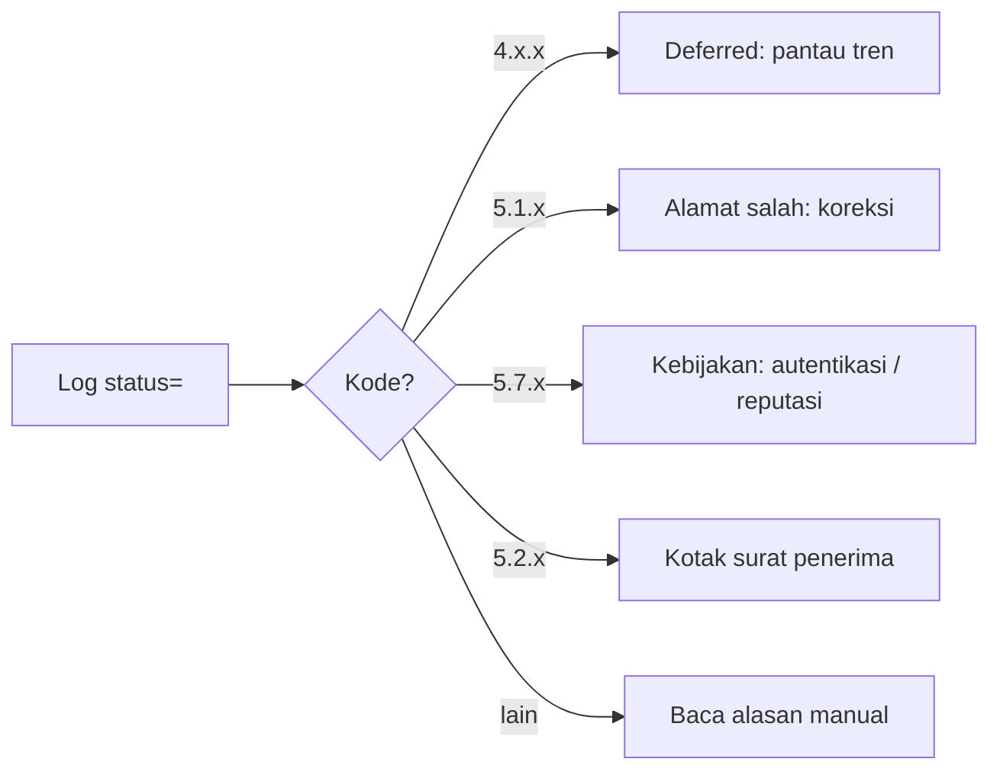

# Memantau Deferred dan Bounce

!!! info "Identitas chapter"
    **ID:** `CH-13-02-02` · **Kategori/modul:** CAT-13 / MOD-13-02 (Antrian dan Pengiriman) · **Estimasi:** 90 menit · **Lingkungan:** produksi · [Lihat chapter ini di dashboard](../../../#CH-13-02-02)

!!! note "Status verifikasi"
    Isi chapter ini ditulis dari dokumentasi resmi dan belum dijalankan penulis pada VM (`verified_on: null`).

## 1. Ringkasan

Deferred berarti "coba lagi nanti"; bounce berarti "gagal permanen". Anda mengklasifikasi keduanya dari log berdasarkan kode status, lalu mengambil tindakan sesuai penyebab.

## 2. Tujuan Pembelajaran

1. Mengambil data `status=deferred` dan `status=bounced` dari log.
2. Mengklasifikasi penyebab berdasarkan kode status dan alasan.
3. Menentukan tindakan: perbaiki sendiri, hubungi penerima, atau abaikan.

## 3. Prasyarat

- `CH-13-02-01` — Inspeksi dan Manajemen Antrian yang Aman.
- Antrean (`CH-13-02-01`).

## 4. Materi Teori

### 4.1 Klasifikasi

| Kategori | Kode | Arti | Tindakan |
|---|---|---|---|
| Sementara | 4.x.x | Coba lagi | Tunggu / perbaiki lokal |
| Permanen | 5.x.x | Gagal | Perbaiki alamat / kebijakan |
| Penerima menolak karena kebijakan | 5.7.x | Autentikasi / reputasi | Periksa DNS & reputasi |
| Kotak surat penuh | 4.2.2 / 5.2.2 | Kuota penerima | Informasikan |
| Tujuan tak ada | 5.1.1 | Alamat salah | Koreksi |

Kode tepatnya ada di RFC 3463; alasan teks bebas bervariasi antar server.



### 4.2 Tren lebih penting dari kejadian

Satu deferred wajar; lonjakan ke satu tujuan menandakan masalah. Hitung per domain tujuan dan per kode.

## 5. Praktik dan Implementasi

1. Kumpulkan statistik deferred/bounce 24 jam.
2. Kelompokkan per domain tujuan dan kode.
3. Tindak lanjuti 3 penyebab teratas.

## 6. Perintah Linux

```bash title="Statistik"
sudo journalctl -u 'postfix@-' --since "24 hours ago" --no-pager | grep -oE 'status=(deferred|bounced)' | sort | uniq -c
sudo journalctl -u 'postfix@-' --since "24 hours ago" --no-pager | grep -oE 'dsn=[0-9.]+' | sort | uniq -c | sort -rn | head
sudo journalctl -u 'postfix@-' --since "24 hours ago" --no-pager | grep 'status=deferred' | grep -oE 'to=<[^>]*>' | sed 's/.*@//; s/>//' | sort | uniq -c | sort -rn | head
```

Hasil yang diharapkan: hitungan per status, per kode DSN, dan per domain tujuan. Bentuk baris log bergantung pada versi.

## 7. Konfigurasi

Tidak ada berkas konfigurasi yang diubah pada chapter ini.

## 8. Verifikasi

- Tiga penyebab teratas teridentifikasi dengan bukti log.
- Tindakan dicatat dan tren turun setelahnya.

## 9. Troubleshooting

| Gejala | Kemungkinan penyebab | Tindakan |
|---|---|---|
| Tidak ada keluaran | Format log / unit | Periksa baris `status=` nyata |
| Banyak deferred ke satu domain | Penerima membatasi / memblokir | Baca alasan, kurangi laju |
| Banyak `5.1.1` | Alamat usang | Bersihkan daftar |
| Banyak `5.7.x` | Autentikasi / reputasi | `CH-14-01-04` |

## 10. Security Review

- Bounce ke alamat palsu menghasilkan backscatter; tolak saat SMTP bila mungkin.
- Lonjakan bounce dapat menandakan akun dikompromikan.
- Log tujuan memuat alamat pihak ketiga; batasi aksesnya.

## 11. Latihan

1. Buat laporan harian deferred/bounce (skrip dan ringkasan).
2. Tentukan ambang alert.
3. Sebutkan tindakan untuk tiga kode berbeda.

## 12. Assessment

1. Apa beda deferred dan bounce?
2. Mengapa tren penting?
3. Apa arti 5.7.x?

**Kunci singkat.** (1) Sementara vs permanen. (2) Lonjakan menunjukkan masalah. (3) Penolakan karena kebijakan.

## 13. Checklist Kelulusan

- [ ] Statistik deferred/bounce tersedia dan dibaca.
- [ ] Tindakan per kategori terdokumentasi.

!!! note "Status belajar"
    Ubah status chapter secara manual di dashboard. Menyelesaikan checklist ini tidak mengubah status otomatis.

## 14. Referensi Resmi

- [RFC 3463 — Enhanced Status Codes](https://www.rfc-editor.org/rfc/rfc3463)
- [Postfix: bounce(5)](https://www.postfix.org/bounce.5.html)
- [Postfix: DEBUG_README](https://www.postfix.org/DEBUG_README.html)

Tautan referensi tidak diverifikasi otomatis pada build ini; periksa ketersediaannya sebelum dipakai.

---

[Kembali ke dashboard kurikulum](../../../#CH-13-02-02){ .md-button }
