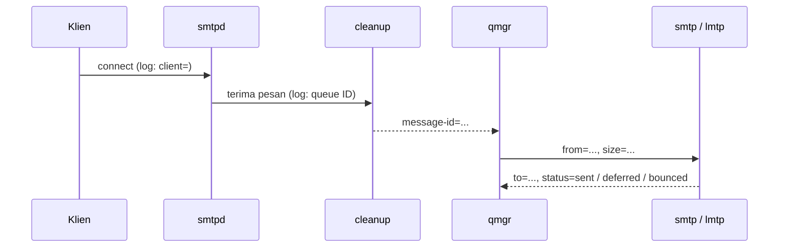

# Melacak Message-ID dan Diagnosis Kegagalan Pengiriman

!!! info "Identitas chapter"
    **ID:** `CH-13-02-03` · **Kategori/modul:** CAT-13 / MOD-13-02 (Antrian dan Pengiriman) · **Estimasi:** 120 menit · **Lingkungan:** produksi · [Lihat chapter ini di dashboard](../../../#CH-13-02-03)

!!! note "Status verifikasi"
    Isi chapter ini ditulis dari dokumentasi resmi dan belum dijalankan penulis pada VM (`verified_on: null`).

## 1. Ringkasan

Saat pengguna bertanya "email saya ke X tidak sampai", jawabannya ada di log. Anda melacak satu pesan dari penerimaan sampai pengiriman akhir dengan Message-ID dan queue ID, dan menentukan titik kegagalan.

## 2. Tujuan Pembelajaran

1. Mencari pesan berdasarkan Message-ID, pengirim, atau penerima.
2. Mengikuti queue ID melintasi komponen Postfix.
3. Menentukan titik kegagalan: diterima, difilter, diantre, dikirim, disimpan.

## 3. Prasyarat

- `CH-13-02-02` — Memantau Deferred dan Bounce.
- Log Postfix (`CH-06-01-06`); antrean (`CH-13-02-01`).

## 4. Materi Teori

### 4.1 Perjalanan satu pesan di log

Pesan diterima `smtpd` (ada `client=`), `cleanup` memberi queue ID dan mencatat `message-id=`, `qmgr` mencatat `from=`, lalu agen pengirim (`smtp`/`lmtp`) mencatat `to=` dan `status=`.



### 4.2 Strategi
Cari berdasarkan identitas yang diketahui pengguna (alamat, perkiraan waktu), temukan queue ID, lalu telusuri queue ID itu. Satu pesan dapat menghasilkan beberapa queue ID (misalnya setelah ekspansi alias atau bounce).

## 5. Praktik dan Implementasi

1. Kirim pesan uji dan catat waktunya.
2. Temukan queue ID lewat penerima atau Message-ID.
3. Telusuri queue ID dan simpulkan statusnya.
4. Ulangi untuk pesan yang gagal.

## 6. Perintah Linux

```bash title="Mencari"
sudo journalctl -u 'postfix@-' --since "1 hour ago" --no-pager -g 'to=<ani@example.com>' | tail -5
sudo journalctl -u 'postfix@-' --since "1 hour ago" --no-pager -g 'message-id=<ID-PESAN-UJI@mail.example.com>'
```

```bash title="Menelusuri satu queue ID"
sudo journalctl -u 'postfix@-' --since "1 hour ago" --no-pager -g '<QUEUE-ID>'
```

Ganti `<QUEUE-ID>` dengan ID dari hasil sebelumnya (kode alfanumerik pendek di awal pesan log). `-g` memfilter dengan pola. Hasil yang diharapkan: baris `client=`, `message-id=`, `from=`, dan `to=... status=`.

## 7. Konfigurasi

Tidak ada berkas konfigurasi yang diubah pada chapter ini.

## 8. Verifikasi

- Anda dapat menyatakan di tahap mana pesan uji berhenti atau berhasil.
- Catatan diagnosis memuat Message-ID, queue ID, status akhir, dan tindakan.

## 9. Troubleshooting

| Gejala | Kemungkinan penyebab | Tindakan |
|---|---|---|
| Pesan tidak ada di log | Tidak sampai server / log lama | Periksa DNS/MX, rentang waktu |
| Ada `client=` tanpa `status=` | Ditolak saat SMTP / masih antre | Cari `NOQUEUE` / `postqueue -p` |
| `status=sent` tetapi pengguna tidak melihat | Filter/folder Spam | Cari di Dovecot / folder |
| Banyak queue ID | Ekspansi alias / bounce | Telusuri tiap ID |

## 10. Security Review

- Log berisi alamat pihak ketiga; bagikan hanya potongan yang perlu.
- Jangan mencari dengan pola yang memperlihatkan isi pesan.
- Pelacakan atas permintaan pengguna tetap mengikuti kebijakan privasi.

## 11. Latihan

1. Lacak tiga pesan: berhasil, ditunda, ditolak.
2. Buat skrip pembantu pencarian berdasarkan penerima.
3. Tulis templat "laporan pelacakan pesan".

## 12. Assessment

1. Apa fungsi `cleanup` di log?
2. Apa arti `NOQUEUE`?
3. Mengapa satu pesan bisa punya banyak queue ID?

**Kunci singkat.** (1) Memberi queue ID dan Message-ID. (2) Ditolak sebelum diantre. (3) Ekspansi alias/bounce.

## 13. Checklist Kelulusan

- [ ] Tiga pesan dilacak end-to-end.
- [ ] Templat laporan pelacakan dibuat.

!!! note "Status belajar"
    Ubah status chapter secara manual di dashboard. Menyelesaikan checklist ini tidak mengubah status otomatis.

## 14. Referensi Resmi

- [Postfix: DEBUG_README](https://www.postfix.org/DEBUG_README.html)
- [Postfix: postfix(1) — peran komponen](https://www.postfix.org/postfix.1.html)
- [systemd: journalctl(1)](https://www.freedesktop.org/software/systemd/man/latest/journalctl.html)

Tautan referensi tidak diverifikasi otomatis pada build ini; periksa ketersediaannya sebelum dipakai.

---

[Kembali ke dashboard kurikulum](../../../#CH-13-02-03){ .md-button }
