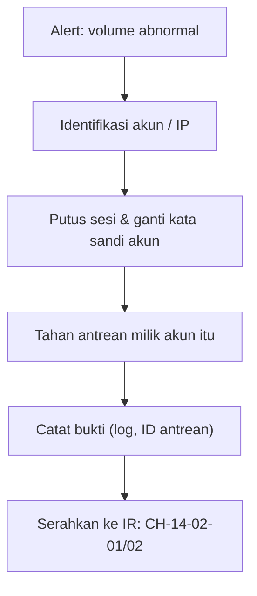

# Volume Keluar Abnormal dan Akun Terkompromi (Penanganan Awal)

!!! info "Identitas chapter"
    **ID:** `CH-13-02-04` · **Kategori/modul:** CAT-13 / MOD-13-02 (Antrian dan Pengiriman) · **Estimasi:** 120 menit · **Lingkungan:** produksi · [Lihat chapter ini di dashboard](../../../#CH-13-02-04)

!!! danger "Peringatan keras"
    Penahanan awal menghentikan email sah ikut terdampak. Lakukan hanya bila ada indikasi kuat, catat tiap langkah, dan jangan menghapus bukti. Prosedur ini belum dijalankan penulis. Belum dijalankan penulis pada VM (`verified_on: null`).

## 1. Ringkasan

Saat sebuah akun mengirim volume abnormal, hitungan menit menentukan kerusakan reputasi. Anda mengenali pola, menahan akun dan antrean miliknya, dan menyerahkan investigasi mendalam ke prosedur insiden (`CH-14-02-02`).

## 2. Tujuan Pembelajaran

1. Mengenali pola volume keluar abnormal dari log dan antrean.
2. Menahan akun terduga dan antrean miliknya tanpa mengganggu pengguna lain.
3. Mencatat langkah dan menyerahkan ke prosedur IR.

## 3. Prasyarat

- `CH-13-02-03` — Melacak Message-ID dan Diagnosis Kegagalan Pengiriman.
- Deteksi volume (`CH-10-03-01`); antrean (`CH-13-02-01`).

## 4. Materi Teori

### 4.1 Penahanan awal



Tujuan penahanan: hentikan kerusakan baru sambil mempertahankan bukti. Menghapus antrean tanpa menyalin bukti menghilangkan petunjuk tentang sumber serangan.

### 4.2 Menahan antrean per pengirim
`postqueue -j` menghasilkan JSON per pesan sehingga pesan dapat dipilih berdasarkan pengirim (`jq`) lalu ditahan lewat `postsuper -h -` yang membaca ID dari input standar.

## 5. Praktik dan Implementasi

1. Identifikasi akun terduga dari log.
2. Putus sesi dan ganti kata sandi.
3. Tahan antrean pengirim itu.
4. Salin bukti, catat, eskalasi.

## 6. Perintah Linux

```bash title="Identifikasi"
sudo journalctl -u 'postfix@-' --since "1 hour ago" --no-pager | grep -o 'sasl_username=[^ ,]*' | sort | uniq -c | sort -rn | head -5
```

```bash title="Menahan akun dan antreannya"
sudo apt install jq
sudo doveadm kick akun-terduga@example.com
postqueue -j | jq -r 'select(.sender=="akun-terduga@example.com") | .queue_id' | sudo postsuper -h -
postqueue -p | tail -1
```

`jq` dipasang bila belum ada. Ganti alamat dengan akun nyata. Setelah ditahan, ganti kata sandi akun (`CH-13-01-03`) dan periksa forward/alias yang mencurigakan (`CH-13-01-04`). Hasil yang diharapkan: pesan milik pengirim itu berstatus tertahan (`!`) di `postqueue -p`.

## 7. Konfigurasi

Tidak ada berkas konfigurasi yang diubah pada chapter ini.

## 8. Verifikasi

- Volume keluar dari akun itu berhenti.
- Antrean pengirim tertahan dan bukti disalin.
- Langkah dicatat dengan waktu dan pelaksana; eskalasi dilakukan.

## 9. Troubleshooting

| Gejala | Kemungkinan penyebab | Tindakan |
|---|---|---|
| Antrean tetap bertambah | Akun lain / sesi baru | Cari sumber lain, perketat |
| Pengguna sah terdampak | Penahanan terlalu luas | Pilih per pengirim, lepas `-H` |
| `jq` galat | Format JSON/ID | Periksa satu baris keluaran `postqueue -j` |
| Tidak ada `sasl_username` | Pengirim bukan via AUTH | Periksa jalur lain (mynetworks, form web) |

## 10. Security Review

- Jangan menghapus antrean sebelum bukti disimpan.
- Penyerang sering kembali: ganti kata sandi **dan** periksa forward, aturan Sieve, dan kunci aplikasi.
- Pertimbangkan akibat hukum dan privasi bila isi pesan dibaca.

## 11. Latihan

1. Simulasikan akun terkompromi di lab dan jalankan penahanan.
2. Tulis daftar periksa 10 menit pertama.
3. Tentukan siapa yang memutuskan menahan akun pada jam non-kerja.

## 12. Assessment

1. Mengapa tidak langsung menghapus antrean?
2. Apa yang diperiksa selain kata sandi?
3. Mengapa dicatat saat itu juga?

**Kunci singkat.** (1) Bukti hilang. (2) Forward, Sieve, kunci aplikasi. (3) Untuk audit dan postmortem.

## 13. Checklist Kelulusan

- [ ] Penahanan awal dilatih di lab dengan akun uji.
- [ ] Daftar periksa 10 menit pertama tertulis.

!!! note "Status belajar"
    Ubah status chapter secara manual di dashboard. Menyelesaikan checklist ini tidak mengubah status otomatis.

## 14. Referensi Resmi

- [Postfix: postsuper(1)](https://www.postfix.org/postsuper.1.html)
- [NIST SP 800-61 Rev. 2](https://csrc.nist.gov/pubs/sp/800/61/r2/final)
- [jq manual](https://jqlang.org/manual/)

Tautan referensi tidak diverifikasi otomatis pada build ini; periksa ketersediaannya sebelum dipakai.

---

[Kembali ke dashboard kurikulum](../../../#CH-13-02-04){ .md-button }
