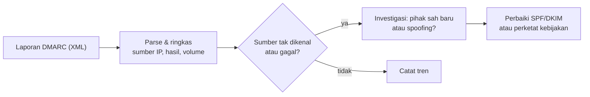

# Memantau Reputasi dan Hasil SPF, DKIM, DMARC

!!! info "Identitas chapter"
    **ID:** `CH-13-03-01` · **Kategori/modul:** CAT-13 / MOD-13-03 (Operasi Rutin dan Tata Kelola) · **Estimasi:** 90 menit · **Lingkungan:** produksi · [Lihat chapter ini di dashboard](../../../#CH-13-03-01)

!!! note "Status verifikasi"
    Isi chapter ini ditulis dari dokumentasi resmi dan belum dijalankan penulis pada VM (`verified_on: null`).

## 1. Ringkasan

Reputasi dan autentikasi memburuk diam-diam: Anda baru tahu setelah email pengguna masuk spam. Chapter ini membangun rutinitas pemantauan: membaca laporan agregat DMARC, memeriksa record DNS autentikasi, dan melihat sinyal reputasi dari penyedia besar.

## 2. Tujuan Pembelajaran

1. Membaca laporan agregat DMARC (XML) dan meringkas sumber pengirim.
2. Memverifikasi record SPF, DKIM, dan DMARC secara berkala.
3. Menentukan tindakan dari tren, bukan dari satu kejadian.

## 3. Prasyarat

- `CH-13-02-04` — Volume Keluar Abnormal dan Akun Terkompromi (Penanganan Awal).
- DMARC terpublikasi dengan `rua` (`CH-08-02-03`); reputasi (`CH-12-02-02`).

## 4. Materi Teori

### 4.1 Sumber sinyal

| Sinyal | Sumber | Frekuensi |
|---|---|---|
| Laporan agregat DMARC | Penerima mengirim ke `rua` | Harian dari penerima |
| Record DNS autentikasi | `dig` | Bulanan / setelah perubahan |
| Bounce dan penolakan 5.7.x | Log Postfix | Harian |
| Dasbor reputasi penyedia | Postmaster tools | Mingguan |



### 4.2 Struktur laporan
Laporan agregat (RFC 7489 lampiran) berisi `policy_published`, lalu banyak `record` per IP sumber: jumlah pesan, hasil SPF/DKIM, dan disposisi. Berkas biasanya terkompresi (zip atau gzip).

## 5. Praktik dan Implementasi

1. Kumpulkan laporan satu minggu dari kotak `rua`.
2. Ringkas sumber IP, volume, dan hasil.
3. Identifikasi sumber tak dikenal.
4. Catat dan tindak lanjuti.

## 6. Perintah Linux

```bash title="Membaca laporan (contoh)"
sudo apt install libxml2-utils
zcat laporan-contoh.xml.gz | xmllint --format - | head -60
zcat laporan-contoh.xml.gz | xmllint --xpath '//record/row/source_ip/text()' - 2>/dev/null | head
```

`laporan-contoh.xml.gz` adalah laporan yang Anda terima. Bila laporan berformat zip, ekstrak dengan `unzip`. Hasil yang diharapkan: struktur XML dan daftar IP sumber. Laporan berisi alamat IP pihak lain; simpan seperlunya.

```bash title="Memeriksa record autentikasi"
dig +short TXT example.com
dig +short TXT 202610._domainkey.example.com
dig +short TXT _dmarc.example.com
```

## 7. Konfigurasi

Tidak ada berkas konfigurasi yang diubah pada chapter ini.

## 8. Verifikasi

- Ringkasan mingguan: semua sumber sah lulus; sumber asing teridentifikasi.
- Record DNS sesuai konfigurasi resmi.
- Tren tercatat bulanan.

## 9. Troubleshooting

| Gejala | Kemungkinan penyebab | Tindakan |
|---|---|---|
| Tidak ada laporan | `rua` salah / belum ada trafik | Periksa alamat dan DMARC |
| Banyak sumber asing | Spoofing / layanan sah belum terdaftar | Investigasi |
| Laporan sulit dibaca | XML mentah | Gunakan skrip ringkas |
| Kotak `rua` penuh | Volume tinggi | Kuota/pembersihan |

## 10. Security Review

- Laporan DMARC membuka pola traffic Anda; batasi aksesnya.
- Layanan analisis pihak ketiga menerima data Anda; nilai risikonya.
- Sumber asing yang konsisten gagal adalah bukti spoofing: pertimbangkan `quarantine`/`reject` (`CH-10-02-04`).

## 11. Latihan

1. Buat skrip yang meringkas IP dan hasil dari laporan.
2. Tulis kriteria untuk menaikkan kebijakan DMARC dari data.
3. Siapkan templat catatan bulanan reputasi.

## 12. Assessment

1. Apa isi laporan agregat?
2. Mengapa memantau tren?
3. Apa tindakan jika sumber asing gagal terus?

**Kunci singkat.** (1) Sumber IP, volume, hasil SPF/DKIM. (2) Satu kejadian tak bermakna. (3) Perketat kebijakan.

## 13. Checklist Kelulusan

- [ ] Ringkasan laporan DMARC mingguan dibuat.
- [ ] Record autentikasi diverifikasi.

!!! note "Status belajar"
    Ubah status chapter secara manual di dashboard. Menyelesaikan checklist ini tidak mengubah status otomatis.

## 14. Referensi Resmi

- [RFC 7489 — DMARC](https://www.rfc-editor.org/rfc/rfc7489)
- [Google Postmaster Tools](https://postmaster.google.com/)
- [xmllint (libxml2)](https://gnome.pages.gitlab.gnome.org/libxml2/xmllint.html)

Tautan referensi tidak diverifikasi otomatis pada build ini; periksa ketersediaannya sebelum dipakai.

---

[Kembali ke dashboard kurikulum](../../../#CH-13-03-01){ .md-button }
