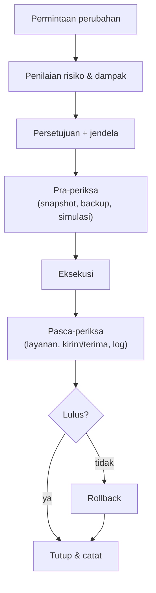

# Upgrade, Maintenance Window, dan Change Management

!!! info "Identitas chapter"
    **ID:** `CH-13-03-02` · **Kategori/modul:** CAT-13 / MOD-13-03 (Operasi Rutin dan Tata Kelola) · **Estimasi:** 120 menit · **Lingkungan:** produksi · [Lihat chapter ini di dashboard](../../../#CH-13-03-02)

!!! warning "Peringatan"
    Upgrade dapat me-restart layanan email dan mengubah perilaku. Selalu snapshot/backup, jadwalkan jendela pemeliharaan, dan siapkan rollback sebelum mulai. Belum dijalankan penulis pada VM (`verified_on: null`).

## 1. Ringkasan

Perubahan terkendali membedakan operasi profesional dari improvisasi. Anda merencanakan upgrade dan perubahan dengan jendela pemeliharaan, prosedur pra-periksa dan pasca-periksa, serta rencana rollback.

## 2. Tujuan Pembelajaran

1. Menyusun alur perubahan: permintaan, persetujuan, jendela, eksekusi, verifikasi, tutup.
2. Menjalankan pra-periksa dan pasca-periksa upgrade.
3. Menyiapkan rollback dan komunikasi.

## 3. Prasyarat

- `CH-13-03-01` — Memantau Reputasi dan Hasil SPF, DKIM, DMARC.
- Siklus patch (`CH-10-03-03`); backup teruji (`CH-11-03-02`).

## 4. Materi Teori

### 4.1 Alur perubahan



### 4.2 Jenis perubahan

| Jenis | Contoh | Risiko |
|---|---|---|
| Standar | Pembaruan keamanan rutin | Rendah |
| Normal | Ubah konfigurasi Postfix | Sedang |
| Darurat | Patch kerentanan kritis | Tinggi; tetap dicatat |

### 4.3 Konfigurasi di Git
Menyimpan `/etc` dalam sistem versi (mis. `etckeeper`) memudahkan melihat siapa mengubah apa, tetapi berkas rahasia (kunci, hash) ikut tersimpan. Gunakan hanya bila repositorinya diperlakukan setara rahasia atau rahasia dikecualikan; lihat `CH-11-03-04`.

## 5. Praktik dan Implementasi

1. Tulis templat permintaan perubahan.
2. Latih satu upgrade di VM lab mengikuti alur.
3. Catat durasi dan temuan.

## 6. Perintah Linux

```bash title="Pra-periksa"
postconf mail_version; dovecot --version
sudo apt update && apt list --upgradable 2>/dev/null
sudo apt-get -s upgrade | head -40
sudo postfix check && sudo doveconf -n >/dev/null && echo konfigurasi-valid
```

`apt-get -s upgrade` hanya mensimulasikan. Pastikan snapshot VM dan backup terbaru ada sebelum lanjut.

```bash title="Eksekusi dan pasca-periksa"
sudo apt upgrade
sudo needrestart -r l
systemctl is-active postfix dovecot rspamd opendkim
sudo /usr/local/sbin/mail-healthcheck.sh; echo "exit=$?"
```

Kirim dan terima pesan uji, lalu periksa log. Hasil yang diharapkan: layanan aktif, health check `exit=0`, pesan uji sukses.

## 7. Konfigurasi

Tidak ada berkas konfigurasi yang diubah pada chapter ini.

## 8. Verifikasi

- Setiap perubahan produksi punya catatan lengkap dan hasil pasca-periksa.
- Rollback pernah dilatih (pulihkan snapshot di lab).
- Pengguna diberi tahu sebelum dan sesudah bila ada dampak.

## 9. Troubleshooting

| Gejala | Kemungkinan penyebab | Tindakan |
|---|---|---|
| Layanan gagal setelah upgrade | Konfigurasi tak kompatibel | Baca log, rollback |
| Pasca-periksa tidak lengkap | Tak ada daftar | Buat daftar baku |
| Perubahan tak tercatat | Terburu-buru | Wajibkan catatan, termasuk darurat |
| Jendela terlampaui | Estimasi buruk | Siapkan batas waktu dan keputusan rollback |

## 10. Security Review

- Perubahan darurat tetap dicatat; sering menjadi sumber insiden.
- Jaga siapa saja yang berhak menyetujui dan menjalankan.
- Simpan konfigurasi di repositori hanya setelah memeriksa rahasia.

## 11. Latihan

1. Lakukan satu upgrade lengkap di VM lab dengan catatan.
2. Tentukan kriteria rollback otomatis.
3. Tulis pengumuman jendela pemeliharaan untuk pengguna.

## 12. Assessment

1. Mengapa simulasi sebelum upgrade?
2. Apa isi pasca-periksa?
3. Apa risiko menyimpan `/etc` di Git?

**Kunci singkat.** (1) Melihat dampak tanpa mengubah. (2) Layanan aktif, kirim/terima, log. (3) Rahasia ikut tersimpan.

## 13. Checklist Kelulusan

- [ ] Alur perubahan dan templat ada.
- [ ] Upgrade dilatih dengan pra/pasca-periksa.
- [ ] Rollback dilatih.

!!! note "Status belajar"
    Ubah status chapter secara manual di dashboard. Menyelesaikan checklist ini tidak mengubah status otomatis.

## 14. Referensi Resmi

- [Ubuntu Server: Package management](https://documentation.ubuntu.com/server/how-to/software/package-management/)
- [Postfix: Release notes](https://www.postfix.org/announcements.html)
- [Google SRE Book: Release Engineering](https://sre.google/sre-book/release-engineering/)

Tautan referensi tidak diverifikasi otomatis pada build ini; periksa ketersediaannya sebelum dipakai.

---

[Kembali ke dashboard kurikulum](../../../#CH-13-03-02){ .md-button }
