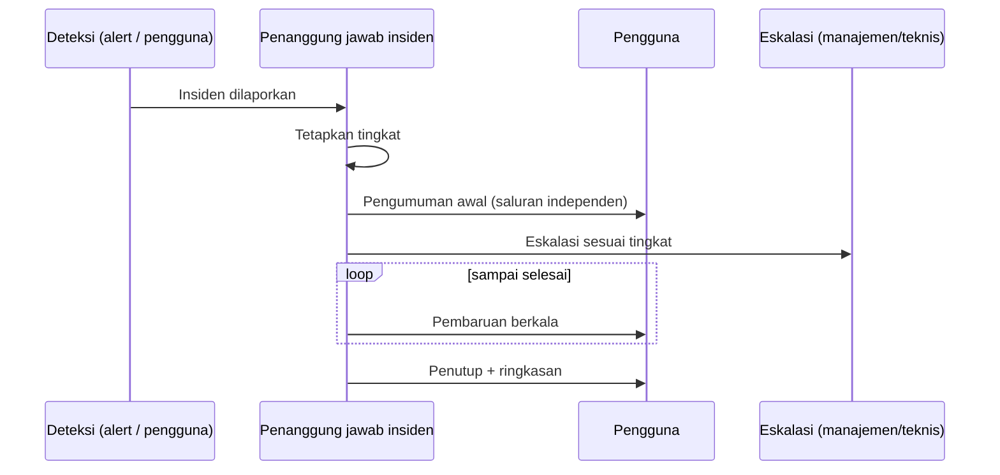

# Komunikasi Insiden dan Ketersediaan Layanan

!!! info "Identitas chapter"
    **ID:** `CH-13-03-03` · **Kategori/modul:** CAT-13 / MOD-13-03 (Operasi Rutin dan Tata Kelola) · **Estimasi:** 60 menit · **Lingkungan:** produksi · [Lihat chapter ini di dashboard](../../../#CH-13-03-03)

!!! note "Catatan"
    Chapter ini konseptual. Templat adalah contoh; sesuaikan dengan struktur organisasi dan pastikan tidak memuat data sensitif. Belum dijalankan penulis pada VM (`verified_on: null`).

## 1. Ringkasan

Saat layanan email terganggu, pengguna paling membutuhkan kejelasan. Anda menyusun templat komunikasi insiden, matriks tingkat keparahan, dan jalur eskalasi.

## 2. Tujuan Pembelajaran

1. Menetapkan tingkat keparahan dan siapa dihubungi pada tiap tingkat.
2. Menyusun templat pengumuman awal, pembaruan, dan penutup.
3. Menentukan saluran komunikasi yang tidak bergantung pada email yang terganggu.

## 3. Prasyarat

- `CH-13-03-02` — Upgrade, Maintenance Window, dan Change Management.
- Pemantauan dan alert (`CH-11-01-03`).

## 4. Materi Teori

### 4.1 Tingkat keparahan (contoh)

| Tingkat | Definisi | Respons awal | Pembaruan |
|---|---|---|---|
| S1 | Seluruh layanan tak berfungsi / dugaan kompromi | Segera | Tiap 30 menit |
| S2 | Sebagian fungsi/pengguna terdampak | Dalam 1 jam | Tiap 2 jam |
| S3 | Gangguan kecil, ada solusi sementara | Hari kerja | Saat selesai |

Angka waktu hanyalah contoh; tetapkan sesuai kemampuan dan kesepakatan layanan.

### 4.2 Saluran
Jangan mengandalkan email dari server yang bermasalah. Siapkan saluran alternatif (halaman status di hosting terpisah, grup pesan, SMS) dan pastikan semua orang tahu lokasinya sebelum insiden.

## 5. Praktik dan Implementasi

1. Tetapkan tingkat keparahan untuk organisasi Anda.
2. Tulis tiga templat pesan.
3. Tentukan saluran independen dan pemiliknya.
4. Latih sekali lewat simulasi.

## 6. Perintah Linux

Chapter ini konseptual; tidak ada perintah yang mengubah sistem.

## 7. Konfigurasi

Tidak ada berkas konfigurasi yang diubah pada chapter ini.

## 8. Verifikasi

- Matriks, templat, dan saluran tertulis dan disetujui.
- Simulasi menghasilkan pengumuman dalam waktu target.
- Tidak ada data sensitif di templat.

## 9. Troubleshooting

| Gejala | Kemungkinan penyebab | Tindakan |
|---|---|---|
| Pengguna tak tahu ada insiden | Tak ada saluran independen | Siapkan halaman status |
| Pembaruan terlambat | Tak ada penanggung jawab | Tetapkan peran |
| Pengumuman berlebihan detail teknis | Tak ada templat | Gunakan templat |
| Eskalasi macet | Kontak usang | Tinjau kontak berkala |

## 10. Security Review

- Jangan mengumumkan detail kerentanan atau data pribadi saat insiden berlangsung.
- Pesan keamanan yang tampak seperti phishing perlu dikenali pengguna: tentukan cara resmi memastikan keaslian pengumuman.
- Pengumuman dugaan kompromi mengikuti jalur hukum/kepatuhan bila relevan.

## 11. Latihan

1. Tulis pengumuman S1 dan S3.
2. Susun daftar kontak eskalasi.
3. Rancang halaman status sederhana.

## 12. Assessment

1. Mengapa saluran harus independen?
2. Apa isi pembaruan berkala?
3. Mengapa menetapkan tingkat sejak awal?

**Kunci singkat.** (1) Email mungkin terganggu. (2) Status, dampak, perkiraan, langkah berikut. (3) Menentukan respons dan frekuensi pembaruan.

## 13. Checklist Kelulusan

- [ ] Matriks keparahan, templat, dan saluran ada.
- [ ] Simulasi dilakukan sekali.

!!! note "Status belajar"
    Ubah status chapter secara manual di dashboard. Menyelesaikan checklist ini tidak mengubah status otomatis.

## 14. Referensi Resmi

- [Google SRE Book: Managing Incidents](https://sre.google/sre-book/managing-incidents/)
- [NIST SP 800-61 Rev. 2](https://csrc.nist.gov/pubs/sp/800/61/r2/final)
- [RFC 2350 — Expectations for CSIRT](https://www.rfc-editor.org/rfc/rfc2350)

Tautan referensi tidak diverifikasi otomatis pada build ini; periksa ketersediaannya sebelum dipakai.

---

[Kembali ke dashboard kurikulum](../../../#CH-13-03-03){ .md-button }
