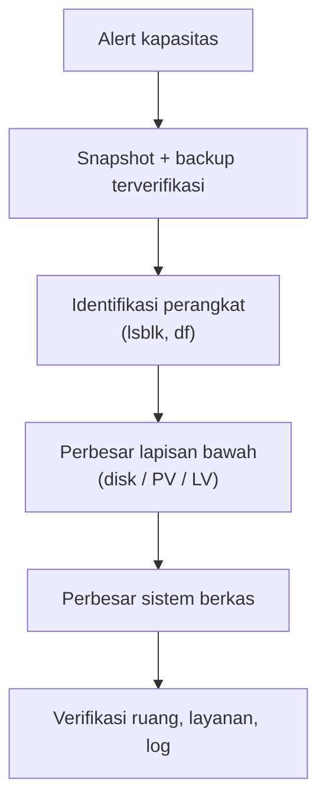
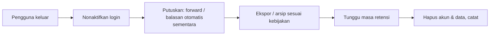

# Kapasitas, Perluasan Storage, dan Offboarding Akun

!!! info "Identitas chapter"
    **ID:** `CH-13-03-04` · **Kategori/modul:** CAT-13 / MOD-13-03 (Operasi Rutin dan Tata Kelola) · **Estimasi:** 90 menit · **Lingkungan:** produksi · [Lihat chapter ini di dashboard](../../../#CH-13-03-04)

!!! danger "Peringatan keras"
    Perubahan ukuran disk/partisi dapat menghancurkan data bila salah perangkat. Snapshot dan backup terverifikasi wajib, periksa nama perangkat dua kali, dan lakukan di jendela perubahan. Belum dijalankan penulis pada VM (`verified_on: null`).

## 1. Ringkasan

Storage akan habis. Anda memperluasnya dengan aman (LVM atau disk virtual yang diperbesar) dan menjalankan offboarding akun: dari penonaktifan hingga penghapusan data sesuai retensi.

## 2. Tujuan Pembelajaran

1. Mengidentifikasi struktur disk (`lsblk`, `df`) sebelum mengubah apa pun.
2. Memperluas sistem berkas dengan aman untuk dua skenario umum.
3. Menjalankan offboarding akun dengan ekspor dan retensi.

## 3. Prasyarat

- `CH-13-03-03` — Komunikasi Insiden dan Ketersediaan Layanan.
- Kapasitas (`CH-11-03-05`), retensi (`CH-13-01-05`), prosedur akun (`CH-13-01-02`).

## 4. Materi Teori

### 4.1 Dua skenario umum

| Skenario | Langkah inti |
|---|---|
| LVM | Tambah ruang pada volume group → `lvextend -r` |
| Disk virtual diperbesar | Perbesar disk di hypervisor → perbesar partisi (`growpart`) → `resize2fs` |

Memperbesar sistem berkas ext4 saat terpasang umumnya didukung; **memperkecil** tidak, dan jauh lebih berisiko.



### 4.2 Offboarding



## 5. Praktik dan Implementasi

1. Baca struktur disk dan catat perangkat yang dipakai `/var/vmail`.
2. Latih pembesaran di VM lab (LVM atau disk virtual).
3. Latih offboarding akun uji sampai ekspor.

## 6. Perintah Linux

```bash title="Identifikasi (baca-saja)"
lsblk -f
df -hT /var/vmail
sudo vgs; sudo lvs
```

`vgs`/`lvs` hanya relevan bila memakai LVM.

```bash title="Contoh LVM (lab) — periksa nama dua kali"
sudo lvextend -r -L +20G /dev/<NAMA-VG>/<NAMA-LV>
df -hT /var/vmail
```

Opsi `-r` ikut memperbesar sistem berkas. Ganti `<NAMA-VG>` dan `<NAMA-LV>` sesuai `lvs`.

```bash title="Contoh disk virtual yang diperbesar (lab; ext4 pada /dev/vda1)"
sudo apt install cloud-guest-utils
sudo growpart /dev/vda 1
sudo resize2fs /dev/vda1
df -hT /
```

Nama perangkat dan jenis sistem berkas berbeda antar instalasi; konfirmasi dengan `lsblk -f`. Perintah `resize2fs` khusus ext4; sistem berkas lain memakai alat berbeda.

```bash title="Offboarding: ekspor ke arsip terenkripsi (akun uji)"
sudo tar -C /var/vmail/example.com -czf - uji1 | age -r age1<KUNCI-PUBLIK-ANDA> -o /var/backups/offboard-uji1-$(date +%F).tar.gz.age
```

## 7. Konfigurasi

Tidak ada berkas konfigurasi yang diubah pada chapter ini.

## 8. Verifikasi

- Ruang bertambah sesuai harapan dan layanan sehat setelahnya.
- Data tidak hilang (jumlah pesan sebelum/sesudah sama).
- Arsip offboarding terenkripsi dan dapat didekripsi; akun dinonaktifkan sampai masa retensi.

## 9. Troubleshooting

| Gejala | Kemungkinan penyebab | Tindakan |
|---|---|---|
| `resize2fs` galat | Partisi belum diperbesar | `growpart` dulu |
| Ruang tidak bertambah | Lapisan atas belum diperbesar | Periksa PV/LV/partisi |
| Salah perangkat | Nama keliru | Pulihkan snapshot; hentikan |
| Offboarding terlalu cepat hapus | Tak ada masa retensi | Perbaiki prosedur, pulihkan backup |

## 10. Security Review

- Arsip offboarding memuat email pribadi: enkripsi dan batasi akses.
- Putuskan siapa yang berhak meminta data eks-pengguna.
- Akun yang dibiarkan menggantung adalah celah; nonaktifkan tepat waktu.

## 11. Latihan

1. Latih pembesaran di VM lab dan catat waktu.
2. Tulis kebijakan offboarding dengan masa retensi.
3. Buat checklist pra-periksa pembesaran.

## 12. Assessment

1. Mengapa memperbesar lebih aman daripada memperkecil?
2. Apa fungsi `lvextend -r`?
3. Mengapa akun tidak langsung dihapus saat offboarding?

**Kunci singkat.** (1) Memperkecil berisiko menghancurkan data. (2) Ikut memperbesar sistem berkas. (3) Masa retensi dan permintaan data.

## 13. Checklist Kelulusan

- [ ] Pembesaran storage dilatih di lab.
- [ ] Kebijakan offboarding tertulis.

!!! note "Status belajar"
    Ubah status chapter secara manual di dashboard. Menyelesaikan checklist ini tidak mengubah status otomatis.

## 14. Referensi Resmi

- [Ubuntu Server: LVM](https://documentation.ubuntu.com/server/explanation/storage/about-lvm/)
- [resize2fs(8)](https://man7.org/linux/man-pages/man8/resize2fs.8.html)
- [lvextend(8)](https://man7.org/linux/man-pages/man8/lvextend.8.html)

Tautan referensi tidak diverifikasi otomatis pada build ini; periksa ketersediaannya sebelum dipakai.

---

[Kembali ke dashboard kurikulum](../../../#CH-13-03-04){ .md-button }
